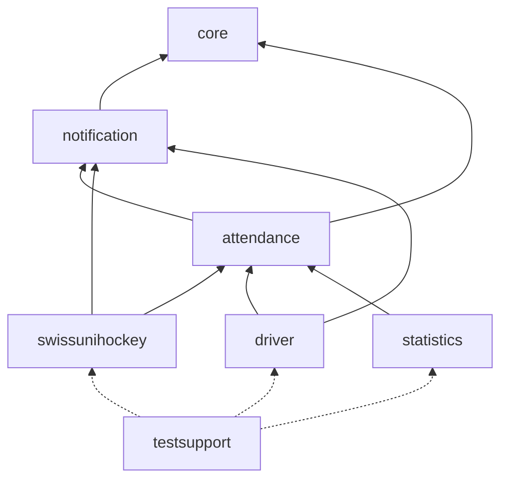
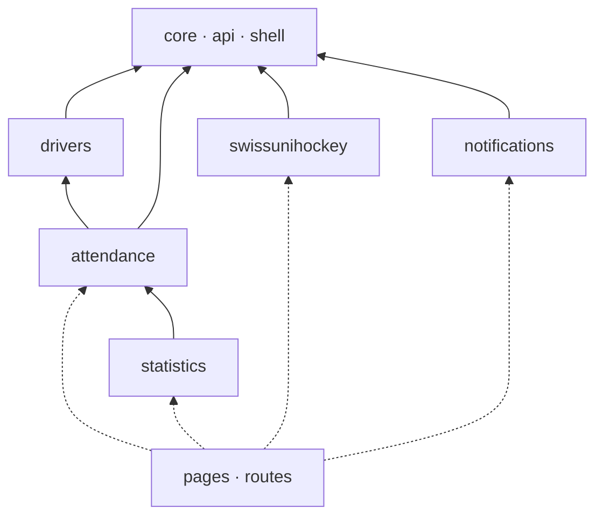

# Architecture

How the platform is cut into modules, which tests exist at which level, and which checks keep it that way. Binding for every feature (E-106 to E-108). The reasons and the measurements behind it: [reviews/2026-11-modularization.md](reviews/2026-11-modularization.md).

## Modules

A module is a part of the platform with a name, an owner in the code (one backend package, one or more frontend folders) and a list of the modules it may use. The list is [`modules.json`](../modules.json) in the root of the repository. It is the single source for three checks: the backend test `ModulesTest`, the import rules of ESLint in the frontend, and `scripts/test-affected.sh`.

| Module | Purpose | Backend package `ch.stvbero.platform.…` | Frontend folder `frontend/src/app/…` |
|---|---|---|---|
| `core` | Shared foundation: sign-in and rights, people, teams, seasons, lines, tiles, errors, clock | `core` | `core`, `api`, `shell` |
| `notification` | Notifications in the app, by e-mail and by push | `notification` | `notifications` |
| `attendance` | Tile «Anwesenheit»: events, series, responses, call-up, attendance check, warnings, event variants, absences, calendar, special line-ups | `attendance` | `attendance` |
| `swissunihockey` | Match days, matches and league tables from swiss unihockey | `swissunihockey` | `swissunihockey` |
| `driver` | Tile «Fahrerliste»: driver list, driver plan, routes, timeline | `driver` | `drivers` |
| `statistics` | Attendance statistics | `statistics` | `statistics` |
| `testsupport` | Seed and test endpoints, only in dev, test and preview | `testsupport` | – |
| `app` | Composition in the frontend: pages that combine several modules (start, profile, teams, administration, assistants), routes | – | `pages`, `app.*.ts` |

### Who may use whom

Backend. An arrow means «may use». Everything may use `core`; `testsupport` may use everything and nothing may use `testsupport`.



Frontend. The pages of `app` compose the modules; the modules never import pages. The page of an event embeds the sections of the driver list, so here `attendance` uses `driver`.



### Rules

1. **A dependency between modules is a decision.** If code needs a module that `modules.json` does not allow, the build fails. Allowing it means changing `modules.json` in the same pull request, where the review sees it. The graph has no cycles.
2. **The lower module never knows the upper one.** If the lower module needs something from above, it declares an interface (an extension point) and the upper module implements it. The lower module injects `Instance<TheInterface>` and works without an implementation.
3. **Inside a module** the convention of [technology.md](technology.md) applies: resources stay thin, services load and store, `…Rules` classes decide without database and framework, the outside world sits behind `…Api` or `…Transport` classes with a simulator.
4. **A new tile is a new module**: a package of its own, a frontend folder of its own, an entry in `modules.json` with its dependencies and its E2E specs.

Extension points that exist:

| Interface (declared in) | Implemented by | For |
|---|---|---|
| `core.auth.RequestGrant` | `attendance.event.EventRequestGrant` | Special permissions per event widen the rights of a request (RR-09) |
| `core.team.TeamListener` | `attendance.variant.StandardVariants`, `attendance.absence.AbsenceService` | New team gets its standard event variants (VAR-01); absences apply to the practices of a new team (ABS-04) |
| `core.season.SeasonCarryOver` | `attendance.lineup.SpecialLineupCarryOver` | Special line-ups move into the new season (LIN-11) |
| `notification.EventLookup` | `attendance.event.NotifiedEvents` | Title and start of an event for the subject of e-mails and pushes (BEN-10) |
| `attendance.event.Standings.Source` | `swissunihockey.league.LeagueStandings` | Ranks of the league table on a match day (AUF-34) |
| `attendance.event.MatchDayTravel` | `driver.DriverTravel` | «Ich reise individuell an» with a response (ANM-13), automatic departure (TML-09) |

Not modules of their own, on purpose: there is one Maven module, one Angular application and one repository. Contract, backend, frontend and tests of a feature change in one pull request and ship as one container; separate builds or repositories would add versioning between them and no speed. The boundaries are enforced by tests instead. When a module must be deployed on its own, or the backend build passes five minutes, this is decided again.

## Tests

Every behaviour is tested at the lowest level that can show it. Lower levels answer in milliseconds and say exactly what broke; the E2E tests are for what only a browser can show.

| Level | What belongs here | Where | Speed |
|---|---|---|---|
| Unit, backend | Every domain rule, with its edge cases (`…RulesTest`) | `backend/src/test`, plain JUnit | milliseconds |
| REST, backend | Every endpoint: permissions with the forbidden case (403), validation, status codes, what is stored, the API contract | `backend/src/test`, `@QuarkusTest` | 0.3 s per test |
| Architecture, backend | Module boundaries, conventions, class size | `backend/src/test/…/architecture` | seconds |
| Unit, frontend | Logic in the browser: formatting, dates, stores, pure functions of components | `frontend/src/**/*.spec.ts`, Vitest | milliseconds |
| E2E | What only the browser shows: a journey over several screens or roles, the wiring of a page to the API, semantics and accessibility (axe), layout, behaviour of the browser (double click, themes, PWA) | `e2e/tests`, Playwright | 2–3 s per test |

Rules for E2E tests, in addition to [testability.md](testability.md):

- One E2E test per acceptance criterion **that needs the browser**. A rule, a permission or a validation is tested in the backend; the E2E test shows once that the page reports the result, not every case again.
- **Viewports.** Every test runs on `mobile`. A test also runs on `desktop` when it is tagged: `test('…', { tag: '@desktop' }, async …)`. Tag a test when it checks something the desktop layout does differently (navigation, tables and grids, drag and drop, elements that exist only at a breakpoint), when it asks for the viewport or is skipped on mobile, and one test per page that opens it with the accessibility check. The **full run** (every test on both viewports) happens in the CI after every merge to `develop` and `main`.
- Every spec belongs to a module: its name is in `e2e` of that module in `modules.json` (in several, if it crosses modules). `scripts/affected.mjs --check` fails otherwise.

## Commands

```bash
scripts/test-affected.sh           # while developing: only what the change can break
scripts/test-affected.sh --no-e2e  # backend and frontend only
scripts/test.sh                    # before handing over: everything, E2E fast run
scripts/test.sh --full             # everything, E2E on both viewports
scripts/e2e.sh tests/f04-responses.spec.ts   # E2E tests in parallel, on stacks of their own
cd backend && mvn quarkus:test     # reruns the backend tests a saved class touches
cd frontend && npm run test:watch  # reruns the frontend unit tests on save
```

`scripts/test-affected.sh` asks git what changed, maps the files to modules and follows the dependencies: a change in the backend of `driver` runs the backend tests of `driver` and its 4 E2E specs; a change in `core`, in the seed, in a migration or in a build file runs everything. `scripts/e2e.sh` builds the app once and starts one backend with its own database per worker, so the tests run in parallel although each resets «its» database, and an app you are trying out by hand is left alone.

## Fitness functions

Checks that fail the build when the architecture erodes. All of them run in `scripts/test.sh` and in the CI.

| Check | Fails when | Where |
|---|---|---|
| Module boundaries, backend | a class uses a module that `modules.json` does not allow; a package belongs to no module; the graph has a cycle | `ModulesTest` (ArchUnit, on the bytecode) |
| Module boundaries, frontend | a file imports from a module its module may not use | `frontend/eslint.config.js` (`no-restricted-imports`, generated from `modules.json`) |
| Conventions, backend | a `…Rules` class touches database, CDI or HTTP; a REST endpoint is not a `…Resource`; a resource uses the `EntityManager`; a service uses JAX-RS; HTTP clients outside `…Api`/`…Transport`; «now» not from the `BackendClock` | `ConventionsTest` (ArchUnit) |
| Class size, backend | a class has more than 400 lines, or a frozen class grew | `CodeSizeTest` |
| File size and complexity, frontend | a file has more than 500 lines of code or a function a complexity above 20, or a frozen file grew | `frontend/eslint.config.js` (`max-lines`, `complexity`) |
| Coverage, backend | less than 94 % of the lines or 83 % of the branches are covered (without test support) | `mvn verify -Pcoverage` (JaCoCo), `coverage.*.minimum` in `backend/pom.xml` |
| API contract | the backend differs from `docs/api/openapi.yaml` | `OpenApiContractTest`, `redocly lint` |
| Bundle size, frontend | the first load exceeds 1 MB | budgets in `frontend/angular.json` |
| Specs assigned | an E2E spec belongs to no module | `scripts/affected.mjs --check` |
| Dialogs, frontend | a dialog is opened with `.showModal()` instead of `showModal(dialog, changes)` from `core/dialog.ts`, which renders the content first | `frontend/eslint.config.js` (`no-restricted-syntax`) |
| Types of the E2E tests | a test has a type error (Playwright itself only strips the types) | `scripts/e2e.sh` (`tsc --noEmit`, before the build) |

**Frozen lists.** The classes and files that were above a limit when it came are listed with their size at that time (`CodeSizeTest.FROZEN`, `FROZEN_MAX_LINES` and `FROZEN_COMPLEXITY` in the ESLint configuration). They may shrink, never grow, and no entry is added. Whoever has to add much to a frozen class first moves a responsibility out of it. The coverage minimum works the same way: raise it when the coverage rises, never lower it to get a change through.

## CI

`ci.yml` runs four jobs in parallel and one check that sums them up:

| Job | Runs | When |
|---|---|---|
| Changes | `scripts/affected.mjs`: which sides a pull request touches | always |
| Backend | API contract, `mvn verify -Pcoverage` | the pull request touches the backend or the contract; every push to `develop`, `main` |
| Frontend | lint, unit tests, build | the pull request touches the frontend or the contract; every push |
| E2E | `scripts/e2e.sh`: fast run on a pull request, full run on a push | the pull request touches code; every push |
| Build und Tests | green if none of the above failed | always |

A pull request that changes only documents, skills or scripts of the pipeline runs no tests. The pipeline's merge check (`scripts/pipeline.sh mergebar`) accepts skipped jobs.
