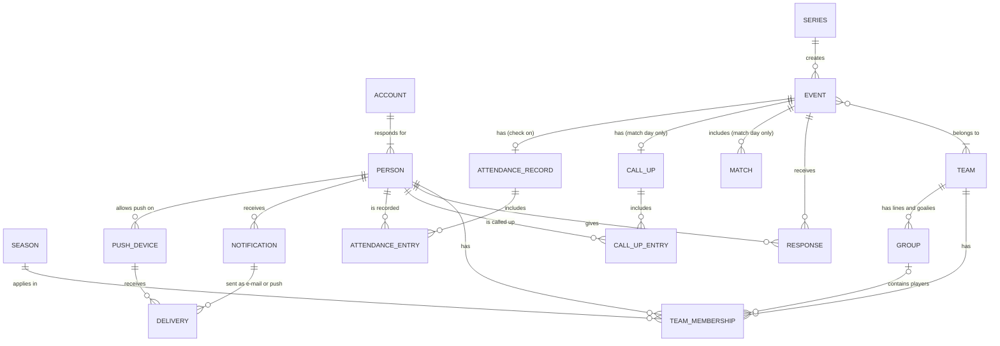

# Domain model

The terms of the app and how they relate. This is a domain model, not a database schema. Code, API and documents use the English terms from [glossary.md](glossary.md); the user interface uses the German terms.

## Terms

| Term | Meaning |
|---|---|
| **Account** | A login. Today each account belongs to exactly one person. Later an account can respond for several people (parents for children). |
| **Person** | A human being in the club. Each person exists exactly once, no matter how many teams they are in. |
| **Team** | A team of the club. Exists across seasons; the name applies per season, so that the archive keeps the name of the time (SAI-02). |
| **Season** | Period for which team memberships and lines apply. |
| **Team role** | What a person is in a team: at least «Spielerin» (player) or «Coach». |
| **Team membership** | Link between person, team and team role in a season. There is exactly one team role per person and team. It stores the day of joining; statistics count a player only from that day on (STA-07). |
| **Line** | Group of players within a team (Linie 1, Linie 2, …). |
| **Goalies** | A group of its own per team, next to the lines. |
| **No line** | Display group for players who are assigned neither to a line nor to the goalies («Ohne Linie»). |
| **Event** | Something people respond to. Has a type: practice, match day or other event. Belongs to one or more teams. |
| **Series** | Rule that creates recurring events («jeden Dienstag 18:30», every Tuesday 18:30). |
| **Match day** | Event of type match day. Because of the tournament format it includes several matches in the same hall. |
| **Match** | A single game within a match day, with opponent and start time. |
| **Response** | A person's answer for an event: attending, declined or maybe. Without a response the status is pending («offen»). |
| **Call-up** | Selection of the players who play on a match day. Created and published by the coach. |
| **Attendance check** | Optional for each event or series, off by default: after the start the coach records who was really there (PRS, E-70). |
| **Attendance** | The fact recorded by the coach per player: present («anwesend»), absent («abwesend») or excused («entschuldigt»). Separate from the response, which is the intention. |
| **Warning** | Computed note for coaches and admins when an upcoming practice or match day has a gap: too few goalies or field players attending (or called up), or a line with too few players (F-16). Not stored. |
| **Warning minimums** | Setting of a team: below these numbers a warning appears (defaults 1 goalie, 10 field players for match days, 6 for practices, 3 per line). |
| **Meeting point** | Time and place where the team meets before a match day. |
| **Statistics** | Read-only numbers per player of a team over a period: responses and, where recorded, attendance of the past events (STA, F-15). |
| **Calendar subscription** | Personal address of a person with a random token. Behind it is an iCalendar feed with the events of her teams, which calendar apps fetch without login. Renewing replaces the token (CAL, F-18). |
| **Notification** | Message to one person about a change (BEN-01 to BEN-07). Always in the list in the app; also by e-mail and push (F-19). |
| **Channel** | Way a notification reaches the person: the app (always), e-mail, push (BEN-10, BEN-11). |
| **Push device** | A browser on a device where the person allowed push (push subscription). A person can have several (F-19). |
| **Delivery** | One e-mail or one push of a notification, with state and attempts. Recorded with the change and sent after it; failed ones are retried (F-19). |
| **Tile** | Self-contained feature module of the platform, appears on the dashboard. |

## Relationships

`GROUP` stands for a line or the goalie group of a team.

## The most important rules

1. **One team role per team.** A person can be coach in Team 1 and player in Team 2, but not both in the same team.
2. **At most one line per team.** Per team a player is in at most one group (line or goalies). In two teams she can have two different lines. The limit of one line is a rule, not a fixed structure: it should be possible to lift it later without rebuilding the model.
3. **One response per person and event.** Even if the event belongs to several teams and the person is in several of them.
4. **Coaches are not players.** They respond the same way, but are listed in a block of their own and do not count towards the player total.
5. **Lines are standard lines.** There are no different lines for single events.
6. **One match day, one call-up.** All matches of a match day share one response and one call-up.
7. **Intention and fact stay separate.** A response is never turned into attendance and attendance never changes a response. Attendance is only recorded where the check is switched on (PRS, E-70).
