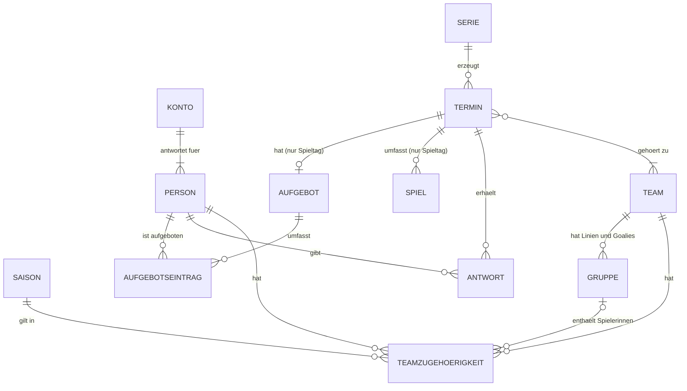

# Fachmodell

Die Begriffe der App und wie sie zusammenhängen. Das ist ein fachliches Modell, kein Datenbankschema. Code, API und Oberfläche verwenden dieselben Begriffe.

## Begriffe

| Begriff | Bedeutung |
|---|---|
| **Konto** | Ein Login. Heute gehört zu jedem Konto genau eine Person. Später kann ein Konto für mehrere Personen antworten (Eltern für Kinder). |
| **Person** | Ein Mensch im Verein. Es gibt jede Person genau einmal, egal in wie vielen Teams sie ist. |
| **Team** | Eine Mannschaft des Vereins. |
| **Saison** | Zeitraum, für den Teamzugehörigkeiten und Linien gelten. |
| **Funktion** | Was eine Person in einem Team ist: mindestens «Spielerin» oder «Coach». |
| **Teamzugehörigkeit** | Verbindung von Person, Team und Funktion in einer Saison. Pro Person und Team gibt es genau eine Funktion. |
| **Linie** | Gruppe von Spielerinnen innerhalb eines Teams (Linie 1, Linie 2, …). |
| **Goalies** | Eigene Gruppe pro Team, neben den Linien. |
| **Ohne Linie** | Sammelgruppe in der Anzeige für Spielerinnen, die weder einer Linie noch den Goalies zugewiesen sind. |
| **Termin** | Etwas, wofür man sich an- oder abmeldet. Hat einen Typ: Training, Spieltag oder Anlass. Gehört zu einem oder mehreren Teams. |
| **Serie** | Regel, die wiederkehrende Termine erzeugt («jeden Dienstag 18:30»). |
| **Spieltag** | Termin vom Typ Spieltag. Wegen der Turnierform umfasst er mehrere Spiele in derselben Halle. |
| **Spiel** | Einzelne Partie innerhalb eines Spieltags, mit Gegner und Anspielzeit. |
| **Antwort** | An- oder Abmeldung einer Person für einen Termin: dabei, nicht dabei oder vielleicht. Ohne Antwort ist der Status «offen». |
| **Aufgebot** | Auswahl der Spielerinnen, die an einem Spieltag spielen. Wird von der Coach erstellt und veröffentlicht. |
| **Treffpunkt** | Zeit und Ort, an dem sich das Team vor einem Spieltag trifft. |
| **Kachel** | Eigenständiges Funktionsmodul der Plattform, erscheint auf dem Dashboard. |

## Zusammenhänge

`GRUPPE` steht für eine Linie oder die Goalie-Gruppe eines Teams.

## Die wichtigsten Regeln

1. **Eine Funktion pro Team.** Eine Person kann in Team 1 Coach und in Team 2 Spielerin sein, aber nicht beides im selben Team.
2. **Höchstens eine Linie pro Team.** Eine Spielerin ist pro Team in höchstens einer Gruppe (Linie oder Goalies). In zwei Teams kann sie zwei verschiedene Linien haben. Die Begrenzung auf eine Linie ist eine Regel, keine feste Struktur: Sie soll später aufgehoben werden können, ohne das Modell umzubauen.
3. **Eine Antwort pro Person und Termin.** Auch wenn der Termin zu mehreren Teams gehört und die Person in mehreren davon ist.
4. **Coaches sind keine Spielerinnen.** Sie melden sich gleich an und ab, stehen aber in einem eigenen Block und zählen nicht zum Spielerinnen-Total.
5. **Linien sind Standardlinien.** Es gibt keine abweichenden Linien für einzelne Termine.
6. **Ein Spieltag, ein Aufgebot.** Für alle Spiele eines Spieltags gibt es eine Anmeldung und ein Aufgebot.
