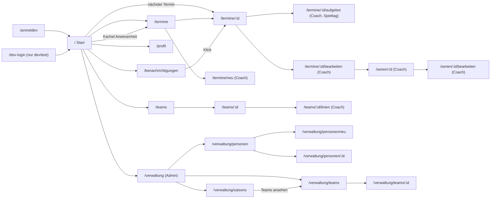

# Navigation und Screens

Karte der Oberfläche für Menschen und Agenten. Der Test-Agent nutzt sie, um gezielt per URL an die richtige Stelle zu springen. Wer eine Route oder feste Test-ID ändert, passt diese Datei im selben PR an.

Stand: Zielbild für den Kern. Die Spalte «Feature» nennt, mit welchem Feature aus dem [Backlog](../pipeline/backlog.md) ein Screen kommt. Gebaut sind F-00 (Grundgerüst: `/anmelden`, `/dev-login`, `/`, `/termine` als leerer Zustand, `/profil`) F-01 (`/teams`, `/teams/:id`, `/verwaltung` mit Personen, Teams und Saisons) F-02 (`/teams/:id/linien`, `/teams/:id` nach Linie) F-03 (`/termine` mit Filtern, `/termine/neu`, `/termine/:id` mit Angaben, `/termine/:id/bearbeiten`, `/serien/:id`, `/serien/:id/bearbeiten`) F-04 (Antworten in `/`, `/termine` und `/termine/:id`, Übersicht nach Team und Linie) F-05 (Spieltag im Formular mit Spielen, Treffpunkt und Google-Maps-Link, Spiele, Resultate und Aufgebotsstatus in `/termine/:id`, `/termine/:id/aufgebot`) und F-06 (`/benachrichtigungen`, Glocke mit Zähler in der Navigation).

## Navigation

- **Mobil:** Bottom-Navigation mit Start, Termine, Teams, Profil. Admins sehen zusätzlich «Verwaltung».
- **Desktop (ab 1024px):** dieselben Einträge als Seitennavigation links.
- **Benachrichtigungen (F-06):** eigener Link in der Navigation, ausserhalb der Liste der Haupteinträge. Mobil eine runde Glocke oben rechts (Name «Benachrichtigungen», Beschriftung nur für Screenreader), ab 1024px ein Eintrag «Benachrichtigungen» über «Start». Mit Ungelesenen zeigt er die Anzahl (`benachrichtigungen-zaehler`), der Name lautet dann z.B. «Benachrichtigungen 2 ungelesen». Der Zähler wird bei jedem Seitenwechsel neu geladen.
- Der aktive Eintrag hat `aria-current="page"`.
- Die Navigation ist ein `nav` mit `aria-label="Hauptnavigation"`.
- Reihenfolge: Start, Termine, Teams, Profil, (Verwaltung). Seitentitel im Browser: «<Seite> · STV Bero».

## Routen

| Route | Screen | Wer | Inhalt | Feature |
|---|---|---|---|---|
| `/anmelden` | Anmelden | alle | Login (Verfahren offen, O-01). Im Testmodus Link «Zur Anmeldung im Testmodus». `?ziel=` wird weitergegeben | F-00 |
| `/dev-login` | Testmodus-Anmeldung | nur `dev`/`test` (Development-Build) | Liste der Seed-Personen (`GET /api/test/personen`), ein Klick meldet an und führt auf `?ziel=` bzw. `/` | F-00 |
| `/` | Start | angemeldet | Begrüssung, nächster eigener Termin mit Antwort-Buttons, Kacheln je nach Rolle | F-00, F-04 |
| `/termine` | Termine | angemeldet | Kommende Termine aller eigenen Teams nach Monat, Umschalter «Kommend»/«Vergangen» (`nav` «Ansicht», `?ansicht=vergangen`), Auswahl «Team» (`?team=<id>`), Coaches und Admins: Link «Termin erfassen». Ab F-04 eigene Antwort direkt änderbar | F-03, F-04 |
| `/termine/:id` | Termin | Mitglieder der beteiligten Teams, Admin | Angaben (Datum, Zeit, Teams, Ort, Treffpunkt, Antwortfrist, Hinweise, Serie), Status «Abgesagt: <Grund>» bzw. «verschoben», Coaches: «Termin bearbeiten», «Serie ansehen». Ab F-04: eigene Antwort, Übersicht nach Team und Linie, Coach-Block. Bei Spieltag ab F-05: Spiele, eigener Aufgebotsstatus | F-03, F-04, F-05 |
| `/termine/neu` | Termin erfassen | Coach, Admin | Auswahl «Einzelner Termin» / «Serie (jede Woche)» (`?art=serie`), Art (Training, Spieltag, Anlass), Titel, Datum bzw. Wochentag und Zeitraum, Beginn, Ende, Teams (Checkboxen), Ort, Google-Maps-Link, Hinweise, Antwortfrist. Bei «Spieltag»: Ort heisst «Spielort», Gruppe «Treffpunkt» (Zeit, Ort), Gruppe «Spiele» mit je einer Gruppe «Spiel n» (Gegner, Anspielzeit, «Heim oder auswärts», «Spiel n entfernen») und «Spiel hinzufügen» | F-03, F-05 |
| `/termine/:id/bearbeiten` | Termin bearbeiten | Coach eines beteiligten Teams, Admin | Angaben ändern, verschieben (anderes Datum oder andere Zeit), «Termin absagen» (Dialog mit Grund). Bei Serienterminen Hinweis «gilt nur für diesen Termin». Spieltag: Spiele wie beim Erfassen; Spiele aus swiss unihockey nur lesend | F-03, F-05 |
| `/termine/:id/aufgebot` | Aufgebot | Coach des Teams, Admin (sonst «Keine Berechtigung»; kein Spieltag: «Nur ein Spieltag hat ein Aufgebot.») | Stand (`aufgebot-status`, `aufgebot-anzahl`), Auswahl nach Linien gruppiert (je eine Gruppe mit dem Gruppennamen, Checkbox mit dem Namen der Spielerin, Antwortstatus und Kommentar daneben), speichert sofort (Rückmeldung «<Name> ist aufgeboten.»), «Veröffentlichen» mit Bestätigung. Coaches stehen nicht in der Auswahl (AUF-28). Abgesagt oder vorbei: nur lesend | F-05 |
| `/serien/:id` | Serie | Mitglieder der Teams der Serie (Coaches und Admins mit Bearbeitung) | Regel, Zeitraum, Teams (alle Teams der Serie, auch die, in denen man nicht ist), Antwortfrist, Ausnahmen (Liste und Formular «Ausnahme hinzufügen»), Link «Serie bearbeiten» | F-03 |
| `/serien/:id/bearbeiten` | Serie bearbeiten | Coach eines Teams der Serie, Admin | Wie «Termin erfassen» als Serie; gilt für künftige Termine (TER-08) | F-03 |
| `/teams` | Meine Teams | angemeldet | Eigene Teams der aktuellen Saison mit eigener Funktion (PTF-12), Link auf `/teams/:id` | F-01 |
| `/teams/:id` | Team | Mitglieder, Admin | Coaches und Spielerinnen getrennt (PTF-07), Spielerinnen nach Linie (Listen mit dem Gruppennamen, leere Gruppen fehlen). Coaches und Admins sehen den Link «Linien einteilen». `?saison=<id>` zeigt eine andere Saison (Archiv mit Hinweis). Ohne Zugehörigkeit «Keine Berechtigung» | F-01, F-02 |
| `/teams/:id/linien` | Linien | Coach, Admin (andere Mitglieder lesend) | Linien hinzufügen, umbenennen, sortieren («<Linie> nach oben/unten»), löschen (Dialog), Spielerinnen per Drag & Drop oder Auswahlfeld «Linie von <Name>» zuweisen; speichert sofort. Ohne Zugehörigkeit «Keine Berechtigung». Aktuelle Saison | F-02 |
| `/benachrichtigungen` | Benachrichtigungen | angemeldet | Eigene Benachrichtigungen, neueste zuerst (Liste «Benachrichtigungen»): Text, Zeitpunkt, ungelesene mit «Neu». Ein Klick markiert als gelesen und öffnet `/termine/:id` (BEN-12). Button «Alle als gelesen markieren» (nur mit Ungelesenen, Rückmeldung «Alle sind als gelesen markiert.»). Leer: «Keine Benachrichtigungen.» | F-06 |
| `/profil` | Profil | angemeldet | Name, Hell/Dunkel/System, Abmelden | F-00 |
| `/verwaltung` | Verwaltung | Admin | Einstieg: Links «Personen», «Teams verwalten», «Saisons». Andere sehen «Keine Berechtigung» | F-00, F-01 |
| `/keine-saison` | Keine aktuelle Saison | angemeldet | Hinweis, wenn `GET /api/ich` mit 409 antwortet (keine Saison als aktuell festgelegt, SAI-03). Ohne Navigation, Buttons «Nochmals versuchen» (zurück zu `?ziel=`) und «Abmelden». Jede Route leitet in diesem Zustand mit `?ziel=` hierher. Direkt geöffnet: ohne Anmeldung zur Anmeldung, mit aktueller Saison direkt weiter zum Ziel | Nachbesserung #13 |
| `/**` | Nicht gefunden | angemeldet | «Diese Seite gibt es nicht.» mit Link «Zur Startseite» | F-00 |
| `/verwaltung/personen` | Personen | Admin | Liste nach Nachname, Suche `?suche=`, Link «Person erfassen» | F-01 |
| `/verwaltung/personen/neu` | Person erfassen | Admin | Vorname, Nachname, E-Mail, Admin. Nach dem Speichern weiter auf `/verwaltung/personen/:id` | F-01 |
| `/verwaltung/personen/:id` | Person bearbeiten | Admin | Angaben ändern, Teamzugehörigkeiten aller Saisons | F-01 |
| `/verwaltung/teams` | Teams verwalten | Admin | Auswahl «Saison» (`?saison=<id>`), Teams der Saison, «Team anlegen». Archiv nur lesend. Ab F-07: Verknüpfung swiss unihockey | F-01, F-07 |
| `/verwaltung/teams/:id` | Team verwalten | Admin | Umbenennen, Coaches und Spielerinnen mit Auswahl «Funktion von <Name>» und «<Name> entfernen», «Person aufnehmen». `?saison=<id>`; Archiv nur lesend | F-01 |
| `/verwaltung/saisons` | Saisons | Admin | Saisons mit Status (aktuell, Archiv, geplant), «Teams ansehen», «Zur aktuellen Saison machen», Formular «Neue Saison» mit Übernahme | F-01 |

Ohne Berechtigung zeigt ein Screen den Text «Keine Berechtigung» (`role="alert"`) statt eines leeren Bildschirms. Ohne Anmeldung leitet jede Route auf `/anmelden` (bzw. im Testmodus `/dev-login`) mit `?ziel=<ursprüngliche Route>` und nach der Anmeldung dorthin zurück. Ob jemand angemeldet ist, prüft das Frontend über `GET /api/sitzung` (immer 200), damit ohne Anmeldung keine Fehler in der Konsole entstehen.

## Dialoge

| Dialog | Geöffnet von | Name (Überschrift) |
|---|---|---|
| Vielleicht mit Kommentar | Antwort «vielleicht» (Feld «Kommentar», Pflicht; leer: Meldung beim Feld) | «Vielleicht – bitte kurz begründen» |
| Absage-Grund | Antwort «nicht dabei», nachdem sie schon gespeichert ist (Feld «Grund (freiwillig)», Buttons «Grund speichern», «Überspringen») | «Nicht dabei» |
| Stellvertretend antworten | Coach in der Übersicht, Button bei einer Person | «Antwort für <Name> eintragen» (Auswahl «Antwort» mit Radiobuttons, Feld «Kommentar (bei «vielleicht» Pflicht)») |
| Termin absagen | Termin bearbeiten, «Termin absagen» | «Termin absagen» (Feld «Grund», Pflicht) |
| Linie löschen | Linien, «<Linie> löschen» | «<Linie> löschen?» |
| Aufgebot veröffentlichen | Aufgebot, «Veröffentlichen» (Buttons «Veröffentlichen», «Abbrechen») | «Aufgebot veröffentlichen?» |
| Resultat erfassen | Termin (Spieltag), Button «Resultat für <Heim> – <Gast> erfassen» (Coach, Admin) | «Resultat: <Heim> – <Gast>» (Feld «Resultat (Heim:Gast, z.B. 5:3)», leer entfernt es, Button «Resultat speichern») |

## Test-IDs

Feste Test-IDs, auf die sich Tests verlassen. Schema und Regeln: [testbarkeit.md](../testbarkeit.md#4-test-ids-dort-wo-semantik-nicht-reicht).

### Global

| Test-ID | Element |
|---|---|
| `hauptnavigation` | Navigation (mobil und Desktop) |
| `theme-umschalter` | Umschalter Hell/Dunkel/System im Profil |
| `testmodus-hinweis` | Banner «Testmodus» (nur dev/test) |
| `kachel-<id>` | Kachel auf dem Start-Screen (Link), z.B. `kachel-anwesenheit` |
| `dev-login-person-<schluessel>` | Eintrag einer Testperson auf `/dev-login`, z.B. `dev-login-person-petra` |
| `naechster-termin` | Karte «Nächster Termin» auf dem Start-Screen: nächster geplanter Termin der eigenen Teams (abgesagte übersprungen) mit Link zum Termin und `meine-antwort`. Ohne Termin: «Keine kommenden Termine» |
| `benachrichtigungen-zaehler` | Anzahl ungelesener Benachrichtigungen in der Navigation (fehlt, wenn alles gelesen ist) |
| `benachrichtigung-<id>` | Eintrag in `/benachrichtigungen` (`li` mit `data-gelesen="true\|false"` und `data-art`, z.B. `ERINNERUNG`) |
| `keine-saison-hinweis` | Hinweis auf `/keine-saison` |

### Teams und Verwaltung (F-01)

| Test-ID | Element |
|---|---|
| `team-karte-<teamId>` | Eintrag in «Meine Teams» (`/teams`) |
| `team-coaches` | Abschnitt «Coaches» (`/teams/:id`, `/verwaltung/teams/:id`) |
| `team-spielerinnen` | Abschnitt «Spielerinnen» (`/teams/:id`, `/verwaltung/teams/:id`) |
| `team-person-<personId>` | Person in `/teams/:id` |
| `mitglied-<personId>` | Person in `/verwaltung/teams/:id` (`li` mit Namen als `aria-label`) |
| `archiv-hinweis` | Hinweis «Saison … im Archiv: nur lesend.» |
| `person-<personId>` | Eintrag in `/verwaltung/personen` |
| `team-<teamId>` | Eintrag in `/verwaltung/teams` |
| `saison-<saisonId>` | Eintrag in `/verwaltung/saisons` (`li` mit Saisonname als `aria-label`) |
| `saison-status` | Status einer Saison: «aktuell», «Archiv», «geplant» |

Erfolgsmeldungen haben `role="status"`, Fehler `role="alert"`. In «Person aufnehmen» sind Personen, die schon im Team sind, mit «(schon im Team)» markiert und nicht wählbar (PTF-04).

### Termine

| Test-ID | Element |
|---|---|
| `termin-karte-<terminId>` | Eintrag in der Terminliste (`li` mit `aria-label` «<Titel> <Datum> <Beginn>», z.B. «Training Di 17.11. 18:30», und `data-status`) |
| `meine-antwort` | Antwort-Buttons der angemeldeten Person (in Karte, Detail und Start), `role="group"` mit Namen «Meine Antwort» bzw. «Meine Antwort für <Titel> <Datum> <Beginn>» und `data-antwort`. Rückmeldung «Gespeichert: dabei.» (`role="status"`). Abgesagt: Buttons `disabled`, Erklärung über `aria-describedby` |
| `antwort-dabei`, `antwort-nicht-dabei`, `antwort-vielleicht` | Die drei Antwort-Buttons innerhalb von `meine-antwort` (Namen «Dabei», «Nicht dabei», «Vielleicht», gewählt: `aria-pressed="true"`) |
| `termin-zaehler` | Gesamtzähler in der Karte der Terminliste (nicht bei abgesagten Terminen) |
| `termin-status` | Hinweis «abgesagt» bzw. «verschoben» (in der Karte als Chip, im Detail als Hinweis mit Grund) |
| `antwortfrist` | Antwortfrist im Detail eines Termins, z.B. «Mo 16.11. 18:30 (24 Stunden vor Beginn)» |
| `ausnahmen` | Abschnitt «Ausnahmen» auf `/serien/:id` |
| `uebersicht` | Gesamte Übersicht eines Termins |
| `uebersicht-total` | Gesamtzähler |
| `uebersicht-team-<teamId>` | Abschnitt eines Teams |
| `uebersicht-team-<teamId>-zaehler` | Zähler eines Teams |
| `uebersicht-gruppe-<gruppeId>` | Linie oder Goalies innerhalb eines Teams |
| `uebersicht-ohne-linie-<teamId>` | Gruppe «Ohne Linie» eines Teams (nur wenn nicht leer) |
| `uebersicht-person-<personId>` | Eintrag einer Person (`li`), mit `data-antwort`, Status als Text, Kommentar «…» nur für Berechtigte, «eingetragen von …», «kurzfristig abgemeldet». Coaches (bzw. Admins) sehen den Button «Antwort für <Name> eintragen». Dieselbe Person kann in mehreren Teams und im Coach-Block stehen: über den Abschnitt eingrenzen |
| `coach-block` | Block der Coaches |

Zähler-Elemente tragen `data-zaehler="dabei|nicht-dabei|vielleicht|offen"`.

### Spieltag und Aufgebot

| Test-ID | Element |
|---|---|
| `spiele` | Liste der Spiele eines Spieltags (`ol`, nach Anspielzeit). Ohne Spiele: Text «Für diesen Spieltag sind noch keine Spiele erfasst.» |
| `spiel-<spielId>` | Ein Spiel (`li` mit `aria-label` «<Anspielzeit> <Heim> – <Gast>», z.B. «09:30 Team 1 – UHC Musterdorf»), dazu «Heim»/«Auswärts» und «Resultat 5:3» |
| `treffpunkt` | Treffpunkt (Zeit und Ort), z.B. «08:00 · Parkplatz Sporthalle Nord» |
| `spielort-karte` | Link «In Google Maps öffnen» (`target="_blank"`) |
| `mein-aufgebot` | Eigener Status im Termin, nur für Spielerinnen des Teams: «aufgeboten», «nicht aufgeboten», «noch kein Aufgebot». Coaches und Admins sehen stattdessen den Stand und den Link «Aufgebot bearbeiten» |
| `aufgebot-auswahl` | Auswahlliste im Aufgebot-Screen |
| `aufgebot-person-<personId>` | Eintrag in der Auswahl (`li` mit `data-antwort` und `data-aufgeboten`, Checkbox mit dem Namen, Antwortstatus als Text daneben) |
| `aufgebot-veroeffentlichen` | Button «Veröffentlichen» (nur im Entwurf; ohne Auswahl `disabled` mit Erklärung) |
| `aufgebot-status` | «Entwurf», «Entwurf: noch niemand ausgewählt» bzw. «veröffentlicht am Mo 16.11. 06:00» |
| `aufgebot-anzahl` | Anzahl Aufgebotene, z.B. «5 aufgeboten» |

### Linien

| Test-ID | Element |
|---|---|
| `linien-verwaltung` | Linien-Screen eines Teams |
| `gruppe-<gruppeId>` | Eine Linie oder Goalies (`section`, benannt nach der Überschrift) |
| `gruppe-ohne-linie` | Gruppe «Ohne Linie» im Linien-Screen (immer sichtbar, leer mit Text «Alle Spielerinnen sind eingeteilt.») |
| `spielerin-<personId>` | Spielerin im Linien-Screen (`li` mit Namen als `aria-label`, ziehbar für Coaches) |
| `linie-hinzufuegen` | Button «Linie hinzufügen» |
| `zuweisung-<personId>` | Auswahlfeld «Linie von <Name>» einer Spielerin (Alternative zu Drag & Drop). Werte: Gruppen-IDs, leer = «Ohne Linie» |

## Darstellungsregeln, die Tests betreffen

- Leere Gruppen («Ohne Linie», leere Linie, Goalies ohne Spielerin) werden in der Übersicht eines Termins nicht angezeigt. Im Linien-Screen werden sie angezeigt.
- Reihenfolge in der Übersicht: Teams nach Name, darin Linien nach Reihenfolge, dann Goalies, dann «Ohne Linie». Personen nach Nachname, dann Vorname.
- Daten im Format «Di 17.11.», Zeiten «18:30». Volles Datum mit Jahr nur, wenn es nicht das aktuelle Jahr ist.
