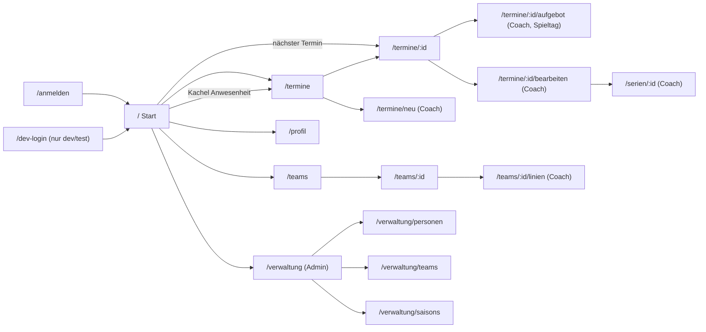

# Navigation und Screens

Karte der Oberfläche für Menschen und Agenten. Der Test-Agent nutzt sie, um gezielt per URL an die richtige Stelle zu springen. Wer eine Route oder feste Test-ID ändert, passt diese Datei im selben PR an.

Stand: Zielbild für den Kern. Was noch nicht gebaut ist, ist mit «geplant» und der Feature-Nummer aus dem [Backlog](../pipeline/backlog.md) markiert.

## Navigation

- **Mobil:** Bottom-Navigation mit Start, Termine, Teams, Profil. Admins sehen zusätzlich «Verwaltung».
- **Desktop (ab 1024px):** dieselben Einträge als Seitennavigation links.
- Der aktive Eintrag hat `aria-current="page"`.
- Die Navigation ist ein `nav` mit `aria-label="Hauptnavigation"`.

## Routen

| Route | Screen | Wer | Inhalt | Feature |
|---|---|---|---|---|
| `/anmelden` | Anmelden | alle | Login (Verfahren offen, O-01) | F-00 |
| `/dev-login` | Testmodus-Anmeldung | nur `dev`/`test` | Liste der Seed-Personen, ein Klick meldet an | F-00 |
| `/` | Start | angemeldet | Begrüssung, nächster eigener Termin mit Antwort-Buttons, Kacheln je nach Rolle | F-00, F-04 |
| `/termine` | Termine | angemeldet | Kommende Termine aller eigenen Teams, eigene Antwort direkt änderbar. Filter `?team=<id>`, `?ansicht=vergangen` | F-03, F-04 |
| `/termine/:id` | Termin | Mitglieder der beteiligten Teams | Angaben, eigene Antwort, Übersicht nach Team und Linie, Coach-Block. Bei Spieltag: Spiele, Treffpunkt, Spielort, eigener Aufgebotsstatus | F-04, F-05 |
| `/termine/neu` | Termin erfassen | Coach | Einzeltermin, Spieltag oder Serie | F-03, F-05 |
| `/termine/:id/bearbeiten` | Termin bearbeiten | Coach | Angaben ändern, verschieben, absagen | F-03 |
| `/termine/:id/aufgebot` | Aufgebot | Coach | Auswahl nach Linien gruppiert, Antwortstatus daneben, veröffentlichen | F-05 |
| `/serien/:id` | Serie | Coach | Regel, Teams, Ausnahmen (Ferien) | F-03 |
| `/teams` | Meine Teams | angemeldet | Eigene Teams mit eigener Funktion | F-01 |
| `/teams/:id` | Team | Mitglieder | Coaches, Spielerinnen nach Linie | F-01, F-02 |
| `/teams/:id/linien` | Linien | Coach | Linien anlegen, umbenennen, sortieren, Spielerinnen zuweisen | F-02 |
| `/benachrichtigungen` | Benachrichtigungen | angemeldet | Eigene Benachrichtigungen, als gelesen markieren | F-06 |
| `/profil` | Profil | angemeldet | Name, Hell/Dunkel/System, Abmelden | F-00 |
| `/verwaltung/personen` | Personen | Admin | Personen anlegen, bearbeiten | F-01 |
| `/verwaltung/teams` | Teams | Admin | Teams, Teamzugehörigkeiten, Verknüpfung swiss unihockey, Abgleich auslösen | F-01, F-07 |
| `/verwaltung/saisons` | Saisons | Admin | Saisons anlegen, aktuelle Saison wechseln, Archiv | F-01 |

Ohne Berechtigung zeigt ein Screen den Text «Keine Berechtigung» (`role="alert"`) statt eines leeren Bildschirms. Ohne Anmeldung leitet jede Route auf `/anmelden` (bzw. im Testmodus `/dev-login`) und danach zurück.

## Dialoge

| Dialog | Geöffnet von | Name (Überschrift) |
|---|---|---|
| Vielleicht mit Kommentar | Antwort «vielleicht» | «Vielleicht – bitte kurz begründen» |
| Absage-Grund | Antwort «nicht dabei» (optional, überspringbar) | «Nicht dabei» |
| Stellvertretend antworten | Coach in der Übersicht, Menü bei einer Person | «Antwort für <Name> eintragen» |
| Termin absagen | Termin bearbeiten | «Termin absagen» |
| Aufgebot veröffentlichen | Aufgebot | «Aufgebot veröffentlichen?» |

## Test-IDs

Feste Test-IDs, auf die sich Tests verlassen. Schema und Regeln: [testbarkeit.md](../testbarkeit.md#4-test-ids-dort-wo-semantik-nicht-reicht).

### Global

| Test-ID | Element |
|---|---|
| `hauptnavigation` | Navigation (mobil und Desktop) |
| `theme-umschalter` | Umschalter Hell/Dunkel/System im Profil |
| `testmodus-hinweis` | Banner «Testmodus» (nur dev/test) |
| `kachel-<id>` | Kachel auf dem Start-Screen, z.B. `kachel-anwesenheit` |
| `naechster-termin` | Karte «Nächster Termin» auf dem Start-Screen |
| `benachrichtigungen-zaehler` | Anzahl ungelesener Benachrichtigungen |

### Termine

| Test-ID | Element |
|---|---|
| `termin-karte-<terminId>` | Eintrag in der Terminliste |
| `meine-antwort` | Antwort-Buttons der angemeldeten Person (in Karte und Detail) |
| `antwort-dabei`, `antwort-nicht-dabei`, `antwort-vielleicht` | Die drei Antwort-Buttons innerhalb von `meine-antwort` |
| `termin-status` | Hinweis «abgesagt» bzw. «verschoben» |
| `uebersicht` | Gesamte Übersicht eines Termins |
| `uebersicht-total` | Gesamtzähler |
| `uebersicht-team-<teamId>` | Abschnitt eines Teams |
| `uebersicht-team-<teamId>-zaehler` | Zähler eines Teams |
| `uebersicht-gruppe-<gruppeId>` | Linie oder Goalies innerhalb eines Teams |
| `uebersicht-ohne-linie-<teamId>` | Gruppe «Ohne Linie» eines Teams (nur wenn nicht leer) |
| `uebersicht-person-<personId>` | Eintrag einer Person, mit `data-antwort` |
| `coach-block` | Block der Coaches |

Zähler-Elemente tragen `data-zaehler="dabei|nicht-dabei|vielleicht|offen"`.

### Spieltag und Aufgebot

| Test-ID | Element |
|---|---|
| `spiele` | Liste der Spiele eines Spieltags |
| `spiel-<spielId>` | Ein Spiel |
| `treffpunkt` | Treffpunkt (Zeit und Ort) |
| `spielort-karte` | Link «In Google Maps öffnen» |
| `mein-aufgebot` | Eigener Status: «aufgeboten», «nicht aufgeboten», «noch kein Aufgebot» |
| `aufgebot-auswahl` | Auswahlliste im Aufgebot-Screen |
| `aufgebot-person-<personId>` | Eintrag in der Auswahl (Checkbox mit Antwortstatus) |
| `aufgebot-veroeffentlichen` | Button «Veröffentlichen» |
| `aufgebot-status` | «Entwurf» bzw. «veröffentlicht am …» |

### Linien

| Test-ID | Element |
|---|---|
| `linien-verwaltung` | Linien-Screen eines Teams |
| `gruppe-<gruppeId>` | Eine Linie oder Goalies |
| `linie-hinzufuegen` | Button «Linie hinzufügen» |
| `zuweisung-<personId>` | Auswahlfeld «Linie» einer Spielerin (Alternative zu Drag & Drop) |

## Darstellungsregeln, die Tests betreffen

- Leere Gruppen («Ohne Linie», leere Linie, Goalies ohne Spielerin) werden in der Übersicht eines Termins nicht angezeigt. Im Linien-Screen werden sie angezeigt.
- Reihenfolge in der Übersicht: Teams nach Name, darin Linien nach Reihenfolge, dann Goalies, dann «Ohne Linie». Personen nach Nachname, dann Vorname.
- Daten im Format «Di 17.11.», Zeiten «18:30». Volles Datum mit Jahr nur, wenn es nicht das aktuelle Jahr ist.
