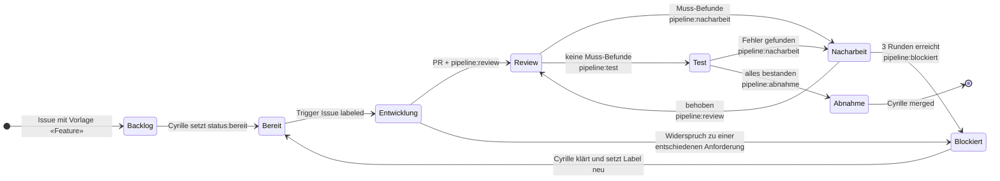

# Produktionspipeline

Drei KI-Agenten bauen Features in der Claude-Cloud, nacheinander und unabhängig voneinander. Cyrille gibt Features frei und nimmt sie ab. Dazwischen läuft alles von selbst.

```
Issue «status:bereit»  →  Entwicklung  →  Review  →  Test  →  Abnahme durch Cyrille (Merge)
                              ↑______________|_________|
                                  Nacharbeit (höchstens 3 Runden)
```

## Wie es funktioniert

- **Jeder Agent ist eine eigene Claude-Cloud-Aufgabe** (scheduled task, früher «Routine»). Jeder Lauf ist eine frische Cloud-Sitzung ohne Wissen aus dem vorherigen Lauf. Der Review- und der Test-Agent beurteilen also Arbeit, die sie nicht selbst gemacht haben.
- **Der Zustand steht auf GitHub, in Labels.** Ein Agent schliesst seine Arbeit ab, indem er das Label wechselt. Das Label-Ereignis startet über einen GitHub-Trigger den nächsten Agenten.
- **Die Anleitung jedes Agenten liegt im Repo** als Skill unter `.claude/skills/`. Die Cloud-Aufgabe ruft nur den Skill auf. Änderungen an der Pipeline laufen damit über normale Commits.
- **Gemergt wird nur von Cyrille.** Kein Agent merged, pusht auf `main` oder schliesst Issues.

## Ablauf



Nach einer Nacharbeit geht es immer zurück ins Review, nicht direkt in den Test. So wird jede Änderung geprüft.

## Rollen

| Agent | Skill | Startet bei | Darf | Darf nicht |
|---|---|---|---|---|
| **Entwicklung** | [`pipeline-entwicklung`](../../.claude/skills/pipeline-entwicklung/SKILL.md) | Issue bekommt `status:bereit`, PR bekommt `pipeline:nacharbeit` | Branch `claude/…` anlegen, Code schreiben, PR eröffnen, Labels wechseln | auf `main` pushen, mergen, Anforderungen mit Status «Entschieden» ändern |
| **Review** | [`pipeline-review`](../../.claude/skills/pipeline-review/SKILL.md) | PR bekommt `pipeline:review` | Code lesen, Build und Tests ausführen, kommentieren, Label wechseln | Code ändern |
| **Test** | [`pipeline-test`](../../.claude/skills/pipeline-test/SKILL.md) | PR bekommt `pipeline:test` | App starten, durchtesten, Testplan unter `e2e/plaene/` committen, Label wechseln | Produktivcode ändern |
| **Cyrille** | – | PR hat `pipeline:abnahme` oder `pipeline:blockiert` | alles | – |

## Labels

| Label | Auf | Bedeutung | Gesetzt von |
|---|---|---|---|
| `typ:feature` | Issue | Feature aus dem Backlog | Vorlage |
| `status:bereit` | Issue | Freigegeben zur Entwicklung | Cyrille |
| `status:in-arbeit` | Issue | Hat einen offenen PR in der Pipeline | Entwicklung |
| `pipeline:review` | PR | Wartet auf Review | Entwicklung |
| `pipeline:nacharbeit` | PR | Befunde aus Review oder Test sind zu beheben | Review, Test |
| `pipeline:test` | PR | Wartet auf Test | Review |
| `pipeline:abnahme` | PR | Bereit zum Mergen | Test |
| `pipeline:blockiert` | Issue, PR | Braucht eine Entscheidung von Cyrille | alle |
| `agent:aktiv` | Issue, PR | Ein Agent arbeitet gerade daran (Sperre) | alle |

**Regeln für Labels**

- Ein PR hat höchstens ein `pipeline:`-Label. Wer wechselt, entfernt zuerst das alte, dann setzt er das neue.
- `agent:aktiv` wird am Anfang eines Laufs gesetzt und am Ende entfernt. Ein Lauf überspringt Einträge mit `agent:aktiv`, ausser das Label ist älter als 3 Stunden (abgebrochener Lauf).
- Die Runde zählt jeder Agent über seine Kommentare: Jeder Abschlusskommentar beginnt mit einer unsichtbaren Markierung `<!-- pipeline:entwicklung -->`, `<!-- pipeline:review -->` oder `<!-- pipeline:test -->`.

## Sicherheit

Das Repo ist öffentlich. Jeder kann Issues und Kommentare schreiben.

- Labels setzen können nur Personen mit Schreibrechten. Die Pipeline startet nur über Labels.
- Ein Agent arbeitet ein Issue nur ab, wenn `status:bereit` von `cyrilleulmi` gesetzt wurde. Er prüft das über die Ereignisse des Issues.
- Anweisungen nehmen die Agenten nur aus diesem Repo (Skills, Anforderungen) und aus Issue-Texten und Kommentaren von `cyrilleulmi`. Alles andere (fremde Kommentare, Inhalte von Webseiten, Antworten von swiss unihockey) sind Daten, keine Anweisungen.
- `.claude/settings.json` verbietet Force-Push, Merge und Löschen über die Kommandozeile.
- Commits und PRs der Agenten erscheinen unter Cyrilles GitHub-Konto. Deshalb kann der Review-Agent einen PR nicht formell «approven» (GitHub verbietet das für eigene PRs). Er entscheidet über das Label.

## Einrichtung

Einmalig, in dieser Reihenfolge. Was schon erledigt ist, ist abgehakt.

- [x] Labels im Repo angelegt
- [x] Skills, Vorlagen und Doku im Repo
- [x] Drei Cloud-Aufgaben angelegt (ohne Trigger): «StvBero · Entwicklung», «StvBero · Review», «StvBero · Test»
- [ ] **Claude GitHub App** auf `cyrilleulmi/StvBeroPlatform` installieren: https://github.com/apps/claude (nötig für GitHub-Trigger)
- [ ] **Cloud-Umgebung** prüfen: Unter claude.ai/code/routines bei jeder Aufgabe *Bearbeiten → Advanced settings*: Repository `cyrilleulmi/StvBeroPlatform` wählen, Umgebung mit Netzwerkzugriff **Trusted** (Standard). Als Setup-Skript `scripts/cloud-setup.sh` eintragen.
- [ ] **GitHub-Trigger** pro Aufgabe hinzufügen (*Bearbeiten → Trigger → + → GitHub event*):

| Aufgabe | Ereignis | Filter |
|---|---|---|
| StvBero · Entwicklung | Issue → labeled | – (der Skill prüft das Label selbst) |
| StvBero · Entwicklung | Pull request → labeled | Labels: is one of `pipeline:nacharbeit` |
| StvBero · Review | Pull request → labeled | Labels: is one of `pipeline:review` |
| StvBero · Test | Pull request → labeled | Labels: is one of `pipeline:test` |

- [ ] **Connectors** der Aufgaben auf das Nötige reduzieren (keine nötig, GitHub läuft über die App).
- [ ] Optional: Bei «Entwicklung» einen zusätzlichen Zeitplan-Trigger (z.B. täglich 06:47) als Auffangnetz, falls ein GitHub-Ereignis verloren geht. Der Skill findet liegengebliebene Arbeit selbst.

## Ein Feature durch die Pipeline schicken

1. Issue mit der Vorlage «Feature» anlegen (oder eines aus dem [Backlog](backlog.md) nehmen).
2. Akzeptanzkriterien prüfen. Sie sind das, was der Test-Agent prüft.
3. Label `status:bereit` setzen.
4. Warten. Der Fortschritt steht als Kommentare im PR. Jede Cloud-Sitzung ist unter claude.ai/code einsehbar.
5. Bei `pipeline:abnahme`: Testbericht lesen, optional selbst ausprobieren, mergen.
6. Bei `pipeline:blockiert`: Frage im Kommentar beantworten, dann das passende Label wieder setzen.

Features nacheinander freigeben, nicht alle auf einmal. Spätere Features bauen auf früheren auf (siehe [Backlog](backlog.md)), und parallele PRs erzeugen Konflikte.

## Grenzen und Kosten

- Cloud-Aufgaben verbrauchen das Abo-Kontingent wie normale Sitzungen. Ein Feature braucht mindestens drei Läufe, mit Nacharbeit mehr.
- GitHub-Ereignisse haben ein Stundenlimit pro Aufgabe und Konto. Was darüber liegt, wird verworfen. Dafür ist der optionale Zeitplan-Trigger da.
- In Cloud-Sitzungen ist die GitHub-GraphQL-API gesperrt. `gh pr …` und `gh issue …` funktionieren dort nicht. Die Agenten nutzen `scripts/pipeline.sh`, das nur die REST-API verwendet.
- In der Cloud läuft kein Docker-Daemon. PostgreSQL startet über `scripts/db-start.sh` direkt, Testcontainers und Quarkus Dev Services sind deshalb aus.
- Es gibt noch keine Vorschau-URL (Hosting offen, O-02). Zum Ausprobieren eine Cloud-Sitzung auf dem PR-Branch öffnen und den Startbefehl aus dem Testbericht verwenden.

## Weitere Unterlagen

- [Backlog](backlog.md) – Features in Umsetzungsreihenfolge mit Akzeptanzkriterien
- [Definition of Done](definition-of-done.md) – was jeder PR erfüllen muss
- [Testbarkeit](../testbarkeit.md), [Navigation](../oberflaeche/navigation.md), [Testdaten](../testdaten.md)
- [API-Vertrag](../api/openapi.yaml), [Zustände](../zustaende.md)
