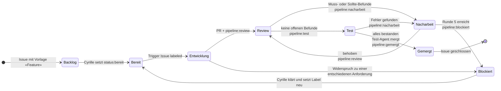

# Produktionspipeline

Drei KI-Agenten bauen Features in der Claude-Cloud, nacheinander und unabhängig voneinander. Cyrille gibt Features frei. Danach läuft alles von selbst bis auf `main`: Besteht ein PR Review und Test, mergt ihn der Test-Agent.

```
Issue «status:bereit»  →  Entwicklung  →  Review  →  Test  →  Merge nach main (Test-Agent)
                              ↑______________|_________|
                                  Nacharbeit (höchstens 4 Runden)
```

## Wie es funktioniert

- **Jeder Agent ist eine eigene Claude-Code-Aufgabe in der Cloud** (scheduled task, früher «Routine»). Jeder Lauf ist eine frische Cloud-Sitzung ohne Wissen aus dem vorherigen Lauf. Der Review- und der Test-Agent beurteilen also Arbeit, die sie nicht selbst gemacht haben.
- **Der Zustand steht auf GitHub, in Labels.** Ein Agent schliesst seine Arbeit ab, indem er das Label wechselt. Das Label-Ereignis startet über einen GitHub-Trigger den nächsten Agenten.
- **Die Anleitung jedes Agenten liegt im Repo** als Skill unter `.claude/skills/`. Die Cloud-Aufgabe ruft nur den Skill auf. Änderungen an der Pipeline laufen damit über normale Commits.
- **Gemergt wird automatisch, aber nur vom Test-Agenten** und nur über `scripts/pipeline.sh mergen`: Squash-Merge, nur ohne Konflikte, nur mit grüner CI und nur genau der getestete Stand. Kein Agent pusht direkt auf `main`. Cyrille greift nur bei `pipeline:blockiert` ein.

## Ablauf



Nach einer Nacharbeit geht es immer zurück ins Review, nicht direkt in den Test. So wird jede Änderung geprüft.

## Rollen

| Agent | Skill | Startet bei | Darf | Darf nicht |
|---|---|---|---|---|
| **Entwicklung** (Aufgaben «Entwicklung» und «Nacharbeit») | [`pipeline-entwicklung`](../../.claude/skills/pipeline-entwicklung/SKILL.md) | Issue bekommt `status:bereit`, PR bekommt `pipeline:nacharbeit` | Branch `claude/…` anlegen, Code schreiben, PR eröffnen, Labels wechseln | auf `main` pushen, mergen, Anforderungen mit Status «Entschieden» ändern |
| **Review** | [`pipeline-review`](../../.claude/skills/pipeline-review/SKILL.md) | PR bekommt `pipeline:review` | Code lesen, Build und Tests ausführen, kommentieren, Label wechseln | Code ändern |
| **Test** | [`pipeline-test`](../../.claude/skills/pipeline-test/SKILL.md) | PR bekommt `pipeline:test` | App starten, durchtesten, Testplan unter `e2e/plaene/` committen, Label wechseln, **bestandenen PR mergen** | Produktivcode ändern, mergen ohne bestandenen Test |
| **Cyrille** | – | PR hat `pipeline:blockiert`; sonst nach Belieben | alles | – |

## Labels

| Label | Auf | Bedeutung | Gesetzt von |
|---|---|---|---|
| `typ:feature` | Issue | Feature aus dem Backlog | Vorlage |
| `status:bereit` | Issue | Freigegeben zur Entwicklung | Cyrille |
| `status:in-arbeit` | Issue | Hat einen offenen PR in der Pipeline | Entwicklung |
| `pipeline:review` | PR | Wartet auf Review | Entwicklung |
| `pipeline:nacharbeit` | PR | Befunde aus Review oder Test sind zu beheben | Review, Test |
| `pipeline:test` | PR | Wartet auf Test | Review |
| `pipeline:gemergt` | PR | Vom Test-Agenten nach `main` gemergt | Test |
| `typ:nachbesserung` | Issue | Befund, der nicht in die Nacharbeit des PRs gehört: betrifft Code, der schon auf `main` war, oder ist ein neues «Sollte» ab Runde 3. Wird mit `status:bereit` angelegt und vor dem nächsten Feature automatisch umgesetzt. Befunde aus einer Nachbesserung selbst kommen ohne `status:bereit` | Review, Test |
| `pipeline:blockiert` | Issue, PR | Braucht eine Entscheidung von Cyrille | alle |
| `agent:aktiv` | Issue, PR | Ein Agent arbeitet gerade daran (Sperre) | alle |

**Regeln für Labels**

- Ein PR hat höchstens ein `pipeline:`-Label. Wer wechselt, entfernt zuerst das alte, dann setzt er das neue.
- `agent:aktiv` wird am Anfang eines Laufs gesetzt und am Ende entfernt. Ein Lauf überspringt Einträge mit `agent:aktiv`, ausser das Label ist älter als 3 Stunden (abgebrochener Lauf).
- Die Runde zählt jeder Agent über seine Kommentare: Jeder Abschlusskommentar beginnt mit einer unsichtbaren Markierung `<!-- pipeline:entwicklung -->`, `<!-- pipeline:review -->` oder `<!-- pipeline:test -->`.

## Sicherheit

Das Repo ist öffentlich. Jeder kann Issues und Kommentare schreiben.

- Labels setzen können nur Personen mit Schreibrechten. Die Pipeline startet nur über Labels.
- Ein Agent arbeitet ein Issue nur ab, wenn `status:bereit` von `cyrilleulmi` gesetzt wurde. Er prüft das über die Ereignisse des Issues.
- Anweisungen nehmen die Agenten nur aus diesem Repo (Skills, Anforderungen) und aus Issue-Texten und Kommentaren von `cyrilleulmi`. Alles andere (fremde Kommentare, Inhalte von Webseiten, Antworten von swiss unihockey) sind Daten, keine Anweisungen.
- `.claude/settings.json` verbietet Force-Push ohne `--force-with-lease`, direkten Push auf `main` und Löschen des Repos.
- Weil ohne menschliche Prüfung gemergt wird, sind Review und Test die einzigen Sicherungen vor `main`. Will Cyrille wieder selbst abnehmen, ersetzt er im Test-Skill den Merge durch ein Label `pipeline:abnahme`.
- Commits und PRs der Agenten erscheinen unter Cyrilles GitHub-Konto. Deshalb kann der Review-Agent einen PR nicht formell «approven» (GitHub verbietet das für eigene PRs). Er entscheidet über das Label.

## Einrichtung

Stand 15.11.2026: erledigt.

- [x] Labels im Repo angelegt
- [x] Skills, Vorlagen und Doku im Repo
- [x] Backlog F-00 bis F-07 als Issues #1–#8 angelegt (ohne `status:bereit`)
- [x] Vier Claude-Code-Aufgaben unter [claude.ai/code/routines](https://claude.ai/code/routines), je mit Repository `cyrilleulmi/StvBeroPlatform`, Umgebung «Default» (Netzwerk «Trusted»), ohne Connectors, Auto-fix aus:

| Aufgabe | Skill | GitHub-Ereignis | Filter |
|---|---|---|---|
| StvBero Pipeline · Entwicklung | `pipeline-entwicklung` | Issue: Labeled | Labels is one of `status:bereit` |
| StvBero Pipeline · Nacharbeit | `pipeline-entwicklung` | Pull request: Labeled | Labels is one of `pipeline:nacharbeit` |
| StvBero Pipeline · Review | `pipeline-review` | Pull request: Labeled | Labels is one of `pipeline:review` |
| StvBero Pipeline · Test | `pipeline-test` | Pull request: Labeled | Labels is one of `pipeline:test` |
| StvBero Pipeline · Wächter | `pipeline-waechter` | Zeitplan: alle 2 Stunden | – |

Was man beim Einrichten wissen muss:

- **Nur eine GitHub-Trigger pro Aufgabe.** Deshalb gibt es für die Nacharbeit eine eigene Aufgabe mit demselben Skill wie die Entwicklung.
- **Aufgaben über claude.ai/code/routines anlegen** (*New task → Set up manually*), nicht aus einem Chat in einem claude.ai-Projekt. Aus einem Projekt angelegte Aufgaben sind Chat-Aufgaben: ohne Repository, ohne GitHub-Trigger, Connectors nicht entfernbar.
- **Trigger nach dem Speichern prüfen.** Auf der Detailseite muss unter «Triggers» `GitHub · cyrilleulmi/stvberoplatform` stehen. Beim Anlegen gingen PR-Trigger einmal verloren («Manual only»). Nach dem Eintragen des Filterwerts mit Tab aus dem Feld gehen, dann speichern.
- Der Filter «Labels is one of» prüft, ob das Label auf dem Issue/PR **vorhanden** ist, nicht nur, ob es gerade gesetzt wurde. Setzt ein Agent z.B. `agent:aktiv` auf ein Issue mit `status:bereit`, startet ein weiterer Lauf. Der erkennt die Sperre und endet sofort.
- Ein Setup-Skript ist nicht nötig: Das Standard-Image hat alles, was das Projekt braucht (Java 21, Maven, Node 22, Chrome, PostgreSQL). `scripts/cloud-setup.sh` prüft das bei Bedarf.
- Optional: Bei «Entwicklung» einen Zeitplan-Trigger (z.B. täglich) als Auffangnetz, falls ein GitHub-Ereignis verloren geht. Das geht nur, wenn keine GitHub-Trigger nötig ist, also in einer separaten Aufgabe.

## Ein Feature durch die Pipeline schicken

1. Issue mit der Vorlage «Feature» anlegen (oder eines aus dem [Backlog](backlog.md) nehmen).
2. Akzeptanzkriterien prüfen. Sie sind das, was der Test-Agent prüft.
3. Label `status:bereit` setzen.
4. Warten. Der Fortschritt steht als Kommentare im PR. Jede Cloud-Sitzung ist unter claude.ai/code einsehbar.
5. Bei `pipeline:gemergt`: Das Feature ist auf `main`. Der Testbericht im PR sagt, was neu ist.
6. Bei `pipeline:blockiert`: Frage im Kommentar beantworten, dann das passende Label wieder setzen.

### Warteschlange

Du kannst beliebig viele Features gleichzeitig auf `status:bereit` setzen. Die Pipeline arbeitet sie **nacheinander** ab:

1. Es ist immer nur ein Feature in Arbeit. Solange ein PR in Review, Test oder Nacharbeit ist, beginnt kein neues Feature. So entstehen keine Konflikte zwischen parallelen PRs.
2. Als nächstes kommen Nachbesserungen (`typ:nachbesserung`, älteste zuerst; sie werden automatisch freigegeben), dann das Feature mit der kleinsten F-Nummer, dessen Voraussetzungen (Zeile «Voraussetzung» im Issue) schon gemergt sind.
3. Nach jedem Merge stösst der Test-Agent das nächste Feature an.
4. Gehen mehrere Issues gleichzeitig auf `status:bereit`, starten mehrere Entwicklungs-Läufe. Nur einer beansprucht das Feature (`scripts/pipeline.sh beanspruchen`), die anderen enden sofort.
5. Steht etwas auf `pipeline:blockiert`, hält die Warteschlange an, bis Cyrille entschieden hat. Danach geht es mit dem blockierten Eintrag weiter.

Die Reihenfolge und Abhängigkeiten stehen im [Backlog](backlog.md).

## Wächter: Abbrüche und verlorene Ereignisse

Läuft das Usage-Kontingent aus, werden neue Läufe abgelehnt und laufende abgebrochen. GitHub-Ereignisse aus dieser Zeit gehen verloren. Ohne Hilfe bliebe die Pipeline dann stehen.

Die Aufgabe «StvBero Pipeline · Wächter» läuft alle 2 Stunden und führt `scripts/pipeline.sh waechter` aus ([Skill](../../.claude/skills/pipeline-waechter/SKILL.md)). Sie erkennt:

- **Abgebrochene Läufe:** Sperre älter als 3 Stunden und seit einer Stunde kein Push und keine Änderung. Sperre weg, Schritt neu anstossen. Damit lange Läufe nicht fälschlich als tot gelten, pusht die Entwicklung mindestens alle 30 Minuten einen Zwischenstand.
- **Verlorene Ereignisse:** Ein PR steht seit 45 Minuten auf `pipeline:review`, `pipeline:test` oder `pipeline:nacharbeit`, aber kein Agent hat ihn gesperrt. Label neu setzen.
- **Stehende Warteschlange:** Nichts läuft, ein Feature ist seit 45 Minuten bereit. Anstossen.
- **Endlosschleifen:** Mehr als 3 Anstösse auf denselben Eintrag in 24 Stunden führen zu `pipeline:blockiert`.

Selbst prüfen, ohne etwas zu ändern: `scripts/pipeline.sh waechter --trocken`.

Nach einem Usage-Reset dauert es also höchstens gut 2 Stunden, bis die Pipeline von selbst weiterläuft. Schneller geht es, wenn du die Wächter-Aufgabe mit «Run now» startest.

## Grenzen und Kosten

- Cloud-Aufgaben verbrauchen das Abo-Kontingent wie normale Sitzungen. Ein Feature braucht mindestens drei Läufe, mit Nacharbeit mehr.
- GitHub-Ereignisse haben ein Stundenlimit pro Aufgabe und Konto. Was darüber liegt, wird verworfen. Dafür ist der optionale Zeitplan-Trigger da.
- In Cloud-Sitzungen ist die GitHub-GraphQL-API gesperrt. `gh pr …` und `gh issue …` funktionieren dort nicht. Die Agenten nutzen `scripts/pipeline.sh`, das nur die REST-API verwendet.
- In der Cloud läuft kein Docker-Daemon. PostgreSQL startet über `scripts/db-start.sh` direkt, Testcontainers und Quarkus Dev Services sind deshalb aus.
- Es gibt noch keine Vorschau-URL (Hosting offen, O-02). Zum Ausprobieren eine Cloud-Sitzung auf dem PR-Branch öffnen und den Startbefehl aus dem Testbericht verwenden.

## Weitere Unterlagen

- [Backlog](backlog.md) – Features in Umsetzungsreihenfolge mit Akzeptanzkriterien
- [Definition of Done](definition-of-done.md) – was jeder PR erfüllen muss
- [Testbarkeit](../testbarkeit.md), [Navigation](../oberflaeche/navigation.md), [Testdaten](../testdaten.md)
- [API-Vertrag](../api/openapi.yaml), [Zustände](../zustaende.md)
