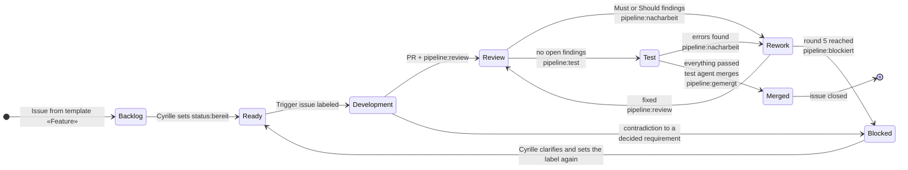

# Production pipeline

Three AI agents build features in the Claude cloud, one after the other and independently of each other. Cyrille releases features. After that, everything runs by itself all the way to `main`: if a PR passes review and test, the test agent merges it.

```
Issue «status:bereit»  →  Development  →  Review  →  Test  →  Merge into main (test agent)
                              ↑______________|_________|
                                  Rework (at most 4 rounds)
```

## How it works

- **Every agent is its own Claude Code task in the cloud** (scheduled task, formerly «Routine»). Every run is a fresh cloud session without knowledge from the previous run. So the review and test agents judge work they did not do themselves.
- **The state is on GitHub, in labels.** An agent finishes its work by switching the label. The label event starts the next agent via a GitHub trigger.
- **Each agent's instructions are in the repo** as a skill under `.claude/skills/`. The cloud task only calls the skill. Changes to the pipeline therefore go through normal commits.
- **Merging is automatic, but only by the test agent** and only via `scripts/pipeline.sh mergen`: squash merge, only without conflicts, only with green CI and only exactly the tested state. No agent pushes directly to `main`. Cyrille only steps in on `pipeline:blockiert`.

## Flow



After rework it always goes back to review, not directly to test. This way every change is checked.

## Roles

| Agent | Skill | Starts when | May | May not |
|---|---|---|---|---|
| **Development** (tasks «Entwicklung» and «Nacharbeit») | [`pipeline-entwicklung`](../../.claude/skills/pipeline-entwicklung/SKILL.md) | Issue gets `status:bereit`, PR gets `pipeline:nacharbeit` | create branch `claude/…`, write code, open PR, switch labels | push to `main`, merge, change requirements with status «Decided» |
| **Review** | [`pipeline-review`](../../.claude/skills/pipeline-review/SKILL.md) | PR gets `pipeline:review` | read code, run build and tests, comment, switch label | change code |
| **Test** | [`pipeline-test`](../../.claude/skills/pipeline-test/SKILL.md) | PR gets `pipeline:test` | start the app, test it thoroughly, commit test plan under `e2e/plans/`, switch label, **merge a passed PR** | change production code, merge without a passed test |
| **Cyrille** | – | PR has `pipeline:blockiert`; otherwise as he likes | everything | – |

## Labels

| Label | On | Meaning | Set by |
|---|---|---|---|
| `typ:feature` | Issue | Feature from the backlog | Template |
| `status:bereit` | Issue | Released for development | Cyrille |
| `status:in-arbeit` | Issue | Has an open PR in the pipeline | Development |
| `pipeline:review` | PR | Waiting for review | Development |
| `pipeline:nacharbeit` | PR | Findings from review or test need fixing | Review, Test |
| `pipeline:test` | PR | Waiting for test | Review |
| `pipeline:gemergt` | PR | Merged into `main` by the test agent | Test |
| `typ:nachbesserung` | Issue | Finding that does not belong in the PR's rework: concerns code that was already on `main`, or is a new «Should» from round 3 on. Created with `status:bereit` and implemented automatically before the next feature. Findings from a follow-up fix itself come without `status:bereit` | Review, Test |
| `pipeline:blockiert` | Issue, PR | Needs a decision from Cyrille | all |
| `agent:aktiv` | Issue, PR | An agent is working on it right now (lock) | all |

**Rules for labels**

- A PR has at most one `pipeline:` label. Whoever switches first removes the old one, then sets the new one.
- `agent:aktiv` is set at the start of a run and removed at the end. A run skips items with `agent:aktiv`, unless the label is older than 3 hours (aborted run).
- Every agent counts the round through its comments: every final comment starts with an invisible marker `<!-- pipeline:entwicklung -->`, `<!-- pipeline:review -->` or `<!-- pipeline:test -->`.

## Security

The repo is public. Anyone can write issues and comments.

- Only people with write access can set labels. The pipeline only starts via labels.
- An agent only works on an issue if `status:bereit` was set by `cyrilleulmi`. It checks this through the issue's events.
- The agents take instructions only from this repo (skills, requirements) and from issue texts and comments by `cyrilleulmi`. Everything else (other people's comments, content of web pages, responses from swiss unihockey) is data, not instructions.
- `.claude/settings.json` forbids force push without `--force-with-lease`, direct push to `main` and deleting the repo.
- Because merging happens without human review, review and test are the only safeguards before `main`. If Cyrille wants to do the acceptance himself again, he replaces the merge in the test skill with a label `pipeline:abnahme`.
- The agents' commits and PRs appear under Cyrille's GitHub account. That is why the review agent cannot formally «approve» a PR (GitHub forbids this for your own PRs). It decides via the label.

## Setup

As of 15.11.2026: done.

- [x] Labels created in the repo
- [x] Skills, templates and docs in the repo
- [x] Backlog F-00 to F-07 created as issues #1–#8 (without `status:bereit`)
- [x] Four Claude Code tasks under [claude.ai/code/routines](https://claude.ai/code/routines), each with repository `cyrilleulmi/StvBeroPlatform`, environment «Default» (network «Trusted»), without connectors, auto-fix off:

| Task | Skill | GitHub event | Filter |
|---|---|---|---|
| StvBero Pipeline · Entwicklung | `pipeline-entwicklung` | Issue: Labeled | Labels is one of `status:bereit` |
| StvBero Pipeline · Nacharbeit | `pipeline-entwicklung` | Pull request: Labeled | Labels is one of `pipeline:nacharbeit` |
| StvBero Pipeline · Review | `pipeline-review` | Pull request: Labeled | Labels is one of `pipeline:review` |
| StvBero Pipeline · Test | `pipeline-test` | Pull request: Labeled | Labels is one of `pipeline:test` |
| StvBero Pipeline · Wächter | `pipeline-waechter` | Schedule: every 2 hours | – |

What you need to know when setting it up:

- **Only one GitHub trigger per task.** That is why rework has its own task with the same skill as development.
- **Create tasks via claude.ai/code/routines** (*New task → Set up manually*), not from a chat in a claude.ai project. Tasks created from a project are chat tasks: without repository, without GitHub trigger, connectors cannot be removed.
- **Check the trigger after saving.** The detail page must show `GitHub · cyrilleulmi/stvberoplatform` under «Triggers». Once, PR triggers got lost when creating («Manual only»). After entering the filter value, leave the field with Tab, then save.
- The filter «Labels is one of» checks whether the label is **present** on the issue/PR, not only whether it was just set. If an agent sets e.g. `agent:aktiv` on an issue with `status:bereit`, another run starts. It detects the lock and ends immediately.
- A setup script is not needed: the standard image has everything the project needs (Java 21, Maven, Node 22, Chrome, PostgreSQL). `scripts/cloud-setup.sh` checks this if needed.
- Optional: for «Entwicklung», a schedule trigger (e.g. daily) as a safety net in case a GitHub event gets lost. This only works when no GitHub trigger is needed, i.e. in a separate task.

## Status page and notifications

**Status page:** https://cyrilleulmi.github.io/StvBeroPlatform/ (source `status/index.html`, published by `.github/workflows/status-page.yml`). It reads the state live from the GitHub API and shows:

- what needs you (blocks, follow-up fixes without release)
- what is in progress right now, with stage and round
- what happened since your last visit (or in the last 24 hours or 7 days), with the full message of the agents
- the queue, in the order in which the pipeline processes it

«Last visit» is stored per device in the browser. Without login, GitHub allows 60 requests per hour; the page needs three per refresh.

**Push messages** only come when something went wrong (E-64, rules in [agent-rules.md](agent-rules.md) section 8).

## Sending a feature through the pipeline

1. Create an issue with the template «Feature» (or take one from the [backlog](backlog.md)).
2. Check the acceptance criteria. They are what the test agent checks.
3. Set the label `status:bereit`.
4. Wait. Progress appears as comments in the PR. Every cloud session can be viewed under claude.ai/code.
5. On `pipeline:gemergt`: the feature is on `main`. The test report in the PR says what is new.
6. On `pipeline:blockiert`: answer the question in the comment, then set the matching label again.

### Queue

You can set any number of features to `status:bereit` at the same time. The pipeline processes them **one after the other**:

1. Only one feature is in progress at a time. As long as a PR is in review, test or rework, no new feature starts. This avoids conflicts between parallel PRs.
2. Next come follow-up fixes (`typ:nachbesserung`, oldest first; they are released automatically), then the feature with the lowest F number whose prerequisites (line «Voraussetzung:» in the issue) are already merged.
3. After every merge, the test agent triggers the next feature.
4. If several issues go to `status:bereit` at the same time, several development runs start. Only one claims the feature (`scripts/pipeline.sh beanspruchen`), the others end immediately.
5. If something is on `pipeline:blockiert`, the queue stops until Cyrille has decided. Then it continues with the blocked item.

The order and dependencies are in the [backlog](backlog.md).

## Watchdog: aborts and lost events

When the usage quota runs out, new runs are rejected and running ones are aborted. GitHub events from that time get lost. Without help, the pipeline would then stand still.

The task «StvBero Pipeline · Wächter» runs every 2 hours and executes `scripts/pipeline.sh waechter` ([skill](../../.claude/skills/pipeline-waechter/SKILL.md)). It detects:

- **Aborted runs:** lock older than 3 hours and no push and no change for an hour. Lock removed, step triggered again. So that long runs are not wrongly considered dead, development pushes an intermediate state at least every 30 minutes.
- **Lost events:** a PR has been on `pipeline:review`, `pipeline:test` or `pipeline:nacharbeit` for 45 minutes, but no agent has locked it. Set the label again.
- **Stalled queue:** nothing is running, a feature has been ready for 45 minutes. Trigger it.
- **Endless loops:** more than 3 triggers on the same item within 24 hours lead to `pipeline:blockiert`.

Check it yourself without changing anything: `scripts/pipeline.sh waechter --trocken`.

So after a usage reset, it takes at most a little over 2 hours until the pipeline continues by itself. It goes faster if you start the watchdog task with «Run now».

## Limits and costs

- Cloud tasks use the subscription quota like normal sessions. A feature needs at least three runs, more with rework.
- GitHub events have an hourly limit per task and account. Anything above it is discarded. That is what the optional schedule trigger is for.
- In cloud sessions the GitHub GraphQL API is blocked. `gh pr …` and `gh issue …` do not work there. The agents use `scripts/pipeline.sh`, which only uses the REST API.
- No Docker daemon runs in the cloud. PostgreSQL starts directly via `scripts/db-start.sh`, so Testcontainers and Quarkus Dev Services are off.
- There is no preview URL yet (hosting open, O-02). To try something out, open a cloud session on the PR branch and use the start command from the test report.

## Further documents

- [Backlog](backlog.md) – features in implementation order with acceptance criteria
- [Definition of Done](definition-of-done.md) – what every PR must meet
- [Testability](../testability.md), [Navigation](../ui/navigation.md), [Test data](../test-data.md)
- [API contract](../api/openapi.yaml), [States](../states.md)
