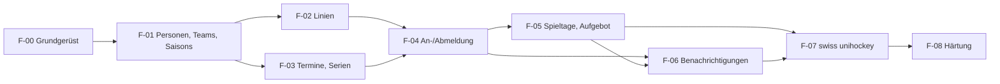

# Backlog

Die Features des Kerns in Umsetzungsreihenfolge. Jedes Feature ist ein Issue auf GitHub mit demselben Titel (`F-xx · …`). Der Entwicklungs-Agent nimmt nur Features, deren Voraussetzungen auf `main` sind.

Die Akzeptanzkriterien sind das, was der Test-Agent prüft. Szenarien `S…` stehen in [test-data.md](../test-data.md#szenarien-für-tests).

| Nr. | Feature | Voraussetzung | Anforderungen |
|---|---|---|---|
| F-00 | Grundgerüst | – | NF-01–NF-24, RR-05 |
| F-01 | Personen, Teams, Saisons | F-00 | PTF, SAI, RR-04 |
| F-02 | Linien | F-01 | LIN |
| F-03 | Termine und Serien | F-01 | TER |
| F-04 | An- und Abmeldung mit Übersicht | F-02, F-03 | ANM, RR-02, RR-03, RR-06 |
| F-05 | Spieltage und Aufgebot | F-04 | AUF |
| F-06 | Benachrichtigungen | F-04, F-05 | BEN |
| F-07 | Anbindung swiss unihockey | F-05, F-06 | SUH |
| F-08 | Härtung vor dem produktiven Betrieb | F-07, F-11 | RR-07, NF-30 |
| F-09 bis F-20 | Batch 2, siehe [unten](#batch-2-f-09-to-f-20) | | |



---

## F-00 · Grundgerüst

**Ziel:** Ein lauffähiges, leeres Gerüst, auf dem alle weiteren Features aufbauen. Es legt die Konventionen fest, an die sich spätere Läufe halten.

**Vorgaben für das Gerüst**, damit nicht jeder Lauf neu entscheidet:

| Punkt | Vorgabe |
|---|---|
| Backend-Sprache | Java 21 LTS (entschieden, E-57). In der Cloud vorinstalliert. |
| Migrationen | Flyway (entschieden, E-57) |
| Build | Maven im Backend, npm im Frontend und in `e2e/` |
| Anmeldung (O-01) | Sitzungs-Cookie. Im Profil `dev`/`test` Anmeldung über `/dev-login`. Produktives Verfahren folgt, sobald entschieden. |

**Struktur:**

```
backend/     Quarkus, Package pro Kachel unter ch.stvbero.platform.<kachel>, gemeinsamer Kern unter …kern
frontend/    Angular (Standalone, Signals), Feature pro Kachel, lazy geladen
e2e/         Playwright Test: tests/, plans/, playwright.config.ts (Projekte mobil + desktop, channel chrome)
scripts/     db-start.sh (besteht), start.sh (alles starten), test.sh (alles testen)
.github/workflows/ci.yml   Build + Tests bei jedem PR
```

**Akzeptanzkriterien:**

1. `scripts/start.sh` startet aus einem frischen Klon Datenbank, Backend (Profil `dev`) und Frontend. Die App ist unter `http://localhost:4200` erreichbar.
2. `scripts/test.sh` führt Backend-Tests und E2E-Tests aus und endet mit Exit-Code 0.
3. `/dev-login` zeigt alle Seed-Personen aus test-data.md (zunächst nur Personen, ohne Teams). Ein Klick meldet an und führt auf `/`.
4. `/` zeigt die Begrüssung mit Vornamen und die Kacheln aus `GET /api/kacheln`. Die Kachel «Anwesenheit» ist registriert und führt auf `/termine` (dort vorerst leerer Zustand).
5. Navigation mobil unten, ab 1024px links, nach navigation.md. Aktiver Eintrag mit `aria-current="page"`.
6. Design-Tokens aus design-principles.md als CSS Custom Properties. Unter `/profil` lässt sich die Darstellung umschalten (ursprünglich Hell/Dunkel/System, seit E-67 Hell/Düne/GitHub Dark/System), die Wahl bleibt nach Neuladen erhalten.
7. PWA: Manifest und Service Worker, installierbar.
8. Test-Endpunkte `reset`, `uhr`, `anmelden` funktionieren im Profil `dev`/`test` und fehlen im Profil `prod` (Test, der das prüft).
9. Ein Backend-Test vergleicht die von Quarkus erzeugte OpenAPI mit `docs/api/openapi.yaml` für alle bereits umgesetzten Pfade.
10. Die Uhr ist injiziert (`java.time.Clock`), `PUT /api/test/uhr` verändert «jetzt» für das ganze Backend.
11. CI-Workflow führt bei jedem PR Build und alle Tests aus.
12. Ohne Anmeldung leitet jede Route auf die Anmeldung und danach zurück.

---

## F-01 · Personen, Teams, Saisons

**Ziel:** Admins verwalten Personen, Teams, Teamzugehörigkeiten und Saisons. Alle sehen ihre Teams.

**Akzeptanzkriterien:**

1. Seed nach test-data.md: Saisons, Teams, Personen, Teamzugehörigkeiten (noch ohne Linien).
2. Als `alex` unter `/verwaltung/personen` eine Person anlegen und bearbeiten.
3. Als `alex` unter `/verwaltung/teams` eine Person mit Funktion ins Team aufnehmen. Zweite Aufnahme derselben Person ins selbe Team wird abgelehnt (PTF-04).
4. Petra kann gleichzeitig Coach in Team 1 und Spielerin in Team 2 sein. `/teams` zeigt bei ihr beide Teams mit der jeweiligen Funktion (PTF-12).
5. `/teams/:id` zeigt Coaches und Spielerinnen getrennt. Coaches erscheinen nie in der Liste der Spielerinnen (PTF-07).
6. Als `alex` unter `/verwaltung/saisons` eine neue Saison mit Übernahme der Vorsaison anlegen und zur aktuellen machen (SAI-04, SAI-06).
7. Szenario S16: Archiv lesend sichtbar.
8. Verwaltungs-Screens und -Endpunkte sind für Nicht-Admins gesperrt (403, «Keine Berechtigung»).

---

## F-02 · Linien

**Ziel:** Coaches teilen ihre Spielerinnen in Linien und Goalies ein.

**Akzeptanzkriterien:**

1. Seed: Gruppen und Zuweisungen nach test-data.md.
2. Als `petra` unter `/teams/<Team 1>/linien`: Linie hinzufügen, umbenennen, Reihenfolge ändern, löschen. Spielerinnen einer gelöschten Linie sind danach «ohne Linie».
3. Zuweisung per Drag & Drop **und** per Auswahlfeld (`zuweisung-<personId>`). Beides speichert sofort.
4. Szenario S15: höchstens eine Gruppe pro Spielerin und Team (LIN-02).
5. Lea hat in Team 1 und Team 2 verschiedene Linien (LIN-03).
6. Goalies existieren pro Team genau einmal und lassen sich nicht löschen.
7. Nur Coaches des Teams (und Admins) können Linien ändern. `anna` sieht die Einteilung lesend, `marc` kann Team 1 nicht ändern (403).

---

## F-03 · Termine und Serien

**Ziel:** Coaches erfassen Trainings, Anlässe und Serien, auch für mehrere Teams.

**Akzeptanzkriterien:**

1. Seed: Serien und Termine nach test-data.md (Antworten folgen mit F-04).
2. `/termine` zeigt alle kommenden Termine der eigenen Teams chronologisch. `anna` sieht Termin 01 (Team 1 + 2), `tina` nicht.
3. Als `petra` einen Termin für Team 1 + Team 2 erfassen. Er erscheint bei Mitgliedern beider Teams (TER-01). Als `marc` kann Petra nicht für Team 1 erfassen (403).
4. Als `petra` eine Serie anlegen (wöchentlich, Zeitraum). Termine erscheinen für jede Woche im Zeitraum (TER-05).
5. Ausnahme für einen Zeitraum hinzufügen. Termine darin verschwinden bzw. werden abgesagt, wie in states.md beschrieben (TER-07).
6. Einzelnen Termin einer Serie verschieben, ohne die Serie zu ändern (TER-06).
7. Szenario S13: abgesagter Termin ist erkennbar, mit Grund.
8. Antwortfrist pro Termin und Serie einstellbar, Standard 24 Stunden (TER-09, TER-10).
9. Filter `?team=` und Ansicht `?ansicht=vergangen` funktionieren und stehen in der URL.

---

## F-04 · An- und Abmeldung mit Übersicht

**Ziel:** Der Hauptgrund für die App. Alle melden sich mit einem Tap an oder ab, Coaches sehen die Übersicht nach Team und Linie.

**Akzeptanzkriterien:**

1. Seed: Antworten nach test-data.md.
2. Szenario S1: Übersicht von Termin 01 genau wie in test-data.md (Zähler, Gruppen, Reihenfolge, Coach-Block, Doppelrollen).
3. Szenario S2: Antwort mit einem Tap aus der Terminliste und aus dem Detail. Zähler aktualisieren sich ohne Neuladen.
4. Szenario S3: «vielleicht» ohne Kommentar nicht möglich, Fehlermeldung beim Feld.
5. «nicht dabei» bietet einen freiwilligen Grund an, der sich überspringen lässt.
6. Szenario S4: Kommentare nur für Coaches des Teams und die Person selbst, auch in der API-Antwort.
7. Szenario S5: kurzfristige Absage wird als solche markiert. (Die Benachrichtigung selbst kommt mit F-06. Hier: Feld `kurzfristig` korrekt.)
8. Szenarien S7 und S8: stellvertretend antworten, mit «eingetragen von», nur für eigene Teams.
9. Start-Screen zeigt den nächsten eigenen Termin mit Antwort-Buttons.
10. Antwort ist nach Neuladen unverändert. Abgesagte Termine nehmen keine Antworten an (409, Buttons deaktiviert mit Erklärung).

---

## F-05 · Spieltage und Aufgebot

**Ziel:** Spieltage in Turnierform mit Spielen, Treffpunkt, Spielort und Aufgebot.

**Akzeptanzkriterien:**

1. Seed: Termine 04 und 05 mit Spielen und Aufgebot nach test-data.md.
2. Als `petra` einen Spieltag für Team 1 mit zwei Spielen, Treffpunkt, Hinweisen und Google-Maps-Link erfassen (AUF-10 bis AUF-16).
3. Termin-Detail zeigt Spiele nach Anspielzeit, Treffpunkt und den Link «In Google Maps öffnen» (öffnet in neuem Tab).
4. `/termine/<04>/aufgebot`: alle Spielerinnen von Team 1 nach Linien gruppiert, Antwortstatus daneben, auch «offen» und «vielleicht» auswählbar (AUF-21, AUF-22).
5. Szenario S9: Veröffentlichen mit Bestätigungsdialog. Danach sehen Spielerinnen «aufgeboten» bzw. «nicht aufgeboten». Vorher sehen sie «noch kein Aufgebot».
6. Szenario S11: Aufgebot-Screen nur für Coaches.
7. Coaches erscheinen nicht in der Auswahl des Aufgebots (AUF-28).
8. Resultat pro Spiel erfassbar (AUF-15).

---

## F-06 · Benachrichtigungen

**Ziel:** Die richtigen Leute erfahren rechtzeitig, was sich geändert hat. Zuerst in der App, weitere Kanäle später (BEN-10 offen).

**Akzeptanzkriterien:**

1. `/benachrichtigungen` zeigt eigene Benachrichtigungen, neueste zuerst. Ungelesene sind gekennzeichnet, die Anzahl steht in der Navigation (`benachrichtigungen-zaehler`).
2. Ein Klick führt zum Termin und markiert als gelesen (BEN-12).
3. Szenario S5: kurzfristige Absage benachrichtigt Petra, nicht Marc.
4. Szenario S6: Erinnerung an Personen ohne Antwort, genau einmal (BEN-01, BEN-13).
5. Szenario S9: Veröffentlichen benachrichtigt alle Spielerinnen des Teams (BEN-03).
6. Szenario S10: Abmeldung einer Aufgebotenen benachrichtigt die Coaches (BEN-04).
7. Änderung eines veröffentlichten Aufgebots benachrichtigt nur Betroffene (BEN-05).
8. Absage oder Verschiebung eines Termins benachrichtigt alle Mitglieder der beteiligten Teams (BEN-07).
9. Versand ist hinter einer Schnittstelle, damit E-Mail oder Push später dazukommen (BEN-11).

---

## F-07 · Anbindung swiss unihockey

**Ziel:** Spieltage kommen automatisch von swiss unihockey.

**Akzeptanzkriterien:**

1. Als `alex` Team 1 mit der swiss-unihockey-Team-ID verknüpfen und den Abgleich auslösen (SUH-02).
2. Im Profil `dev`/`test` spricht die App mit dem Simulator, im Profil `prod` mit `https://api-v2.swissunihockey.ch/api`. Der echte Client ist mit aufgezeichneten Antworten getestet (Fixture-Dateien), nicht live.
3. Spiele am selben Tag in derselben Halle werden ein Spieltag mit mehreren Spielen (SUH-04).
4. Szenario S12: Verschiebung wird übernommen, eigene Daten bleiben, Team wird benachrichtigt.
5. Spiel fehlt bei swiss unihockey: wird markiert, nicht gelöscht.
6. Simulator «nicht erreichbar»: Abgleich meldet den Fehler, nichts wird verändert, die App funktioniert normal (SUH-09).
7. Täglicher Abgleich als geplanter Job.
8. Die offenen Fragen O-20 bis O-24 sind, soweit ohne Zugangsdaten möglich, geklärt und in open-points.md bzw. 06-swiss-unihockey.md nachgeführt.

---

## F-08 · Härtung vor dem produktiven Betrieb

**Ziel:** Sicherheitslücken schliessen, die in der Entwicklung bewusst offen blieben. Sammelt Sicherheitsbefunde aus Review und Test (E-62). Muss vor dem ersten produktiven Betrieb erledigt sein.

**Akzeptanzkriterien:**

1. Schutz gegen Anfragen von fremden Seiten (CSRF) für alle schreibenden Endpunkte, z.B. Sitzungs-Cookie mit `SameSite` plus Prüfung von `Origin`. Eine schreibende Anfrage mit fremdem `Origin` wird mit 403 abgelehnt (Test).
2. Sitzungen laufen ab: nach Inaktivität und nach einer Höchstdauer (Werte als Annahme festlegen und in open-points.md nennen). Abmelden macht die Sitzung sofort ungültig (Test).
3. Sitzungs-Token werden nur gehasht gespeichert. Ein Token aus der Datenbank allein erlaubt keine Anmeldung (Test).
4. Swagger UI ist im Profil `prod` nicht erreichbar (Test).
5. Sicherheits-Header im Profil `prod`: `Content-Security-Policy`, `X-Content-Type-Options: nosniff`, `Referrer-Policy` (Test).
6. Weitere Sicherheitsbefunde, die bis dahin als Kommentar in diesem Issue gesammelt wurden, sind behoben oder begründet zurückgestellt.

---

# Batch 2 (F-09 to F-20)

Decided on 16.11.2026 (E-68 to E-71). Written in English, because the repository switches to English with F-09 to F-11. F-09 translates the rest of this file.

| No. | Feature | Voraussetzung | Requirements |
|---|---|---|---|
| F-09 | English: glossary, documentation and pipeline | – | NF-02 (changed), NF-40 (new) |
| F-10 | English: backend, database and API | F-09 | NF-40 |
| F-11 | English: frontend, E2E tests and status page | F-10 | NF-40 |
| F-12 | Coaches manage all teams | F-11 | RR-03, RR-04, RR-06 (changed), RR-08 (new) |
| F-13 | Start shows the next two practices | F-11 | ANM (extended) |
| F-14 | Attendance check per event | F-11 | PRS (new) |
| F-15 | Attendance statistics | F-12, F-14 | STA (new) |
| F-16 | Warnings for events and call-ups | F-11 | ANM, AUF (extended) |
| F-17 | Team overview with data from swiss unihockey | F-11 | SUH (extended) |
| F-18 | Calendar subscription (iCal) | F-11 | CAL (new) |
| F-19 | Notifications by e-mail and push | F-11 | BEN-10, BEN-11 (decided: both) |
| F-20 | Driver list for match days | F-12 | DRV (new) |

F-08 (Härtung) follows after F-11.

---

## F-09 · English: glossary, documentation and pipeline

**Goal:** The repository switches from German to English (decision E-68). This is step 1 of 3: fix the vocabulary, then translate everything that is not application code. After this step, agents write English.

**Before you start:** PR #46 (themes) must be merged or closed, and the backlog PR for batch 2 as well. If either is still open, set `pipeline:blockiert` on this issue, say which PR is open, and stop. Both touch many documents and would conflict.

**What stays German (binding for F-09 to F-11, decided by Cyrille, E-68):**

- All text the users see in the app (labels, messages, e-mails, notifications) and the status page text. German (Switzerland), «ss» instead of «ß».
- Browser addresses of the app: `/termine`, `/teams`, `/profil`, `/verwaltung`, `/benachrichtigungen` and so on.
- Requirement, decision and open-point IDs (`ANM-03`, `E-65`, `O-12`, `S19`, `F-04`), so old commits, PRs and issues stay traceable.
- GitHub labels (`status:bereit`, `pipeline:review`, `typ:nachbesserung`, …), skill names (`pipeline-entwicklung`, `pipeline-review`, `pipeline-test`, `pipeline-waechter`), the subcommands of `scripts/pipeline.sh` and the comment markers (`<!-- pipeline:entwicklung -->` …). The cloud tasks and their GitHub triggers are configured against these names.
- The keyword `Voraussetzung:` in issue bodies. `scripts/pipeline.sh voraussetzungen` parses it.
- Seed person keys (`alex`, `petra`, `anna`, …) and seed names.
- Closed issues, merged PRs and git history are not rewritten.

**Glossary (binding starting point):** Use exactly these terms. Add missing terms in the same style and list every addition in the PR.

| German | English | Notes |
|---|---|---|
| Person | person | |
| Team | team | |
| Saison | season | |
| Funktion (im Team) | team role | values `PLAYER`, `COACH` |
| Teamzugehörigkeit | team membership | |
| Spielerin | player | |
| Coach | coach | |
| Linie | line | |
| Gruppe (Linie oder Goalies) | group | |
| Goalies | goalies | |
| Termin | event | types `PRACTICE`, `MATCH_DAY`, `OTHER` |
| Training | practice | |
| Spieltag | match day | |
| Anlass | other event | |
| Spiel | match | |
| Serie | series | |
| Ausnahme (einer Serie) | series exception | |
| Antwort | response | |
| dabei / nicht dabei / vielleicht / offen | `ATTENDING` / `DECLINED` / `MAYBE` / `PENDING` | |
| Antwortfrist | response deadline | |
| kurzfristige Absage | late cancellation | |
| stellvertretend antworten | respond on behalf | |
| Absage (eines Termins) | cancellation | |
| Aufgebot | call-up | states `NONE`, `DRAFT`, `PUBLISHED` |
| aufgeboten | called up | |
| Treffpunkt | meeting point | |
| Spielort | venue | |
| Resultat | result | |
| Benachrichtigung | notification | |
| Erinnerung | reminder | |
| Kachel | tile | |
| Verwaltung | administration | |
| Abgleich (swiss unihockey) | sync | |
| Darstellung | theme | |
| Anforderung | requirement | |
| Entscheid | decision | |
| Offener Punkt | open point | |
| Annahme | assumption | |
| Nachbesserung | follow-up fix | label stays `typ:nachbesserung` |
| Nacharbeit | rework | label stays `pipeline:nacharbeit` |
| Fachmodell | domain model | |
| Testdaten / Seed | test data / seed | |

**Scope of this step:**

- All Markdown in the repo: `README.md`, `AGENTS.md`, `CLAUDE.md`, `docs/**`, `backend/README.md`, `frontend/README.md`, `e2e/plans/**`, `.github/**` templates.
- File and folder names of documents become English (for example `docs/domain-model.md` → `docs/domain-model.md`, `docs/requirements/` → `docs/requirements/`, `docs/decisions.md` → `docs/decisions.md`, `e2e/plans/` → `e2e/plans/`). All links are updated.
- The content of the four skills under `.claude/skills/` and of `docs/pipeline/**`. Names stay, see above.
- Comments, help text and output of the scripts in `scripts/` and of `.github/workflows/`.
- The rules for agents: commit messages, PR descriptions and agent comments are English from now on. Issue and PR titles keep the pattern `F-xx · <title>`.
- Application code (`backend/src`, `frontend/src`, `e2e/tests`, `status/`) is **not** touched in this step. Where documents quote code paths or identifiers that are still German, they keep the current name. F-10 and F-11 update them.

**Acceptance criteria:**

1. `docs/glossary.md` exists with the table above, completed for every domain term used in `docs/domain-model.md`. `AGENTS.md` lists it under «read first» and says that code, API and documents use these terms.
2. No German prose is left in the Markdown files, skills, script comments and templates listed above. Exceptions: quoted UI text (in «…»), the names listed under «What stays German», and proper names.
3. Requirement tables keep their IDs and their status. The status values are translated consistently (`Decided`, `Accepted`, `Assumption`, `Open`, `Later`), and the legend in `README.md` explains them.
4. NF-02 reads: the user interface is German, everything else in the repository is English. A new requirement NF-40 states the language rule with the list of exceptions above.
5. No broken relative links in Markdown (checked with a script or tool, command named in the PR).
6. The pipeline still works: `scripts/pipeline.sh` runs with the same subcommands, and each skill still references existing files. `scripts/pipeline.sh naechstes-feature` still finds issues that use `Voraussetzung:`.
7. `scripts/test.sh` is green. No application code changed (`git diff --stat` shows no files under `backend/src`, `frontend/src`, `e2e/tests`).

**Out of scope:** application code, database, API contract content (F-10), frontend and E2E tests (F-11).

---

## F-10 · English: backend, database and API

**Goal:** Step 2 of 3 of the switch to English (E-68). Backend code, database schema and the API contract use the terms of `docs/glossary.md`. The app behaves exactly as before.

**What stays German (binding for F-09 to F-11, decided by Cyrille, E-68):**

- All text the users see in the app (labels, messages, e-mails, notifications) and the status page text. German (Switzerland), «ss» instead of «ß».
- Browser addresses of the app: `/termine`, `/teams`, `/profil`, `/verwaltung`, `/benachrichtigungen` and so on.
- Requirement, decision and open-point IDs (`ANM-03`, `E-65`, `O-12`, `S19`, `F-04`), so old commits, PRs and issues stay traceable.
- GitHub labels (`status:bereit`, `pipeline:review`, `typ:nachbesserung`, …), skill names (`pipeline-entwicklung`, `pipeline-review`, `pipeline-test`, `pipeline-waechter`), the subcommands of `scripts/pipeline.sh` and the comment markers (`<!-- pipeline:entwicklung -->` …). The cloud tasks and their GitHub triggers are configured against these names.
- The keyword `Voraussetzung:` in issue bodies. `scripts/pipeline.sh voraussetzungen` parses it.
- Seed person keys (`alex`, `petra`, `anna`, …) and seed names.
- Closed issues, merged PRs and git history are not rewritten.

**Scope:**

- `docs/api/openapi.yaml`: paths, parameters, schema names, field names, enum values, descriptions and examples in English (for example `/api/termine` → `/api/events`, `antwort: DABEI` → `response: ATTENDING`). `docs/api/README.md` conventions updated.
- Backend: packages (`ch.stvbero.platform.<tile>` in English), classes, methods, fields, variables, comments, log messages, test names, configuration keys (`STV_*` environment variables keep their prefix, the rest of the name becomes English).
- Database: tables, columns, constraints and indexes in English. There is no production data yet, so the existing Flyway migrations are **rewritten** instead of adding rename migrations. The PR says clearly that local databases need `scripts/db-start.sh reset`.
- Problem Details: the machine-readable parts (`rule`, field names) are English. The messages shown to users stay German.
- Test endpoints (`/api/test/...`) in English, for example `/api/test/login`, `/api/test/clock`.
- Everything that calls the API is adapted in this step so that `main` stays green: the generated types and API calls in the frontend, the helpers and API calls in `e2e/tests`. Only what is needed for the renamed API. The rest of frontend and E2E follows in F-11.
- Documents that quote backend paths, API paths or fields (`docs/test-data.md`, `docs/states.md`, `docs/testability.md`, `docs/ui/navigation.md`, E2E plans) are updated.

**Acceptance criteria:**

1. `npx -y @redocly/cli lint docs/api/openapi.yaml` passes without errors and warnings. No German identifier is left in paths, parameters, schemas, fields and enum values.
2. The contract test (generated OpenAPI against `docs/api/openapi.yaml`) is green.
3. No German identifier is left in `backend/src` (packages, classes, methods, fields, SQL). German remains only in user-facing messages and seed names. The PR lists the search used to check this.
4. A fresh database (`scripts/db-start.sh reset`, then start) migrates without errors and contains the same seed as before, per `docs/test-data.md`.
5. Behaviour is unchanged: all backend tests and all E2E tests are green in both projects (`mobil`, `desktop`). No test was deleted or weakened; renamed tests keep their requirement ID.
6. The app starts with `scripts/start.sh` and every screen works as before (exploratory round by the test agent, mobile and desktop).
7. Messages shown to users are still German (spot check: validation error, 403, 404, 409 with a rule).

**Out of scope:** new behaviour of any kind. Frontend code beyond the API calls and E2E code beyond the helpers (F-11).

---

## F-11 · English: frontend, E2E tests and status page

**Goal:** Step 3 of 3 of the switch to English (E-68). After this step the whole repository is English, except what users see.

**What stays German (binding for F-09 to F-11, decided by Cyrille, E-68):**

- All text the users see in the app (labels, messages, e-mails, notifications) and the status page text. German (Switzerland), «ss» instead of «ß».
- Browser addresses of the app: `/termine`, `/teams`, `/profil`, `/verwaltung`, `/benachrichtigungen` and so on.
- Requirement, decision and open-point IDs (`ANM-03`, `E-65`, `O-12`, `S19`, `F-04`), so old commits, PRs and issues stay traceable.
- GitHub labels (`status:bereit`, `pipeline:review`, `typ:nachbesserung`, …), skill names (`pipeline-entwicklung`, `pipeline-review`, `pipeline-test`, `pipeline-waechter`), the subcommands of `scripts/pipeline.sh` and the comment markers (`<!-- pipeline:entwicklung -->` …). The cloud tasks and their GitHub triggers are configured against these names.
- The keyword `Voraussetzung:` in issue bodies. `scripts/pipeline.sh voraussetzungen` parses it.
- Seed person keys (`alex`, `petra`, `anna`, …) and seed names.
- Closed issues, merged PRs and git history are not rewritten.

**Scope:**

- Frontend: folders, files, components, services, signals, variables, CSS classes, comments. For example `kern/` → `core/`, `seiten/` → `pages/`, `anwesenheit/` → `attendance/`, `texte.ts` → `texts.ts`.
- UI texts: the keys in `texts.ts` become English, the German values stay exactly as they are.
- Routes shown in the browser stay German (`/termine` …). Route constants and component names are English.
- `data-testid` values become English, with the scheme in `docs/testability.md` and the list in `docs/ui/navigation.md` updated.
- Values stored in the browser (`localStorage` key `stv-theme` and its values) become English. An old German value falls back to «System» without an error.
- `e2e/tests`: file names, helper names, test titles and comments in English. Test titles keep the requirement ID. `e2e/playwright.config.ts` project names `mobil` and `desktop` become `mobile` and `desktop`; scripts, CI and documents are updated accordingly.
- `status/index.html`: code and comments English, visible text stays German.
- A last sweep over the whole repository for leftover German identifiers and comments, including `scripts/`, CI and configuration files.

**Acceptance criteria:**

1. No German identifier, file name, folder name or comment is left in `frontend/src`, `e2e/` and `status/`, apart from the exceptions above. The PR lists the search used to check this.
2. The visible app is unchanged: same texts, same addresses, same layout. Checked on every screen in `docs/ui/navigation.md`, mobile and desktop, in the themes «Hell», «Düne» and «GitHub Dark».
3. `npm run lint` and `npm run build` in `frontend/` are clean.
4. All E2E tests are green in both projects. No test was deleted or weakened.
5. A browser that still has a German value in `localStorage` (for example `stv-theme` = `hell`) loads the app without console errors.
6. `scripts/test.sh` is green and the CI workflow passes.
7. `AGENTS.md` and `docs/glossary.md` state that the switch is complete, and E-68 is recorded as done in `docs/decisions.md`.

**Out of scope:** new behaviour of any kind.

---

## F-12 · Coaches manage all teams

**Goal:** Coaches may do almost everything admins do, across all teams. Only deleting stays with admins (decision E-69).

**Today:** A coach edits events and lines of her own team only, responds on behalf of players of her own team only and sees comments of her own team only (RR-03, RR-06). Administration (`/verwaltung`) is for admins only.

**New rules:**

- A person is a coach in the sense of this feature if she is coach of at least one team in the current season.
- Coaches may, for **every** team: see teams, players and membership; create and edit people; add people to teams and change their team role; create, rename and reorder lines and assign players; create, edit, move and cancel events and series; respond on behalf of anyone; see comments; build and publish call-ups; enter results.
- Coaches may **not** delete. Deleting means: delete a person, a team, a line, an event, a series or a series exception, and remove a person from a team. These actions are hidden for coaches and answer 403 in the API.
- Still admin only: seasons (create, make current), linking a team to swiss unihockey and triggering the sync, granting or removing the admin flag.
- Players keep exactly the rights they have today.

**Acceptance criteria:**

1. As `marc` (coach of another team than Team 1): edit an event of Team 1, assign a player of Team 1 to a line, respond on behalf of a player of Team 1, and see her comment. All work in the UI and the API.
2. As `petra`: «Verwaltung» is visible in the navigation. She creates a person and adds her to Team 2 with a team role.
3. As `petra`: every delete action listed above is absent in the UI and answers 403 with «Keine Berechtigung» in the API. One API test per delete endpoint.
4. As `petra`: seasons, swiss unihockey link and admin flag are not reachable (hidden, API 403).
5. As `alex` (admin): everything works as before, including all delete actions.
6. As `anna` (player only): nothing changed. Administration and other teams' data answer 403.
7. A person who is coach in Team 1 and player in Team 2 (`petra`) has coach rights everywhere.
8. Notifications that go to «the coaches of the team» (late cancellation, withdrawal of a called-up player) still go only to the coaches of that team, not to all coaches.
9. Requirements RR-03, RR-04 and RR-06 are rewritten and RR-08 («deleting is for admins») is added. The matrix of who may do what is in `docs/requirements/07-roles-rights.md`.

**Assumptions to confirm (record as open points):** coaches see comments of all teams; removing a person from a team counts as deleting; cancelling an event does not.

**Out of scope:** new team roles such as assistant coach.

---

## F-13 · Start shows the next two practices

**Goal:** On the start screen every player always sees at least her next two practices and can respond right there.

**Today:** The start screen shows only the next own event with response buttons.

**Acceptance criteria:**

1. The start screen shows the next own event of any type first, as today.
2. Below it, it shows practices until at least two upcoming practices are visible in total. If the next event already is a practice, one more practice follows. If the next event is a match day, two practices follow.
3. Every shown event has the response buttons. A response updates the counters without reloading, exactly like in the event list.
4. Cancelled practices are not counted towards the two. They are not shown here.
5. Only events of the person's own teams count. A person in two teams sees the next two practices across both teams, each with the team name.
6. With fewer than two upcoming practices, the screen shows what exists and no empty placeholders. With none, the existing empty state stays.
7. «Vielleicht» still asks for a comment (ANM-04) from the start screen.
8. A link «Alle Termine» leads to `/termine`.
9. The feature applies to coaches as well: they see the next two practices of the teams they belong to.

**Out of scope:** changing the event list.

---

## F-14 · Attendance check per event

**Goal:** After an event the coach ticks off who was really there. The check can be switched on per event and is **off by default** (decision E-70).

**Background:** The app knows responses (intention), not attendance (fact). Both stay separate: a response is never turned into attendance (see «Later functions», attendance check).

**Acceptance criteria:**

1. When creating or editing an event, a switch «Präsenz erfassen» is offered. It is off by default. A series has the same switch; it applies to all events of the series, and a single event can deviate.
2. For an event with the switch on, coaches and admins see «Präsenz erfassen» on the event from its start time on. Before the start it is not offered.
3. The screen lists the players of the involved teams grouped by line, with their response next to the name. Each player is marked «anwesend», «abwesend» or «entschuldigt». Players who responded «dabei» are preselected as «anwesend», all others as «abwesend». Nothing is saved until the coach saves.
4. Saving stores who recorded the attendance and when. It can be corrected later; the last value counts.
5. Coaches are not part of the attendance list (same rule as the call-up).
6. Players see their own recorded attendance on the event, not that of others.
7. For an event with the switch off, no attendance can be recorded (UI absent, API 409 with a rule).
8. Switching the check off on an event that already has recorded attendance asks for confirmation and keeps the data.
9. A cancelled event takes no attendance.
10. Seed: one past practice of Team 1 with the switch on and recorded attendance, one with the switch on and nothing recorded.
11. Requirements are written as `PRS-xx` in a new file under `docs/requirements/` and the entry in «Later functions» is moved to done.

**Out of scope:** statistics (F-15), export for J+S.

---

## F-15 · Attendance statistics

**Goal:** Coaches look up how reliably players respond and attend. Players see their own numbers.

**Acceptance criteria:**

1. A new screen «Statistik» for coaches and admins, reachable from the attendance tile and from a team page. Address in German, for example `/statistik`.
2. Filters, all reflected in the address: team (all teams the person may see, per F-12), period (current season by default, custom from/to), event type (all, practices, match days).
3. Per player one row: number of events, «dabei», «nicht dabei», «vielleicht», «offen», share of «dabei» in percent, number of late cancellations.
4. Where attendance was recorded (F-14), the row also shows «anwesend», «abwesend», «entschuldigt» and the attendance rate, based only on events with recorded attendance. The screen says on how many events the rate is based.
5. Rows are grouped by line and sortable by name and by each rate. A summary row shows the team average.
6. A click on a player opens her list of events in the period with response and attendance.
7. Only past events count. Cancelled events are left out. A player counts only for events from the day she joined the team.
8. Players see the same numbers for themselves only, under their profile. The API answers 403 for other people's statistics.
9. The numbers match the seed: at least one scenario in `docs/test-data.md` with expected values for one player, checked by a backend test and an E2E test.
10. Mobile first: the table is readable at 375px without horizontal page scrolling (card per player or a scrollable table inside the card).
11. Requirements are written as `STA-xx`.

**Out of scope:** export, charts over time.

---

## F-16 · Warnings for events and call-ups

**Goal:** Coaches see at a glance when an event or a call-up has a problem, for example no goalie.

**Acceptance criteria:**

1. Event overview for coaches and admins shows warnings above the list of responses:
   - «Kein Goalie angemeldet» when no goalie responded «dabei».
   - «Nur <n> Feldspielerinnen angemeldet» when fewer field players than the minimum responded «dabei».
   - «<Linie> nur zu <n>» when a line has fewer players «dabei» than the line minimum.
2. Call-up screen shows the same warnings based on the selected players instead of the responses, and updates them while selecting.
3. Publishing a call-up with warnings is allowed. The confirmation dialog repeats the warnings.
4. The minimums are settings per team with defaults: 1 goalie, 10 field players for match days, 6 for practices, 3 per line. Coaches and admins change them on the team page.
5. Warnings are shown for upcoming events only, and not for cancelled events.
6. Players do not see warnings (UI and API).
7. Warnings are not only a colour: each has an icon and text (`accent-mustard`), and is announced to screen readers.
8. The event list for coaches marks events with at least one warning.
9. Seed: one upcoming practice of Team 1 where no goalie responded «dabei».
10. The entry «Warnings» in «Later functions» is moved to done.

**Out of scope:** notifications about warnings.

---

## F-17 · Team overview with data from swiss unihockey

**Goal:** Each team has a page with its league data from swiss unihockey: table, upcoming matches, latest results.

**Background:** The connection exists since F-07, but access to the real interface is unclear (open points O-20 to O-24). The page therefore works against the simulator until then. The data source sits behind the existing interface, so switching to the real one is configuration only.

**Acceptance criteria:**

1. The team page gets a section or tab «Liga» for teams linked to swiss unihockey. Teams without a link show a hint, for admins with a link to the administration.
2. «Tabelle»: rank, team, matches, wins, draws, losses, goals, points. The own team is highlighted, not only by colour.
3. «Kommende Spiele»: date, time, opponent, venue. Matches that exist as a match day in the app link to it.
4. «Letzte Resultate»: the last five matches with result.
5. The page shows league and group name and «Stand: <date and time>» of the last successful load.
6. Data is loaded with the daily sync and cached. The page never calls swiss unihockey while rendering. Admins can reload by hand.
7. In profiles `dev` and `test` the simulator delivers table and matches; the test endpoint that sets simulator data is extended and documented in the API contract. The seed contains a plausible table with eight teams for Team 1.
8. The real client is implemented for the table endpoint and tested with fixture files, not live.
9. swiss unihockey unreachable: the page shows the last loaded data with its date and a hint. Never loaded: a clear empty state. The rest of the app works normally (SUH-09).
10. Everyone who may see the team sees this page.
11. Readable at 375px: the table shows rank, team and points, further columns on wider screens or by scrolling inside the card.

**Out of scope:** player statistics, live results, other clubs' teams.

---

## F-18 · Calendar subscription (iCal)

**Goal:** Members subscribe to their events in the calendar of their phone.

**Acceptance criteria:**

1. The profile offers «Kalender abonnieren» with a personal address, a button to copy it and short instructions for iPhone, Android and Outlook.
2. The address delivers an iCalendar feed (`text/calendar`) with all upcoming events of the person's teams plus the past 30 days.
3. Each entry has title (type and team), start, end, venue, and in the description: meeting point, notes, own response and a link to the event in the app. Match days list their matches.
4. Cancelled events are delivered as cancelled (`STATUS:CANCELLED`), so they disappear or are struck through. Moved events keep their identity (`UID`) so calendars update instead of duplicating.
5. Times are correct across daylight saving changes (time zone Europe/Zurich).
6. The address contains a long random token and works without login, because calendar apps cannot log in. The token grants read access to the feed only.
7. «Adresse erneuern» creates a new token; the old address answers 404 at once.
8. The feed contains no comments of other people and no responses of other people.
9. A feed test validates the output against the iCalendar format and checks one seed event field by field.
10. Requirements are written as `CAL-xx`. The entry in «Later functions» is moved to done.

**Out of scope:** writing back from the calendar, one feed per team.

---

## F-19 · Notifications by e-mail and push

**Goal:** People learn about changes even when the app is closed. Notifications go out by e-mail **and** push, in addition to the list in the app (decision E-71, closes open point O-05).

**Background:** Since F-06, sending sits behind an interface (BEN-11) with the app as the only channel.

**Acceptance criteria:**

1. Two new channels behind the existing interface: e-mail and web push. The notification in the app stays for every notification.
2. The profile has a section «Benachrichtigungen» with one switch per channel. E-mail is on by default if the person has an e-mail address. Push is off until the person allows it on this device.
3. Switching on push asks for the browser permission and registers the device. A person can have several devices. A denied permission is explained, with a hint on how to allow it again. On iPhone the hint says that the app must be added to the home screen first.
4. Push uses the service worker of the PWA and the Web Push standard (VAPID). A tap on the push opens the event in the app.
5. E-mails are German, plain and readable on a phone: subject with the essence, one sentence on what happened, a button to the event, and a line on how to switch e-mails off.
6. The reminder to respond (BEN-01) and all other notification types from F-06 use the channels the person switched on.
7. A failed delivery does not block the action that caused it and is retried. A push subscription that the push service reports as expired is removed.
8. Profiles `dev` and `test` send nothing to the outside. E-mails and pushes are recorded and can be read through the existing test endpoint for notifications, with the channel.
9. Configuration for production (SMTP, VAPID keys) comes from environment variables and is documented. Without configuration the channel is off and the app runs normally.
10. One notification leads to at most one e-mail and one push per device.
11. BEN-10 is updated to «decided: e-mail and push», and O-05 is closed.

**Assumption to confirm:** no digest, every notification is sent on its own.

**Out of scope:** SMS, per-type settings, choosing the e-mail provider for production (open point O-02, hosting).

---

## F-20 · Driver list for match days

**Goal:** For a match day the team plans who drives and who rides along. The distance is calculated automatically and credited to the driver.

**Background:** Match days already have a meeting point and a venue with a Google Maps link, so that this feature fits without rebuilding (see «Later functions»).

**Acceptance criteria:**

1. Each match day has a section «Fahrerliste». It can be used as soon as meeting point and venue are set; otherwise it says what is missing.
2. Every member of the team can enter herself as a driver with the number of free seats, and remove herself again. Coaches and admins can enter and change drivers on behalf of others.
3. Passengers: members add themselves to a car with free seats and can leave it. Coaches and admins assign and move passengers. A person sits in at most one car. A car never has more passengers than seats.
4. The list shows who has no seat yet among the players who are called up, or who responded «dabei» while there is no published call-up.
5. The route from the meeting point to the venue is calculated once per match day: distance in kilometres and driving time. Each driver is credited with the return trip (twice the distance).
6. The calculation sits behind an interface. Profiles `dev` and `test` use a simulator with fixed values per pair of places, controllable through a test endpoint. For production one real routing service is implemented and tested with recorded answers, with its key from an environment variable. Recommendation: OpenRouteService; note the choice and its limits as an open point.
7. Routing unavailable or no result: the list works without distance, shows a hint, and coaches can enter the kilometres by hand. A manual value is marked as such.
8. Changing meeting point or venue recalculates the route and the credits.
9. A summary per season shows kilometres and number of trips per person. Coaches and admins see everyone, members see themselves.
10. A cancelled match day keeps its list but credits no kilometres.
11. Changes to a car notify the people affected in the app (and by the channels from F-19, if merged).
12. Coordinates of the places are derived from the address or the Google Maps link; the PR describes how, and what happens when that fails.
13. Seed: match day event 04 with two cars, one full, and one player without a seat.
14. Requirements are written as `DRV-xx`. The entry in «Later functions» is moved to done.

**Assumptions to confirm:** only kilometres are counted, no money; every member of the team may drive, also people who are not called up.

**Out of scope:** reimbursement in francs, routes with pick-up stops, parents as drivers (needs the parent functions).
