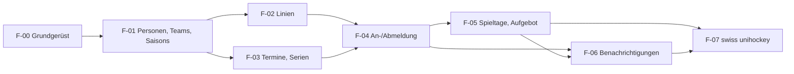

# Backlog

Die Features des Kerns in Umsetzungsreihenfolge. Jedes Feature ist ein Issue auf GitHub mit demselben Titel (`F-xx · …`). Der Entwicklungs-Agent nimmt nur Features, deren Voraussetzungen auf `main` sind.

Die Akzeptanzkriterien sind das, was der Test-Agent prüft. Szenarien `S…` stehen in [testdaten.md](../testdaten.md#szenarien-für-tests).

| Nr. | Feature | Voraussetzung | Anforderungen |
|---|---|---|---|
| F-00 | Grundgerüst | – | NF-01–NF-24, RR-05 |
| F-01 | Personen, Teams, Saisons | F-00 | PTF, SAI, RR-04 |
| F-02 | Linien | F-01 | LIN |
| F-03 | Termine und Serien | F-01 | TER |
| F-04 | An- und Abmeldung mit Übersicht | F-02, F-03 | ANM, RR-02, RR-03, RR-06 |
| F-05 | Spieltage und Aufgebot | F-04 | AUF |
| F-06 | Benachrichtigungen | F-04, F-05 | BEN |
| F-07 | Anbindung swiss unihockey | F-05, F-06 | SUH |



---

## F-00 · Grundgerüst

**Ziel:** Ein lauffähiges, leeres Gerüst, auf dem alle weiteren Features aufbauen. Es legt die Konventionen fest, an die sich spätere Läufe halten.

**Vorgaben für das Gerüst**, damit nicht jeder Lauf neu entscheidet:

| Punkt | Vorgabe |
|---|---|
| Backend-Sprache | Java 21 LTS (entschieden, E-57). In der Cloud vorinstalliert. |
| Migrationen | Flyway (entschieden, E-57) |
| Build | Maven im Backend, npm im Frontend und in `e2e/` |
| Anmeldung (O-01) | Sitzungs-Cookie. Im Profil `dev`/`test` Anmeldung über `/dev-login`. Produktives Verfahren folgt, sobald entschieden. |

**Struktur:**

```
backend/     Quarkus, Package pro Kachel unter ch.stvbero.platform.<kachel>, gemeinsamer Kern unter …kern
frontend/    Angular (Standalone, Signals), Feature pro Kachel, lazy geladen
e2e/         Playwright Test: tests/, plaene/, playwright.config.ts (Projekte mobil + desktop, channel chrome)
scripts/     db-start.sh (besteht), start.sh (alles starten), test.sh (alles testen)
.github/workflows/ci.yml   Build + Tests bei jedem PR
```

**Akzeptanzkriterien:**

1. `scripts/start.sh` startet aus einem frischen Klon Datenbank, Backend (Profil `dev`) und Frontend. Die App ist unter `http://localhost:4200` erreichbar.
2. `scripts/test.sh` führt Backend-Tests und E2E-Tests aus und endet mit Exit-Code 0.
3. `/dev-login` zeigt alle Seed-Personen aus testdaten.md (zunächst nur Personen, ohne Teams). Ein Klick meldet an und führt auf `/`.
4. `/` zeigt die Begrüssung mit Vornamen und die Kacheln aus `GET /api/kacheln`. Die Kachel «Anwesenheit» ist registriert und führt auf `/termine` (dort vorerst leerer Zustand).
5. Navigation mobil unten, ab 1024px links, nach navigation.md. Aktiver Eintrag mit `aria-current="page"`.
6. Design-Tokens aus design-grundlagen.md als CSS Custom Properties. Unter `/profil` lässt sich Hell/Dunkel/System umschalten, die Wahl bleibt nach Neuladen erhalten.
7. PWA: Manifest und Service Worker, installierbar.
8. Test-Endpunkte `reset`, `uhr`, `anmelden` funktionieren im Profil `dev`/`test` und fehlen im Profil `prod` (Test, der das prüft).
9. Ein Backend-Test vergleicht die von Quarkus erzeugte OpenAPI mit `docs/api/openapi.yaml` für alle bereits umgesetzten Pfade.
10. Die Uhr ist injiziert (`java.time.Clock`), `PUT /api/test/uhr` verändert «jetzt» für das ganze Backend.
11. CI-Workflow führt bei jedem PR Build und alle Tests aus.
12. Ohne Anmeldung leitet jede Route auf die Anmeldung und danach zurück.

---

## F-01 · Personen, Teams, Saisons

**Ziel:** Admins verwalten Personen, Teams, Teamzugehörigkeiten und Saisons. Alle sehen ihre Teams.

**Akzeptanzkriterien:**

1. Seed nach testdaten.md: Saisons, Teams, Personen, Teamzugehörigkeiten (noch ohne Linien).
2. Als `alex` unter `/verwaltung/personen` eine Person anlegen und bearbeiten.
3. Als `alex` unter `/verwaltung/teams` eine Person mit Funktion ins Team aufnehmen. Zweite Aufnahme derselben Person ins selbe Team wird abgelehnt (PTF-04).
4. Petra kann gleichzeitig Coach in Team 1 und Spielerin in Team 2 sein. `/teams` zeigt bei ihr beide Teams mit der jeweiligen Funktion (PTF-12).
5. `/teams/:id` zeigt Coaches und Spielerinnen getrennt. Coaches erscheinen nie in der Liste der Spielerinnen (PTF-07).
6. Als `alex` unter `/verwaltung/saisons` eine neue Saison mit Übernahme der Vorsaison anlegen und zur aktuellen machen (SAI-04, SAI-06).
7. Szenario S16: Archiv lesend sichtbar.
8. Verwaltungs-Screens und -Endpunkte sind für Nicht-Admins gesperrt (403, «Keine Berechtigung»).

---

## F-02 · Linien

**Ziel:** Coaches teilen ihre Spielerinnen in Linien und Goalies ein.

**Akzeptanzkriterien:**

1. Seed: Gruppen und Zuweisungen nach testdaten.md.
2. Als `petra` unter `/teams/<Team 1>/linien`: Linie hinzufügen, umbenennen, Reihenfolge ändern, löschen. Spielerinnen einer gelöschten Linie sind danach «ohne Linie».
3. Zuweisung per Drag & Drop **und** per Auswahlfeld (`zuweisung-<personId>`). Beides speichert sofort.
4. Szenario S15: höchstens eine Gruppe pro Spielerin und Team (LIN-02).
5. Lea hat in Team 1 und Team 2 verschiedene Linien (LIN-03).
6. Goalies existieren pro Team genau einmal und lassen sich nicht löschen.
7. Nur Coaches des Teams (und Admins) können Linien ändern. `anna` sieht die Einteilung lesend, `marc` kann Team 1 nicht ändern (403).

---

## F-03 · Termine und Serien

**Ziel:** Coaches erfassen Trainings, Anlässe und Serien, auch für mehrere Teams.

**Akzeptanzkriterien:**

1. Seed: Serien und Termine nach testdaten.md (Antworten folgen mit F-04).
2. `/termine` zeigt alle kommenden Termine der eigenen Teams chronologisch. `anna` sieht Termin 01 (Team 1 + 2), `tina` nicht.
3. Als `petra` einen Termin für Team 1 + Team 2 erfassen. Er erscheint bei Mitgliedern beider Teams (TER-01). Als `marc` kann Petra nicht für Team 1 erfassen (403).
4. Als `petra` eine Serie anlegen (wöchentlich, Zeitraum). Termine erscheinen für jede Woche im Zeitraum (TER-05).
5. Ausnahme für einen Zeitraum hinzufügen. Termine darin verschwinden bzw. werden abgesagt, wie in zustaende.md beschrieben (TER-07).
6. Einzelnen Termin einer Serie verschieben, ohne die Serie zu ändern (TER-06).
7. Szenario S13: abgesagter Termin ist erkennbar, mit Grund.
8. Antwortfrist pro Termin und Serie einstellbar, Standard 24 Stunden (TER-09, TER-10).
9. Filter `?team=` und Ansicht `?ansicht=vergangen` funktionieren und stehen in der URL.

---

## F-04 · An- und Abmeldung mit Übersicht

**Ziel:** Der Hauptgrund für die App. Alle melden sich mit einem Tap an oder ab, Coaches sehen die Übersicht nach Team und Linie.

**Akzeptanzkriterien:**

1. Seed: Antworten nach testdaten.md.
2. Szenario S1: Übersicht von Termin 01 genau wie in testdaten.md (Zähler, Gruppen, Reihenfolge, Coach-Block, Doppelrollen).
3. Szenario S2: Antwort mit einem Tap aus der Terminliste und aus dem Detail. Zähler aktualisieren sich ohne Neuladen.
4. Szenario S3: «vielleicht» ohne Kommentar nicht möglich, Fehlermeldung beim Feld.
5. «nicht dabei» bietet einen freiwilligen Grund an, der sich überspringen lässt.
6. Szenario S4: Kommentare nur für Coaches des Teams und die Person selbst, auch in der API-Antwort.
7. Szenario S5: kurzfristige Absage wird als solche markiert. (Die Benachrichtigung selbst kommt mit F-06. Hier: Feld `kurzfristig` korrekt.)
8. Szenarien S7 und S8: stellvertretend antworten, mit «eingetragen von», nur für eigene Teams.
9. Start-Screen zeigt den nächsten eigenen Termin mit Antwort-Buttons.
10. Antwort ist nach Neuladen unverändert. Abgesagte Termine nehmen keine Antworten an (409, Buttons deaktiviert mit Erklärung).

---

## F-05 · Spieltage und Aufgebot

**Ziel:** Spieltage in Turnierform mit Spielen, Treffpunkt, Spielort und Aufgebot.

**Akzeptanzkriterien:**

1. Seed: Termine 04 und 05 mit Spielen und Aufgebot nach testdaten.md.
2. Als `petra` einen Spieltag für Team 1 mit zwei Spielen, Treffpunkt, Hinweisen und Google-Maps-Link erfassen (AUF-10 bis AUF-16).
3. Termin-Detail zeigt Spiele nach Anspielzeit, Treffpunkt und den Link «In Google Maps öffnen» (öffnet in neuem Tab).
4. `/termine/<04>/aufgebot`: alle Spielerinnen von Team 1 nach Linien gruppiert, Antwortstatus daneben, auch «offen» und «vielleicht» auswählbar (AUF-21, AUF-22).
5. Szenario S9: Veröffentlichen mit Bestätigungsdialog. Danach sehen Spielerinnen «aufgeboten» bzw. «nicht aufgeboten». Vorher sehen sie «noch kein Aufgebot».
6. Szenario S11: Aufgebot-Screen nur für Coaches.
7. Coaches erscheinen nicht in der Auswahl des Aufgebots (AUF-28).
8. Resultat pro Spiel erfassbar (AUF-15).

---

## F-06 · Benachrichtigungen

**Ziel:** Die richtigen Leute erfahren rechtzeitig, was sich geändert hat. Zuerst in der App, weitere Kanäle später (BEN-10 offen).

**Akzeptanzkriterien:**

1. `/benachrichtigungen` zeigt eigene Benachrichtigungen, neueste zuerst. Ungelesene sind gekennzeichnet, die Anzahl steht in der Navigation (`benachrichtigungen-zaehler`).
2. Ein Klick führt zum Termin und markiert als gelesen (BEN-12).
3. Szenario S5: kurzfristige Absage benachrichtigt Petra, nicht Marc.
4. Szenario S6: Erinnerung an Personen ohne Antwort, genau einmal (BEN-01, BEN-13).
5. Szenario S9: Veröffentlichen benachrichtigt alle Spielerinnen des Teams (BEN-03).
6. Szenario S10: Abmeldung einer Aufgebotenen benachrichtigt die Coaches (BEN-04).
7. Änderung eines veröffentlichten Aufgebots benachrichtigt nur Betroffene (BEN-05).
8. Absage oder Verschiebung eines Termins benachrichtigt alle Mitglieder der beteiligten Teams (BEN-07).
9. Versand ist hinter einer Schnittstelle, damit E-Mail oder Push später dazukommen (BEN-11).

---

## F-07 · Anbindung swiss unihockey

**Ziel:** Spieltage kommen automatisch von swiss unihockey.

**Akzeptanzkriterien:**

1. Als `alex` Team 1 mit der swiss-unihockey-Team-ID verknüpfen und den Abgleich auslösen (SUH-02).
2. Im Profil `dev`/`test` spricht die App mit dem Simulator, im Profil `prod` mit `https://api-v2.swissunihockey.ch/api`. Der echte Client ist mit aufgezeichneten Antworten getestet (Fixture-Dateien), nicht live.
3. Spiele am selben Tag in derselben Halle werden ein Spieltag mit mehreren Spielen (SUH-04).
4. Szenario S12: Verschiebung wird übernommen, eigene Daten bleiben, Team wird benachrichtigt.
5. Spiel fehlt bei swiss unihockey: wird markiert, nicht gelöscht.
6. Simulator «nicht erreichbar»: Abgleich meldet den Fehler, nichts wird verändert, die App funktioniert normal (SUH-09).
7. Täglicher Abgleich als geplanter Job.
8. Die offenen Fragen O-20 bis O-24 sind, soweit ohne Zugangsdaten möglich, geklärt und in offene-punkte.md bzw. 06-swiss-unihockey.md nachgeführt.
