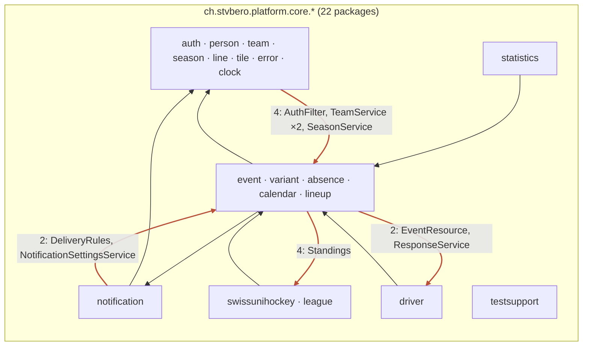
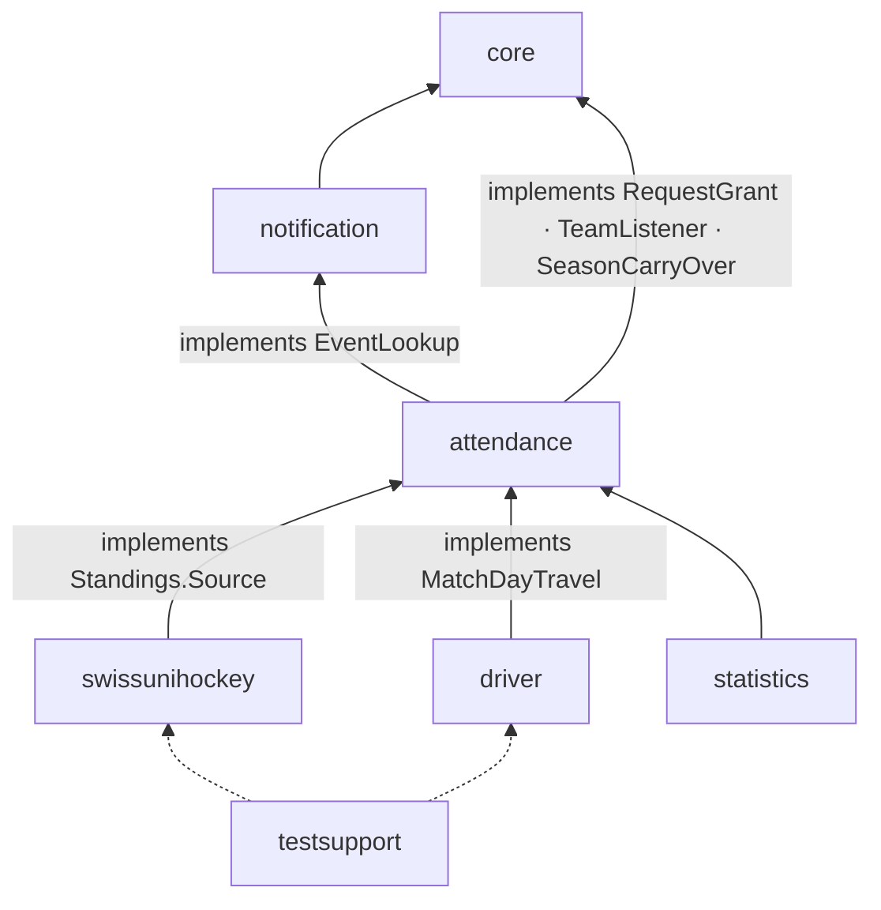
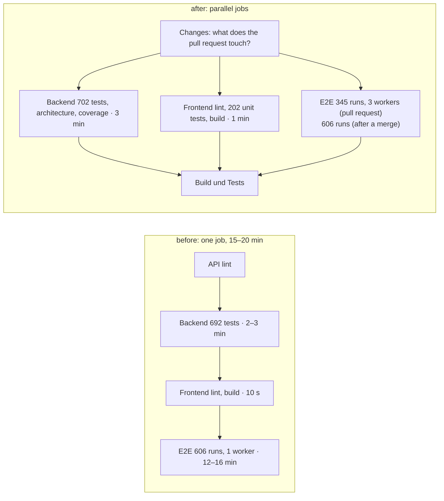

# Review 24.11.2026 · Modules, tests and quality

Why development got slower, what was changed about it on the branch `claude/modularization-quality`, and what is left. Based on pull request #86 (`a80743e`). The rules that came out of it are in [architecture.md](../architecture.md); the decisions are E-106 to E-108.

## Findings in short

| Question | Answer | Done on the branch |
|---|---|---|
| Why did it get slower? | Feedback: every change waited 15 to 20 minutes for one CI job, 80 % of it E2E tests that ran one after another, every test twice. Structure: every tile lived in `core`, 11 of 22 packages depended on each other in a circle, so no change was local. | see below |
| Is the focus on E2E tests right? | No. 44 % of the 303 E2E tests re-check rules, permissions and validations the backend already proves (96 % line coverage there). The frontend had no unit test at all, so every bit of browser logic was tested through the whole stack. E2E tests stay for what only the browser shows. | Unit tests for the frontend (Vitest, 202 tests in 2 s). E2E in parallel and on desktop only where the layout differs: 345 instead of 606 runs on a pull request, spread over several workers. Rule for new tests in architecture.md. |
| A mode that runs only the affected tests? | Yes, it follows from the modules. | `scripts/test-affected.sh`; `mvn quarkus:test` and `npm run test:watch` while typing. |
| Modules, layers or adapters in the backend, checked by ArchUnit? | Modules yes: that is where the damage was. Layers and adapters as packages no: the convention by class name (`…Resource`, `…Service`, `…Rules`, `…Api`) was already followed almost everywhere and is now a test. | 7 modules, 6 extension points, `ModulesTest`, `ConventionsTest`. |
| Split the projects, separate builds? | No. One repository, one Maven module, one Angular app: a feature changes contract, backend, frontend and tests in one pull request and ships as one container. Separate builds would cost more than the 3 minutes they could save. The CI is split into parallel jobs instead. | CI with jobs Backend, Frontend, E2E. |
| Does the code need optimizing? Metrics, quality gates? | No rewrite: no rot, conventions followed, one real bug found. The cost is in duplication and in a handful of classes that are too big. Gates yes, as tests in the repository, not as an external service. | Size limits with frozen lists, coverage minimum, module and convention tests. The findings below are open. |

## Measured before

- **CI:** one job, 15 to 20 minutes (three green runs of 24.11.: 15:19, 19:58, 20:17). In the run of #86: backend 2:04, frontend lint and build 0:10, E2E 11:53 for 606 test runs on one worker.
- **Tests:** backend 692 (261 pure unit tests, 431 REST tests), frontend 0, E2E 303 tests × 2 viewports = 606 runs. Backend coverage 95.9 % of the lines, 85.1 % of the branches.
- **Structure, backend:** 285 classes, 24 500 lines, all tiles below `ch.stvbero.platform.core`. 11 of 22 packages formed one cycle. Seen as the modules of today, 12 references in 8 classes pointed the wrong way; five of them were written with the full class name instead of an import, so no import list showed them.
- **Structure, frontend:** folders by place in the navigation (`pages/profile`, `pages/teams`, `pages/administration`), so one folder held code of three tiles and `core` imported from a tile.
- **Hot files** (changes in the last 200 commits): `docs/api/openapi.yaml` 35, `frontend/src/app/core/texts.ts` 33, the generated `schema.d.ts` 33, `docs/ui/navigation.md` 33, `docs/decisions.md` 31, `styles.css` 17, `app.routes.ts` 13, `Seed.java` 13. Every feature edits them, so parallel branches collide there.

## Backend: before and after

Before, as the modules of today would have seen it. Red: references from a lower to an upper module. Together they made `core`, `notification`, `attendance`, `swissunihockey` and `driver` one lump.

After. Every arrow is allowed by `modules.json`; the build fails on any other.

Where a lower module needed an upper one, it now declares an interface (an extension point) and the upper module implements it: the labels on the arrows. What changed in the code:

- 276 files moved, package names only: `core.event|variant|absence|calendar|lineup` → `attendance.…`, `core.swissunihockey` → `swissunihockey`, `core.league` → `swissunihockey.league`, `core.notification|driver|statistics|testsupport` → top level. The three tile definitions moved to their modules.
- Six extension points replace the 12 references (table in architecture.md). `EventResource` lost its `EntityManager`: the automatic departure is in `DepartureRefresh`.
- Behaviour is unchanged with two exceptions, both towards the documented convention: the carry-over of special line-ups takes the time from the `BackendClock` instead of `Instant.now()`, and league data that cannot be read is logged as a warning instead of being dropped silently.

## Frontend: before and after

```mermaid
flowchart LR
  subgraph before["before: by place in the navigation"]
    b1["attendance/ (30 files, with time.ts used by all)"]
    b2["pages/profile: absences, calendar subscription, notification settings, driving"]
    b3["pages/teams: league, special line-ups, lines"]
    b4["pages/administration: event variants, swiss unihockey link, people, teams"]
    b5["core/ imports attendance/time"]
  end
  subgraph after["after: by module, pages compose"]
    a1["attendance/ + absences, calendar subscription, special line-ups, event variants"]
    a2["notifications/ · swissunihockey/ · drivers/ · statistics/"]
    a3["core/ + time.ts · api/ · shell/"]
    a4["pages/: start, profile, teams, administration, assistants"]
  end
  before --> after
```

14 files moved, the URL `/termine/ueberarbeiten` kept. ESLint generates the import rules from `modules.json`. 202 unit tests in 18 spec files cover the logic that had none: dates including the change to summer time, formatting, the driver plan store (60 tests), fairness, warnings, statistics filters.

## Tests: before and after

| | Before | After |
|---|---|---|
| E2E runs on a pull request | 606 (303 × 2) | 345 (303 mobile + 42 `@desktop`) |
| E2E workers | 1, shared database | one backend and database per worker |
| E2E time on a machine with 2 cores, 2 workers | not possible in parallel | fast run 5.7 min, full run 9.9 min |
| E2E time in the CI (4 cores) | 12–16 min | not measured yet: the workflow runs with the first pull request. Expected from the numbers above: about 4 min for the fast run on 3 workers plus 1.5 min build |
| Feedback for a change in the driver list backend | everything, 15–20 min | `scripts/test-affected.sh`: backend tests of `driver` and `testsupport`, 4 of 38 specs |
| Frontend unit tests | 0 | 202, 2 s |
| Backend tests | 692 in 3:01 | 702 in 2:33 (10 architecture tests; test database without fsync) |

Nothing was removed from the E2E suite. The 134 tests that repeat backend cases are still there; trimming them is a follow-up, with the list per spec file from the analysis (examples: `f16-warnings` mirrors `WarningsTest`, `f17-league` mirrors `LeagueTest`, `f12-coach-rights` mirrors `CoachRightsTest`). 14 of them have no backend test with the same requirement ID and need a look before anything is deleted.

## Code review of the backend

Read-only review of all packages. Verdict: conventions B, correctness B−, authorisation A−, duplication C, tests B−. No TODO, no commented-out code, no endpoint without a permission check. Open findings, most important first; none is fixed on this branch except where noted.

| # | Kind | Where | What | Effort |
|---|---|---|---|---|
| 1 | Bug | `driver/DriverSwaps` (`accept`, `close`) | The check runs before the match day is locked and closing does not require the status «open»: two accepts at the same time answer 500 instead of 409. The swaps have no page since E-98, so only the API is affected. | S |
| 2 | Risk | `swissunihockey/SuSync.sync`, `league/LeagueService.refresh` | The request to swiss unihockey runs inside the database transaction that holds the lock on the team: a slow answer blocks a connection and the row. | M |
| 3 | Risk | `driver/DriverListService` (summary of the season) | Asks the routing service once per match day, without the limit of 12 the plan view has. | S |
| 4 | Risk | `attendance/event/EventReader` | Every event list loads all team memberships of the season, not only those of the listed teams; the list of past events has no limit. | S–M |
| 5 | Risk | `GET` of event, timeline, driver list, driver plan | Reading writes (automatic departure) and may call the routing service. | M |
| 6 | Risk | `core/auth/SessionService` | Sessions never expire. To decide together with the login (O-01). | M |
| 7 | Maintainability | 9 places in `attendance` and `driver` | «Members of the teams of the event, my roles, may I see or change it» is written 9 times. One `EventAccess` would shrink the big services. | M |
| 8 | Maintainability | `DriverListService` / `DriverPlanService` | Two copies of the context, the car query and the DTO assembly. | M |
| 9 | Maintainability | 105 native SQL statements in services | Tables without an entity (cars, passengers, responses, routes) are read in several classes. A repository class per table group. | L |
| 10 | Tests | 35 of 41 REST test classes, every E2E test | Every test resets the whole seed (truncate and insert row by row): 250 ms each, about 430 times per backend run, which is most of its test time. The test database now runs without fsync (160 ms, backend run 3:01 → 2:33). The bigger step is open: restore the seed from a copy, or reset once per class where a class only reads. | M |
| 11 | Tests | `DriverSwaps`, `EventGrants`, `SuSync.apply`, `EventReader` | Logic that is only covered through REST; that is how finding 1 stayed hidden. | M |

Fixed here because the new architecture tests demanded it: `Instant.now()` in `SeasonService`, the `EntityManager` in `EventResource`, the static lookup in `Standings`.

Frozen at their size, to be cut when they are next changed (how: per class in the review notes): `DriverListService` 707, `Seed` 691, `ClubSeed` 661, `DriverPlanService` 623, `SeriesService` 456, `SuSync` 424; in the frontend `driver-plan.ts` 930, `membership-table.ts` 890, `event-form.ts` 710 (complexity 34), `event-variants.ts` 630, `driver-list.ts` 570, `team-wizard.ts` 530.

Two bugs in the frontend came out of the new tests and are fixed on the branch:

- **Stale answers.** Found by the first parallel E2E run (`f15-statistics`, desktop): the pages with filters loaded on every change and showed whichever answer arrived last. Changing two filters quickly could leave the numbers of the earlier filter on the screen. The statistics of a team and of a person, the event list and the calendar now ignore an answer that is no longer the latest (as the people search already did). 23 other pages load the same way but only when their route changes; they are unchanged.
- **Filter from the address.** Found by a unit test: `statistics/statistics-common.ts` looked up «art» in a plain object, so `?art=constructor` put a function into the request.

## Not done, on purpose

- **The hot files.** `core/texts.ts` (1 750 lines, every feature edits it) should be split per module, `app.routes.ts` should only compose the routes each module exports, `openapi.yaml` could be split per tag. Each is its own change with its own conflicts with open branches.
- **`schema.d.ts` out of git.** It is generated and causes a conflict in every second branch, but the Dockerfile builds the frontend without generating it, and the Dockerfile changes only through an issue of its own. Marked as generated for GitHub's diff.
- **Extension point for the sections of the event page**, so the frontend of `attendance` no longer imports `drivers`. A redesign of the page, not a move.
- **Running only the affected E2E specs in the CI of a pull request.** Possible with the same script; left out so that the gate before the automatic merge stays the whole suite.
- **SonarCloud or another external gate.** The checks are tests in the repository: they run locally, for every agent, with the same result as in the CI.

## Verified

On the branch, on a machine with 2 cores: `scripts/test.sh --full` green in 14.5 minutes. In it: `mvn verify -Pcoverage` with 702 tests, coverage 95.9 % of the lines and 85.1 % of the branches; frontend lint, 202 unit tests, build; E2E full run on 2 workers with 600 passed and 6 skipped in 10.2 minutes, the same 600 and 6 as the CI run of #86. The E2E fast run alone: 344 passed and 1 skipped in 5.7 minutes.

Not verified: the new `ci.yml` on GitHub (the workflow runs with the first pull request of the branch, so the times of the CI in the table above are an estimate), and the container image (no Docker here; the job «Container image» checks it).
