# States and flows

State diagrams of the domain objects and sequence diagrams of the most important flows. The test agent derives test cases from them: every transition is a test case, and so is every transition that is not allowed.

Whoever changes the behavior updates the diagram in the same PR. Diagrams are [Mermaid](https://mermaid.js.org) and are rendered directly by GitHub.

State names in capitals (`PENDING`, `ATTENDING`, `PLANNED`, `DRAFT`, …) are the API values (English since F-10).

## Response of a person to an event

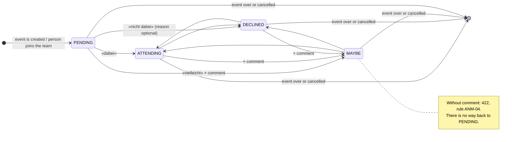

| Rule | Reference |
|---|---|
| Every change is allowed, also after the response deadline. | ANM-09 |
| A change **away from ATTENDING** after the response deadline sets `lateCancellation` and notifies the coaches. | ANM-10, BEN-02 |
| For a called-up player (published call-up), every withdrawal notifies the coaches, also before the deadline: from ATTENDING or PENDING to DECLINED or MAYBE, or from MAYBE to DECLINED (assumption F-06, O-49). If a late cancellation applies at the same time, only that one notification goes out. | AUF-26, BEN-04 |
| A late cancellation notifies once, on the change away from ATTENDING. Further changes that stay late do not notify again. Recipients are the coaches of the teams in which the person is a player for the event (O-17). | ANM-10, BEN-02 |
| The `lateCancellation` mark stays on further changes between DECLINED and MAYBE and is dropped with ATTENDING (assumption O-43). | ANM-10 |
| Every member of a participating team (any team role) may respond for themselves, otherwise 403. | ANM-01, RR-02 |
| Responses set on behalf of someone follow the same transitions and store `enteredBy`. Allowed for coaches (of any team) and admins, for any member of a participating team (RR-03, E-69). Otherwise 403; person in no participating team: 404. If the person then responds themselves, `enteredBy` is dropped. | ANM-11, ANM-12, RR-06 |
| Every response replaces the previous one completely, including the comment. In the UI, «nicht dabei» saves immediately and then offers the reason. | ANM-05, ANM-08 |
| After the event is cancelled or over, no more changes are possible (409). | TER-06 |

## Event

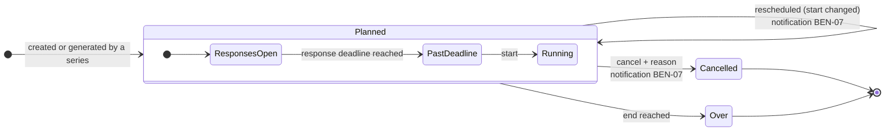

- Only `PLANNED` or `CANCELLED` is stored. "Past deadline", "running" and "over" follow from the backend clock.
- A reminder (BEN-01) goes out 12 hours before the response deadline to all members of the participating teams (any team role) with response PENDING, at most once per person and event (BEN-13, table `reminder`). After the deadline there are no more reminders. The 12 hours are an assumption (O-18). The check runs every minute; in tests immediately when the clock is set (`PUT /api/test/clock`).
- Cancelling and rescheduling (individually, or through an exception or change of the series that cancels an event with responses) notify all members of the participating teams (BEN-07). When rescheduling, also the members of teams that were removed in the process. A changed series time is not a rescheduling (O-41). A series event without responses that is removed by an exception or change of the series notifies nobody (assumption F-06, O-52).
- Rescheduling keeps all responses. Whether «dabei» still applies after a rescheduling is up to the person.

| Rule | Reference |
|---|---|
| An event belongs to the season its date falls into. It is visible to members (any team role) of a participating team in that season, to coaches and to admins, otherwise 403. | TER-13, RR-02 |
| Create, edit and cancel: admins and coaches (coach of at least one team in the current season), for every team (RR-03, E-69). Players: 403. | TER-01, TER-11, RR-06 |
| End before start, no team, match day with more than one team, unknown team or an event in the past: 400 with field. Event in an archived season: 409 (SAI-02). | TER-04, AUF-03 |
| Cancelled or past events can neither be changed nor cancelled again: 409, rule TER-06. | TER-06 |
| A different start time sets `rescheduled` (stays set afterwards). A series event changed this way no longer takes over later changes of the series. | TER-06 |
| Response deadline = start minus `responseDeadlineHours` (0 to 336, default 24). Outside this range: «Mindestens 0 Stunden.» or «Höchstens 336 Stunden (14 Tage).», in the form and in the API. | TER-09, TER-10 |
| List: upcoming = end after "now", ascending; past = end reached, descending. The team chips (E-111, `?teams=<id>,<id>`, the old `?team=<id>` as one team) show the user's own events in which one of these teams takes part (coaches and admins: all events of these teams, E-69); the own teams are on by default and the URL carries nothing then; the last team that is on stays on. A chosen team that is not one of the user's teams (e.g. a shared link) gets a chip as well, so that chips and list match. | TER-13, TER-24 |

## Series

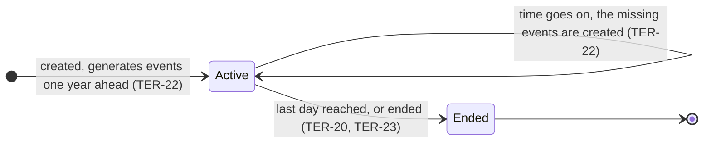

When an exception is added (e.g. holidays), the following applies to the affected future events:

- Event without responses: is removed.
- Event with responses: is cancelled, reason = reason of the exception. This way no response is lost and everyone is notified.

This is an assumption.

| Rule | Reference |
|---|---|
| Creating generates an event for every weekday in the validity period that has not started yet, up to one year from today. The last day is optional: without it the series runs on; a last day before the first one is refused (400). | TER-05, TER-22, TER-23 |
| As time goes on the events that are missing are created, so they always exist one year ahead: the days after the day up to which the series has its events (`eventsUntil`), up to its last day at most. A job runs every six hours (in test mode also right after the clock is set). Excluded days stay excluded; an event that was removed does not come back; a series is not ended by the end of its season. An upcoming event whose day lies outside its season (created before the season of its day existed) moves into the season of its day as soon as that season has all teams of the event. | TER-22 |
| An exception affects future **planned** events of the series whose date lies within the period (including individually rescheduled ones). Cancelled ones stay. | TER-07 |
| Changing affects only future events: planned events that were not changed individually take over the new details (responses stay, `rescheduled` is not set). New dates get an event. Events whose date no longer fits the series are removed or cancelled as with an exception (reason «Serie geändert»). Past, cancelled and individually changed events stay. | TER-08 |
| Permissions as for events. Viewing: members of the series' teams, coaches and admins (403). | TER-11, RR-06 |

## Call-up of a match day

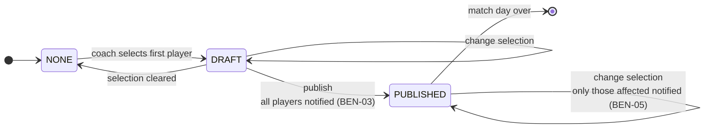

A player's view (`myCallUp`):

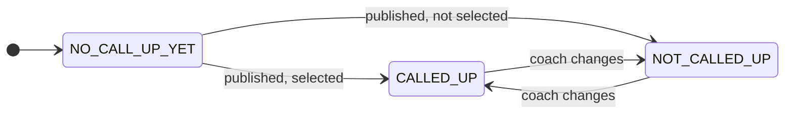

- As long as the call-up is a draft, only coaches see it (AUF-23).
- Any player of the team can be called up, regardless of her response (AUF-22).
- Called-up players do not confirm (AUF-25).

| Rule | Reference |
|---|---|
| Coaches of the team and admins may view, select and publish, otherwise 403. An event that is not a match day has no call-up (409, rule AUF-02). | RR-03, AUF-02 |
| Saving replaces the whole selection. Only players of the team, no coaches and nobody from outside: 422 with rule AUF-28. Empty selection in a draft: back to NONE. | AUF-22, AUF-28 |
| Only a draft with at least one player can be published, and only once (otherwise 409, rule AUF-23). After that it stays published, even if the coach changes the selection (assumption O-46). | AUF-23 |
| Before publication, people without coach permission see `callUpStatus: NONE` and `myCallUp: NO_CALL_UP_YET` (assumption O-45). `myCallUp` exists only for players of the team. | AUF-23, AUF-24 |
| Cancelled or past match day: selecting and publishing give 409 (TER-06), viewing works. Concurrent changes never give 500. | TER-06 |
| Publishing notifies all players of the team, each with «aufgeboten» or «nicht aufgeboten» (BEN-03). A later change notifies only those who are added or removed (BEN-05). Changes in a draft notify nobody. | AUF-24, AUF-27 |

## Attendance check of an event

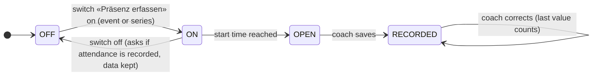

| Rule | Reference |
|---|---|
| The switch is off by default. A series passes it on to the events it creates or changes (only future, not individually changed events, TER-08); changing it on a single event makes the event individually changed. Missing in the request: off for new, unchanged for existing events and series. | PRS-01 |
| Recording only with the switch on (409 rule PRS-07), not for a cancelled event (409 rule PRS-09), only from the start time on (409 rule PRS-02). No end. Archived season: 409 (SAI-02). | PRS-02, PRS-07, PRS-09 |
| Coaches (any team) and admins see and save the list, everyone else 403. The list contains the players of the involved teams by team and line (as in the overview), no coaches (save with a coach or an outsider: 422 rule PRS-05). | PRS-05, PRS-10 |
| Without a recorded value the status is the preselection: ATTENDING → PRESENT, everything else → ABSENT. Looking at the list saves nothing. | PRS-03 |
| Saving sets the status of the given players, stores who and when, and keeps the values of players not in the request. The response is never changed. Concurrent saves never give 500. | PRS-04 |
| A player sees only their own recorded value (`myAttendance`), only while the switch is on. The overview contains no attendance. | PRS-06 |
| Switching the check off keeps the recorded attendance; the UI asks first if something is recorded (`attendanceRecorded`). | PRS-08 |

## Warnings

Warnings have no state of their own: they are computed on every request from responses (overview, event list) or the selection (call-up) and the minimums of the team (F-16, E-79).

| Rule | Reference |
|---|---|
| Per team of the event, with its minimums (defaults 1 · 10 · 6 · 3, `0` = off): fewer goalies than the minimum (`GOALIES`), fewer field players than the minimum for the event type (`FIELD_PLAYERS`; all players outside the goalies, including «Ohne Linie»), a line with at least one but fewer players than the line minimum (`LINE`). Order: goalies, field players, lines by order. | ANM-40, ANM-46 |
| Counted: «dabei» in the overview and the event list (`warningCount`), selected in the call-up. | ANM-40, AUF-30 |
| Only practices and match days that are planned and not over (end after «now»). Cancelled, past and other events: no warnings (empty list, `warningCount: 0`). | ANM-42 |
| Only coaches and admins get warnings and the minimums; for players the fields are missing. Changing the minimums: coaches and admins (`PUT /api/teams/{teamId}/warning-minimums`), otherwise 403; values outside 0–99: 400. | ANM-41, ANM-43 |
| Publishing a call-up with warnings is allowed; the dialog repeats them. | AUF-31 |

## Statistics

The statistics have no state of their own: they are computed on every request from responses and attendance (STA, F-15).

| Rule | Reference |
|---|---|
| An event counts if it belongs to the team, lies in the season and the period, has started (backend clock) and is not cancelled; optionally only one type. A player counts only for events on or after her day of joining (`joinedOn`). | STA-02, STA-07 |
| Response counters use the current response (none: «offen»). Late cancellations are the stored flag of ANM-10 (cleared when she changes back to «dabei»). | STA-03 |
| Attendance counts only for events with the check on and recorded attendance, and only where a value is stored for the player. Values kept while the check is off (PRS-08) do not count. | STA-04 |
| Team statistics: coaches and admins, otherwise 403. Statistics of a person: herself, coaches and admins, otherwise 403. Period outside one season or end before start: 400. | STA-01, STA-02, STA-08 |

## League data (F-17)

The league data of a linked team is a cache (`league_snapshot`), filled by the daily sync (04:30, after the matches) and by an admin with «Neu laden». The league page only reads the cache and never calls swiss unihockey.

| Rule | Reference |
|---|---|
| A successful load replaces league, group, table and matches of the current season and sets «Stand» (`loadedAt`). Data of an earlier season does not count: after a season change the page shows «noch keine Daten» until the next load. | F-17 |
| A failed load (not reachable, unexpected answer) changes no data and only stores the time of the attempt (`failedAt`); the page shows the last data with a notice. The next successful load clears `failedAt`. The manual reload answers 502 (rule SUH-09) with «… Es werden weiterhin die zuletzt geladenen Daten angezeigt.», or «… Bitte später nochmals versuchen.» if nothing was loaded yet; the daily run tries again the next day; a failing team does not hold up the others. | SUH-09 |
| Own team in the table: the row with the linked team ID; without team IDs the name the team has in the matches, otherwise the name in the app. | F-17 |
| «Kommende Spiele»: matches without a result that have not ended (start + 75 minutes after «now»), the next five. «Letzte Resultate»: the last five with a result. A match links to the match day of the team in the app that contains it (same SU match ID). | F-17 |
| Reading: members of the team in the current season, coaches and admins (403 otherwise). Reloading: admins (403); a team without link or outside the current season: 409. | F-17, RR-07 |

## Calendar subscription (F-18)

A person has no address until her first visit of «Profil» (`GET /api/me/calendar` creates it), then exactly one. «Adresse erneuern» replaces the token; there is no state «switched off».

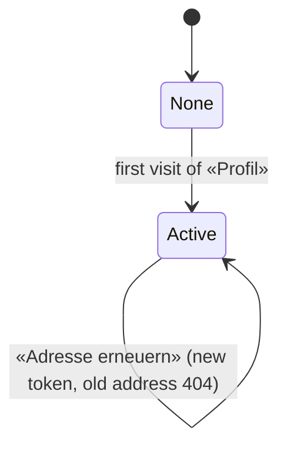

| Rule | Reference |
|---|---|
| `GET /api/me/calendar` returns the same address on every call until it is renewed; two first calls at the same time create one address. Without login 401. | CAL-01 |
| The feed is public and needs only the token; a wrong, malformed or renewed token gives 404. The token is no session: as `stv_session` it gives 401. | CAL-06, CAL-07 |
| The feed is built anew on every call from the current data and the backend clock: events of the own teams (member in the season of the event) that ended after «now» minus 30 days, chronologically, cancelled ones with `STATUS:CANCELLED`. A changed or moved event keeps its `UID`. | CAL-02, CAL-04 |
| The feed shows only the own response and the own comment, never those of others. | CAL-08 |

## Driver list of a match day (F-20)

The list itself has no stored state; it follows from the match day. The route of a match day is stored with the places it was calculated for.

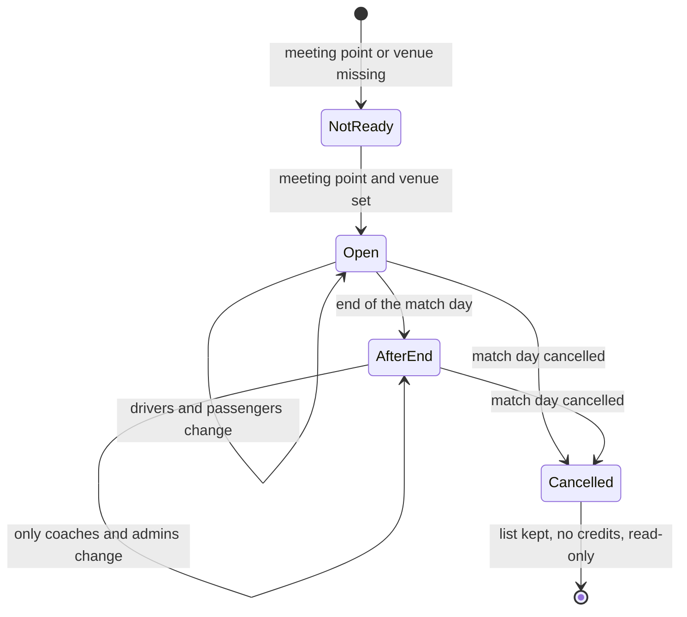

Route of a match day:

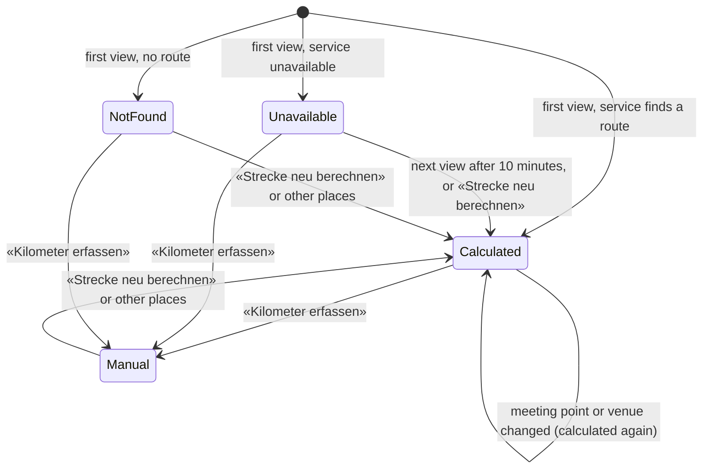

| Rule | Reference |
|---|---|
| Not a match day: 409 (rule DRV-01). Meeting point or venue missing: the list shows what is missing; every change gives 409 (rule DRV-01). | DRV-01 |
| Every change locks the match day (`select … for update`): two concurrent requests for the last seat give one 200 and one 409, never a 500 and never an overfull car. A person never ends up in two cars. | DRV-02, DRV-03 |
| Entering the same passenger into the same car again changes nothing and notifies nobody. Leaving a car one does not sit in: 404. | DRV-03 |
| A passenger who becomes driver leaves her seat; a driver cannot ride along (422). A car removed takes its passengers out. | DRV-02, DRV-03 |
| After the end of the match day members get 409 (rule DRV-02), coaches and admins can still correct the list. Cancelled: 409 for everyone (rule DRV-10). Archived season: 409. | DRV-02, DRV-10 |
| The routing service is called outside the transaction; the result is stored per match day with its places. A stored route is used as long as the places are the same, except «unavailable», which is retried after 10 minutes. A cancelled match day is not calculated again. | DRV-05, DRV-07, DRV-08 |
| Credits are not stored: they follow from the cars, the route and the status of the match day on every read. | DRV-05, DRV-09, DRV-10 |
| Notifications go out in the transaction of the change, to the people affected but never to the person who made the change. | DRV-11 |

## Match of a match day

| Rule | Reference |
|---|---|
| Matches have an opponent, start time, home/away and optionally a result home:away (e.g. 5:3). The API returns them ordered by start time. | AUF-14, AUF-15 |
| Coaches of the team and admins may create, change and delete them (403). Only for match days (409, rule AUF-01). | TER-11, RR-06 |
| The start time lies on the day of the match day (400 on the field `startTime`). When changing a match, this only applies to a new start time, so the result can always be entered. If the match day is moved to another day, manually entered matches move with it. If it has matches from swiss unihockey, it can only be moved within the same day (422 on the field `start`, rule SUH-05); their date comes from swiss unihockey (assumption O-48). | AUF-01, SUH-05 |
| Adding and deleting only while the match day is planned and not over (409, TER-06). Changing, e.g. the result, also afterwards; only a cancelled match day gives 409 (assumption O-47). | AUF-15, TER-06 |
| Matches from swiss unihockey: opponent, start time and home/away are read-only; deleting only when swiss unihockey no longer delivers them (409, rule SUH-06). The result can be entered. | SUH-06 |
| A match day with matches or a call-up cannot be changed to another type (409, rule AUF-01). | AUF-01 |

## Match from swiss unihockey

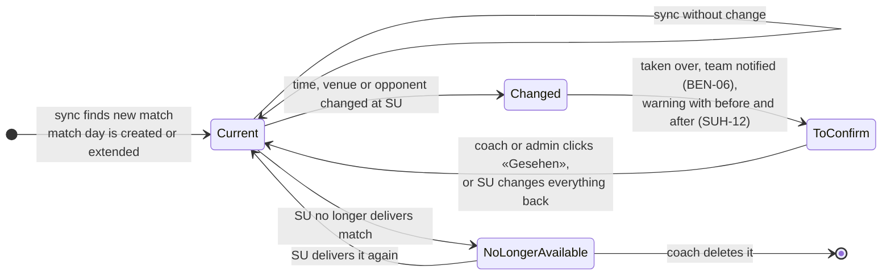

- The sync only overwrites imported fields: opponent, start time, home/away, venue, result. Meeting point, notes, responses and call-up stay untouched (SUH-06).
- Matches of the same team on the same day in the same hall form one match day (SUH-04). A new match joins an existing imported match day with the same day and the same hall, otherwise a new match day «Spieltag» is created. Manually created match days never get matches from the sync (SUH-10).
- Start and end of an affected match day follow its matches: start is the first start time, end is the last plus the match duration of the team (TML-02, default 50 minutes; 75 minutes before E-85). If this changes the start, the match day counts as rescheduled.
- If matches move to another day or another hall, the sync looks at all matches of a match day together: if none stays on the previous day in the previous hall (e.g. a whole tournament one week later), the match day moves with all its matches (new venue and time; meeting point, notes, responses and call-up stay, assumption F-07). If the matches go to different targets, it moves to where most of them go, on a tie to the earliest match. The remaining matches move to the matching or a new match day. If at least one match stays, the match day stays too. A day and a hall always belong to at most one imported match day (SUH-04).
- All members of the team are notified (BEN-06), once per match day and sync, if time, hall, opponent or home/away of a match changed and the match day is planned and not over. A new result (SUH-08) or a «nicht mehr vorhanden» mark does not notify.
- A changed match keeps the values it had before the first unconfirmed change (`suChange` of the match: time, hall, opponent, home/away, each with before and after). Coaches and admins see the warning in the event list (`warningCount`), in the overview (`MATCH_CHANGED`) and on the match, until one of them confirms it (`POST /api/events/{eventId}/matches/{matchId}/confirm-su-change`). A second change before that keeps the first «before»; if swiss unihockey changes everything back, the warning disappears by itself. Only match days that are planned and not over get the warning (SUH-12).
- A match that swiss unihockey lists as «Abgesagt» (no date, hall «???») counts as no longer delivered.
- A team can have several links in a season; the sync takes the matches of all of them (SUH-11). If the last link of a team is removed, the imported matches of its upcoming match days are marked «nicht mehr vorhanden».
- A match day created by the sync starts with the usual meeting point of the team and no meeting time (AUF-32); its end is the last start plus the match duration of the team (TML-02, default 50 minutes).
- After every sync the links remember when it ran and whether it worked (SUH-13).
- A match «nicht mehr vorhanden» (no longer available) stays until the coach removes it: in `/termine/:id/bearbeiten` with «Spiel <n> entfernen» and «Änderungen speichern» (`DELETE /api/events/{eventId}/matches/{matchId}`). Imported matches that swiss unihockey still delivers cannot be removed (SUH-06, #44).
- The sync only overwrites the result if swiss unihockey delivers one; a manually entered result stays otherwise (O-47).
- If swiss unihockey cannot be reached or delivers something unexpected, nothing changes. The manual sync reports it (502, rule SUH-09) and the link shows the failed attempt (SUH-13), the daily run (04:30) tries again the next day; a failing team does not hold up the others (SUH-09).
- The current season is synced. A team without a link or outside the current season: 409.

## Notification

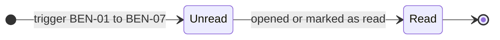

| Rule | Reference |
|---|---|
| Every person sees only their own notifications, newest first. Marking someone else's as read: 403. Marking several times changes nothing. | RR-07 |
| A click on a notification marks it as read and opens the event. | BEN-12 |
| Whoever triggers something is not notified about it (e.g. the coach who cancels; assumption F-06, O-50). | BEN |
| The list in the app always exists. E-mail and push receive the same messages through the `Channel` interface (F-19). | BEN-10, BEN-11, BEN-14, E-56 |
| E-mail goes to persons with an e-mail address who did not switch it off (default: on). Push goes to every device the person registered. At most one e-mail and one push per device per notification. | BEN-15, BEN-20 |
| Registering the same device again updates it (one device). Concurrent registrations or removals of the same device, or concurrent changes of the e-mail switch, never give 500 (a second removal gives 204 or 404). | BEN-15, BEN-16 |

### Delivery (e-mail or push, F-19)

Every e-mail and every push is recorded in the transaction of the change (outbox) and sent right after the commit; the scheduler checks every minute for due retries. A failure never rolls back the change.

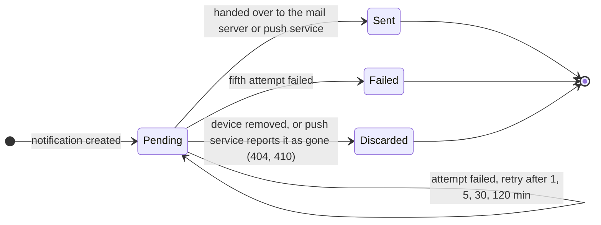

| Rule | Reference |
|---|---|
| A push subscription the push service reports as gone is removed; the person sees push off on that device. | BEN-19 |
| In `dev` and `test` nothing goes out: the simulator accepts every delivery (or fails on purpose with `PUT /api/test/delivery`). | BEN-21 |

## Season

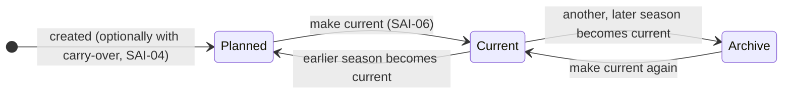

| Rule | Reference |
|---|---|
| There is always exactly one current season. If `season` is not given, it applies. | SAI-03 |
| If no season is current (yet), e.g. in a fresh installation without seed, `GET /api/me` and every request without `season` answer 409 «Keine aktuelle Saison» (rule SAI-03). The UI then redirects every route to the notice `/keine-saison`. It shows the notice only in this state: opened directly without login, it goes to the login; with a current season, on to the target. | SAI-03 |
| "Archive" is every season that starts before the current one. Teams and memberships in it are read-only: changing gives 409 with rule SAI-02. | SAI-02 |
| A new season is "planned" first and can be adjusted before it becomes current. | SAI-04 |
| Carry-over copies teams, team memberships and lines with names, order and assignments. The source stays unchanged. | SAI-04, LIN-11 |
| Name already taken or period overlaps with another season: 409. Two concurrent requests (double click) also give 201 and 409, never 500. End before start: 400. | SAI-01 |

## Absences

| Rule | Reference |
|---|---|
| Entering an absence declines every upcoming practice of the person's teams that touches one of its days: «nicht dabei» with «Abwesend: <Grund> · <Bemerkung>». An own «nicht dabei» stays, «dabei» and «vielleicht» are replaced. The response remembers the absence (`response.absence_id`). | ABS-03 |
| Creating, moving or changing the teams of a practice, a series or a team membership applies the absences again: covered practices without a response are declined, practices no longer covered lose a response set by an absence («offen»). A response given by hand is never touched and no longer belongs to the absence. | ABS-04 |
| Changing an absence reopens what it no longer covers and declines what it covers newly (also over «dabei»/«vielleicht»). Deleting reopens its upcoming practices; past ones keep «nicht dabei». | ABS-05 |
| Overlapping absences: 409. Last day before the first or completely in the past, more than a year: 400. «Anderes» without a note: 422. Someone else's absence: 404. | ABS-02, ABS-01 |

## Team membership

| Rule | Reference |
|---|---|
| Exactly one team role per person, team and season. A second admission gives 409 with rule PTF-04, even if both requests arrive at the same time. Changing the team role goes through «Funktion ändern». | PTF-04 |
| Coaches are never listed among the players. | PTF-07 |
| Removing deletes only the membership; the person stays. | PTF-01 |
| Only admins manage people, teams, memberships and seasons (403). Only its members and admins see a team (403). | RR-04, RR-07 |
| The admin permission cannot be taken away from the last person who has it (409, rule RR-04). | RR-04 |

## Lines

| Rule | Reference |
|---|---|
| Lines and goalies belong to a team in a season. The API always works with the current season; the archive shows its assignment unchanged. | LIN-03, LIN-11, SAI-02 |
| Every team has exactly one group «Goalies» per season. It is created with the team (or when the team enters a season) and can be neither deleted nor renamed nor moved (409, rule LIN-05). | LIN-05 |
| A player is in at most one group per team. A new assignment replaces the previous one; `groupId: null` means "no line". Two concurrent assignments never give 500. | LIN-02, LIN-06 |
| Only people with team role "player" in the team can be assigned (otherwise 409, rule LIN-10). If a player becomes coach, she loses her assignment. | LIN-10 |
| A new line without position goes to the end. Moving and deleting renumber the lines (1, 2, …, without gap). The UI suggests «Linie n» with the next free n. | LIN-09 |
| Names are unique per team, case-insensitive, also against «Goalies» (409, rule LIN-09). When renaming, the message appears at the name field and the focus stays in the field. | LIN-09 |
| If a line is moved to the edge with "up"/"down", the focus goes to the opposite button of the same line (the pressed one is disabled afterwards). | LIN-09 |
| Deleted line: its players are «Ohne Linie» afterwards. | LIN-06 |
| Coaches of the team and admins may change (otherwise 403); all members of the team and admins may view. | LIN-07, RR-03, RR-07 |

## Forms

| Rule | Reference |
|---|---|
| While a request is running, the submit button is disabled and further clicks (also a double click) do not trigger a second request. | – |
| Applies to every writing action, not only to forms: login at `/dev-login`, logout, rename, add, remove, create a season and make it current, save a person, add, rename, move, delete and assign lines, save event and series, cancel an event, add an exception, select the call-up (all checkboxes disabled) and publish it, save a result. The clicked button has `aria-busy="true"` during the request, similar buttons next to it are `disabled`. If the request fails, they can be used again. | Follow-up fix #14 |

## Session

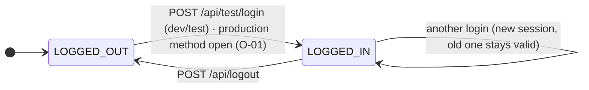

| Rule | Reference |
|---|---|
| Without a valid session, all domain endpoints answer 401 (Problem Details). Only `GET /api/session`, `POST /api/logout` and the test endpoints are public. | RR-07 |
| `GET /api/session` always answers 200 with `signedIn: true/false`. | F-00 |
| Logout deletes the session and the cookie, 204 also without a valid session. Idempotent: several (also concurrent) logouts with the same cookie all answer 204, never 500. | F-00, follow-up fix #26 |
| A session does not expire (assumption, O-33). | O-01 |

## Flows

### Login and redirect back

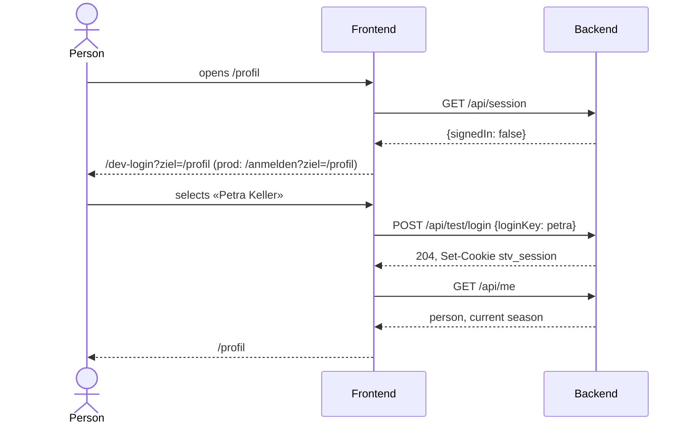

### Responding with one tap

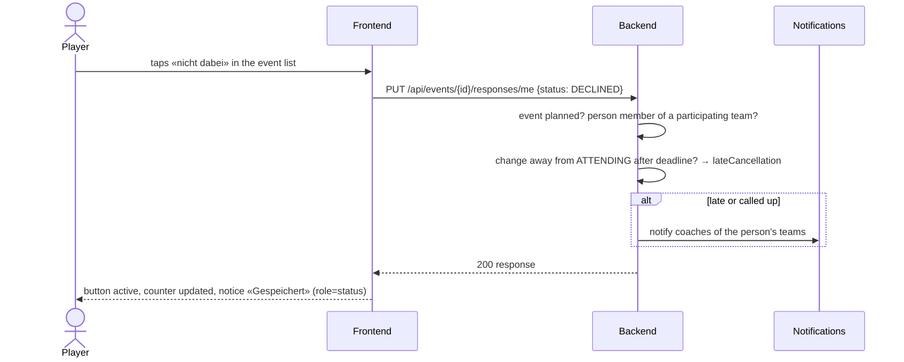

### Publishing the call-up

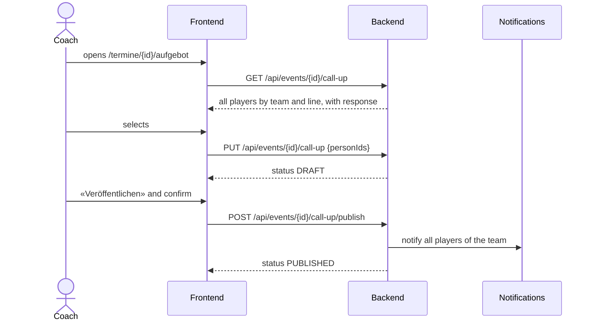

### Sync with swiss unihockey

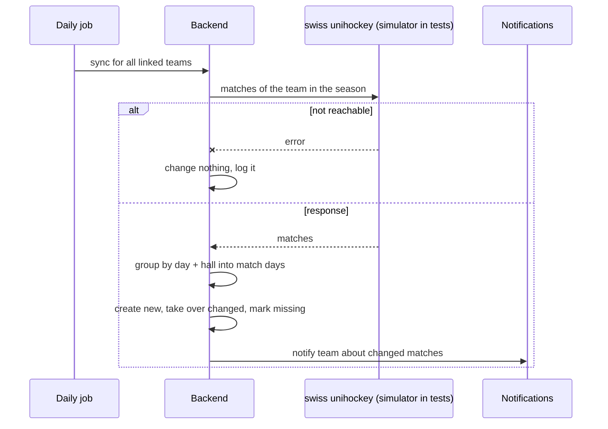
