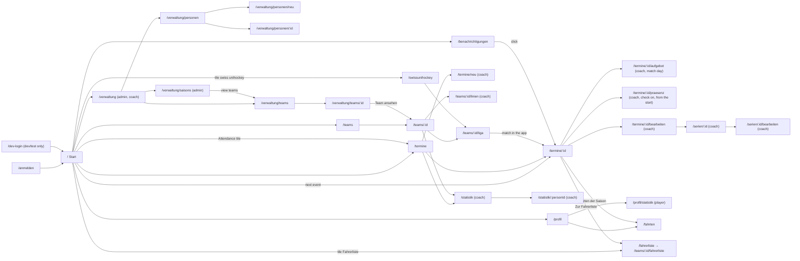

# Navigation and screens

Map of the UI for humans and agents. The test agent uses it to jump straight to the right place by URL. Whoever changes a route or a fixed test ID updates this file in the same PR.

Status: target state for the core. The column «Feature» states with which feature from the [backlog](../pipeline/backlog.md) a screen arrives. Built are F-00 (foundation: `/anmelden`, `/dev-login`, `/`, `/termine` as empty state, `/profil`), F-01 (`/teams`, `/teams/:id`, `/verwaltung` with people, teams and seasons), F-02 (`/teams/:id/linien`, `/teams/:id` by line), F-03 (`/termine` with filters, `/termine/neu`, `/termine/:id` with details, `/termine/:id/bearbeiten`, `/serien/:id`, `/serien/:id/bearbeiten`), F-04 (responses in `/`, `/termine` and `/termine/:id`, overview by team and line), F-05 (match day in the form with matches, meeting point and Google Maps link; matches, results and call-up status in `/termine/:id`; `/termine/:id/aufgebot`) and F-06 (`/benachrichtigungen`, bell with counter in the navigation). F-14: switch «Präsenz erfassen» in the event and series form, section «Präsenz» in `/termine/:id`, `/termine/:id/praesenz`. F-12: coaches (coach of at least one team in the current season) see «Verwaltung» and manage all teams; delete actions, «Saisons», swiss unihockey and the admin checkbox stay with admins (RR-03, RR-08). F-15: `/statistik`, `/statistik/:personId`, `/profil/statistik`, link «Statistik» in `/termine` and `/teams/:id`, section «Meine Statistik» in `/profil`. F-16: warnings in the overview of `/termine/:id`, in `/termine/:id/aufgebot` and its confirmation dialog, marker «<n> Warnungen» in `/termine`, section «Warnungen» with the minimums in `/teams/:id` (coaches and admins only). F-17: section «Liga» in `/teams/:id`, `/teams/:id/liga`. F-18: section «Kalender abonnieren» in `/profil`. F-19: section «Benachrichtigungen» in `/profil`. F-20: section «Fahrerliste» in `/termine/:id` for match days, `/fahrten`, section «Meine Fahrten» in `/profil`. E-93: part «Was im Kalender erscheint» in «Kalender abonnieren» (`/profil`). E-94: checkbox «Grund bei «nicht dabei» verlangen» in the dialog of a variant; with it, «nicht dabei» asks for the reason first. E-95: «Sonderberechtigungen» in «Angaben» of `/termine/:id` and as a section of `/serien/:id`.

## Navigation

- **Mobile:** bottom navigation with «Start», «Termine», «Teams», «Profil». Admins and coaches also see «Verwaltung» (F-12).
- **Desktop (from 1024px):** the same entries as a side navigation on the left.
- **Notifications (F-06):** its own link in the navigation, outside the list of main entries. On mobile a round bell at the top right in a fixed header, the content scrolls underneath (name «Benachrichtigungen», label for screen readers only); from 1024px an entry «Benachrichtigungen» above «Start». With unread notifications it shows the number (`notifications-counter`), and the name then reads e.g. «Benachrichtigungen 2 ungelesen». The counter is reloaded on every page change.
- **Desktop, coaches (E-91):** below the main entries a list «Meine Teams verwalten» (`nav-manage-teams`) with one entry «<Team> verwalten» per team the person coaches in the current season (`nav-manage-team-<id>`, to `/verwaltung/teams/:id`). Not on mobile.
- The active entry has `aria-current="page"`.
- The navigation is a `nav` with `aria-label="Hauptnavigation"`.
- Order: «Start», «Termine», «Teams», «Profil», («Verwaltung»). Page title in the browser: «<Seite> · STV Bero».

## Routes

| Route | Screen | Who | Content | Feature |
|---|---|---|---|---|
| `/anmelden` | «Anmelden» (login) | everyone | Login (method open, O-01). In test mode link «Zur Anmeldung im Testmodus». `?ziel=` is passed on | F-00 |
| `/dev-login` | «Testmodus-Anmeldung» (test mode login) | only `dev`/`test` (development build) | List of seed persons (`GET /api/test/persons`); one click logs in and leads to `?ziel=` or `/` | F-00 |
| `/` | «Start» | logged in | Greeting, own next event with response buttons and counter, then «Nächster Spieltag» if the next event is not a match day (AUF-35, `next-match-day`), then «Weitere Trainings» until at least two upcoming practices are visible (cancelled ones skipped), link «Alle Termine», tiles depending on role | F-00, F-04, F-13 |
| `/termine` | «Termine» (events) | logged in | Link «Kalender» to `/termine/kalender` (KAL-01). Coaches and admins: link «Statistik» (F-15). Upcoming events of all own teams by month, switch «Kommend»/«Vergangen» (`nav` «Ansicht», `?ansicht=vergangen`), select «Team» (`?team=<id>`; coaches and admins choose from all teams of the season and then see that team's events, F-12), coaches and admins: link «Termin erfassen». From F-04 own response can be changed directly, only on events of own teams (events of other teams show no «Meine Antwort», F-12) | F-03, F-04 |
| `/termine/:id` | «Termin» (event) | members of the teams involved, coach, admin | Details (date, time, teams, location, meeting point, response deadline, notes, series), status «Abgesagt: <Grund>» or «verschoben», coaches: «Termin bearbeiten», «Serie ansehen». From F-04: own response, overview by team and line, coach block. For a match day from F-05: matches, own call-up status. From F-14 with the switch «Präsenz erfassen» on: coaches and admins see the section «Präsenz» (before the start only «Die Präsenz lässt sich ab Beginn des Termins erfassen.», from the start «Noch keine Präsenz erfasst.» / «Präsenz ist erfasst.» and the link «Präsenz erfassen» / «Präsenz korrigieren»); players with a recorded value see «Deine Präsenz» . For a match day from F-20 the section «Fahrerliste» (`driver-list`, below the matches): without meeting point or venue only «Die Fahrerliste ist bereit, sobald Treffpunkt und Spielort erfasst sind. Es fehlt: …» (coaches also «Ergänze die Angaben unter «Termin bearbeiten».»); otherwise «Strecke» (route, distance and driving time, chips «von Hand erfasst» and «Fahrzeit angepasst», «So wird die Fahrzeit berechnet», credit per car; coaches and admins: «Kilometer erfassen», «Fahrzeit anpassen», «Automatisch berechnen», «Strecke neu berechnen»), then «Autos» with only «<n> Plätze für <m> Personen» (`driver-seat-summary`, without those who travel on their own) and the button «Plätze zuweisen» (`driver-assign`, everyone of the team) that opens the cars as bubbles (`seat-board-<eventId>`, DRV-32: tap a person, then «<Vorname> hier einsteigen»; «<Name> austragen» with a question if the car has passengers; seats per car; «Fahrerin oder Fahrer hinzufügen»; «Alle verteilen»), «Reist individuell an» (list, «Ich reise individuell an»), «Zur Fahrerliste» (`driver-plan-link`) and «Fahrten der Saison». Cancelled: notice, no credits, the cars only to look at («Autos zeigen»). Feedback as `role="status"` (E-96) | F-03, F-04, F-05, F-14, F-20 |
| `/termine/kalender` | «Kalender» (calendar view) | logged in | Links «Abwesenheiten» and «Liste». Group «Teams» with one checkbox per team (`calendar-teams`, `?teams=<id>,<id>`, at least one stays chosen), «Meine Teams» back to the default, «Alle Teams» for coaches and admins (`?alle=ja`). Card with the month (`h2` «November 2026», `‹`/`›` «Vorheriger Monat»/«Nächster Monat», «Heute», `?monat=`), a table Mo–So, one link per day (name «Di 17.11.: 2 Termine[, abwesend]», `aria-current="date"` on the chosen day, `?tag=`). Card of the chosen day: «Du bist abwesend: …» and the events with time, place, teams, variant and the own response. Players see only their teams («Keine Berechtigung» otherwise) | KAL (E-92) |
| `/termine/neu` | «Termin erfassen» (create event) | coach, admin | Choice «Einzelner Termin» / «Serie (jede Woche)» (`?art=serie`), type (Training, Spieltag, Anlass), title, date or weekday and period, start, end, teams (checkboxes), location, Google Maps link, notes, response deadline, checkbox «Präsenz erfassen» (off by default, F-14). For «Spieltag»: location is called «Spielort», group «Treffpunkt» (time, place), group «Spiele» with one group «Spiel n» each (opponent, start time, «Heim oder auswärts», «Spiel n entfernen») and «Spiel hinzufügen» | F-03, F-05 |
| `/termine/:id/bearbeiten` | «Termin bearbeiten» (edit event) | coach (any team), admin | Change details, postpone (other date or other time), «Termin absagen» (dialog with reason). For series events notice «gilt nur für diesen Termin». Switching «Präsenz erfassen» off while attendance is recorded asks «Präsenz ausschalten?» («Ausschalten und speichern», «Abbrechen»; F-14). Match day: matches as when creating; matches from swiss unihockey read-only; if swiss unihockey no longer delivers a match, it shows «swiss unihockey liefert dieses Spiel nicht mehr.» and the button «Spiel <n> entfernen» (#44) | F-03, F-05 |
| `/termine/:id/aufgebot` | «Aufgebot» (call-up) | coach (any team), admin (otherwise «Keine Berechtigung»; not a match day: «Nur ein Spieltag hat ein Aufgebot.») | Status (`call-up-status`, `call-up-count`), selection grouped by lines (one group each with the group name, checkbox with the player's name, response status and comment next to it), saves immediately (feedback «<Name> ist aufgeboten.»), «Veröffentlichen» with confirmation. Coaches are not in the selection (AUF-28). Cancelled or past: read-only | F-05 |
| `/termine/:id/praesenz` | «Präsenz erfassen» (attendance check) | coach (any team), admin (otherwise «Keine Berechtigung»; check off, cancelled: «Für diesen Termin lässt sich keine Präsenz erfassen.»; before the start: «Die Präsenz lässt sich ab Beginn des Termins erfassen.») | State (`attendance-state`: «Noch keine Präsenz erfasst.» or «Zuletzt gespeichert von <Name> am <Datum> <Zeit>.»), players of the involved teams by team (`h3` with the team name, teams by name as in the overview) and within the team by line (`h4` with the group name; a player in two teams appears in both, with one status), each with response status, comment and a radio group «Präsenz von <Name>» with «anwesend», «abwesend», «entschuldigt». Preselection: «dabei» → «anwesend», otherwise «abwesend». Summary «4 anwesend · 3 abwesend · 0 entschuldigt», «Noch nicht gespeichert.» after changes, button «Präsenz speichern» (feedback «Die Präsenz ist gespeichert.»). Coaches are not in the list (PRS-05) | F-14 |
| `/serien/:id` | «Serie» (series) | members of the teams of the series, coaches and admins (coaches and admins with editing) | Rule, period, teams (all teams of the series, including those one is not in), response deadline, exceptions (list and form «Ausnahme hinzufügen»), link «Serie bearbeiten», section «Sonderberechtigungen» (RR-10, E-95) | F-03 |
| `/serien/:id/bearbeiten` | «Serie bearbeiten» (edit series) | coach (any team), admin | Like «Termin erfassen» as a series; applies to future events (TER-08), also the switch «Präsenz erfassen» (PRS-01) | F-03, F-14 |
| `/statistik` | «Statistik» (statistics) | coach (any team), admin (otherwise «Keine Berechtigung») | Subtitle «Team 1 · Saison 2026/27». Filters (`statistics-filter`, all in the URL): select «Team» (`?team=`, all teams of the season), date fields «Von» (`?von=`) and «Bis» (`?bis=`, default the whole season, button «Ganze Saison» when changed), select «Art» («Alle Termine», «Trainings» `?art=training`, «Spieltage» `?art=spieltag`). Card with the period, `statistics-base` («26 Termine im Zeitraum. Die Präsenzquote beruht auf 1 Termin mit erfasster Präsenz.»), hint what counts, select «Sortieren nach» («Name», «Zusagequote» `?sortierung=zusage`, «Präsenzquote» `?sortierung=praesenz`). One card per group (`h2` line, «Goalies», «Ohne Linie») with a table (name «Statistik <Gruppe>», scrolls sideways in a focusable region of the same name, name column stays visible): row header = name (link to `/statistik/:personId` with the same filters), columns «Termine», «dabei», «nicht dabei», «vielleicht», «offen», «Zusagequote», «kurzfristig abgemeldet», «anwesend», «abwesend», «entschuldigt», «Präsenzquote» (rates «8 %», without base «–»). Card «Teamschnitt» with one row (counts «24.1») | F-15 |
| `/statistik/:personId` | «Statistik» of a player | coach (any team), admin; the person herself (otherwise «Keine Berechtigung») | `h1` name, link «Zur Statistik» (keeps the filters; the person herself without coach rights sees «Zum Profil» instead), filters as above («Team»: the teams she plays in), card `statistics-numbers` (list of the same 11 values as the table, `dt`/`dd`), `statistics-base` («Präsenzquote auf Basis von 1 Termin mit erfasster Präsenz.», «Im Team seit 01.10.2026.» if she joined after the season start), list «Termine im Zeitraum» (`statistics-events`), newest first: link «Training Do 12.11. 19:00» to the event, chips «Antwort: dabei», «kurzfristig abgemeldet», «Präsenz: anwesend» (only where recorded) | F-15 |
| `/profil/abwesenheiten` | «Abwesenheiten» (absences) | logged in | Link «Zum Profil», form «Abwesenheit eintragen» / «Abwesenheit bearbeiten» (Erster Tag, Letzter Tag, group «Grund» with radios «Ferien», «Verletzung», «Anderes», «Bemerkung (freiwillig)» or «Bemerkung» for «Anderes», button «Eintragen»/«Speichern»), list «Deine Abwesenheiten» (`li` named «Ferien 14.12.2026 – 20.12.2026», «2 Trainings abgesagt», «… bearbeiten», «… löschen» with dialog «Abwesenheit löschen?») | ABS (E-92) |
| `/profil/statistik` | «Meine Statistik» (own statistics) | logged in | Same content as `/statistik/:personId` for the own person, link «Zum Profil». Without a team as player: «Du spielst in dieser Saison in keinem Team.» | F-15 |
| `/teams` | «Meine Teams» (my teams) | logged in | Own teams of the current season with own team role (PTF-12), link to `/teams/:id` | F-01 |
| `/teams/:id` | «Team» | members, coach, admin | Coaches and players separate (PTF-07), players by line (lists with the group name, empty groups are missing). Coaches and admins see the link «Linien einteilen» and, in the current season, «Statistik» (to `/statistik?team=<id>`, F-15) and the section «Warnungen» with the fields «Goalies mindestens», «Feldspielerinnen am Spieltag mindestens», «Feldspielerinnen im Training mindestens», «Pro Linie mindestens» (whole numbers 0–99, error «Bitte eine Zahl von 0 bis 99 eingeben.» at the field) and the button «Mindestzahlen speichern» (feedback «Die Mindestzahlen sind gespeichert.», F-16). In the current season the section «Liga» (F-17): linked teams «Tabelle, kommende Spiele und Resultate von swiss unihockey.» and the link «Liga ansehen» (to `/teams/:id/liga`); other teams «Dieses Team ist nicht mit swiss unihockey verknüpft. Darum gibt es keine Ligadaten.», admins also the link «In der Verwaltung verknüpfen» (to `/verwaltung/teams/:id`). `?saison=<id>` shows another season (archive with notice). Without team membership (and not coach or admin) «Keine Berechtigung» | F-01, F-02, F-12, F-16, F-17 |
| `/teams/:id/liga` | «Liga» (league) | members, coach, admin | League data from swiss unihockey of the current season, from the cache of the daily sync (never live). Section with «<Liga> · <Gruppe>» as heading, «Stand: Mo 16.11.2026, 04:30», «Die Daten werden jeden Morgen neu geladen.»; admins: button «Neu laden» (feedback «Die Ligadaten sind neu geladen.» as `role="status"`, failure as `role="alert"`). swiss unihockey not reachable at the last attempt: notice «swiss unihockey war am <Datum, Zeit> nicht erreichbar. Angezeigt wird der Stand vom <Datum, Zeit>.»; never loaded: «Es sind noch keine Daten von swiss unihockey geladen.» (after a failed attempt also «Der letzte Versuch am … hat nicht geklappt: swiss unihockey war nicht erreichbar.»). «Tabelle» (`table`, columns «Rang», «Team», «Punkte», «Spiele», «Siege», «Unentschieden», «Niederlagen», «Tore»; on a phone rank, team and points are visible, the rest scrolls inside the card; own team bold with a bar and the chip «Unser Team»). «Kommende Spiele» (next five: date · time, «Heim gegen <Gegner>» / «Auswärts bei <Gegner>», hall and place; a match that belongs to a match day in the app is a link to `/termine/:id` with «Zum Spieltag»). «Letzte Resultate» (last five: date, «<Heim> – <Gast> <Resultat>», chip «Sieg», «Unentschieden» or «Niederlage»). Team not linked: «Dieses Team ist nicht mit swiss unihockey verknüpft. …», admins with «In der Verwaltung verknüpfen». Without team membership (and not coach or admin) «Keine Berechtigung» | F-17 |
| `/teams/:id/linien` | «Linien» (lines) | coach (any team), admin (other members read-only) | Add, rename, sort («<Linie> nach oben/unten»), delete (dialog, admins only, RR-08) lines, assign players by drag and drop or select field «Linie von <Name>»; saves immediately. Without team membership (and not coach or admin) «Keine Berechtigung». Current season | F-02, F-12 |
| `/fahrerliste` | «Fahrerliste» (driver plan, DRV-24) | logged in | Opens `/teams/:id/fahrerliste` of the own team (first team as player, otherwise the first team); without a team «Du bist in dieser Saison in keinem Team. …» (`driver-plan-no-team`) with a link «Teams» | E-91 |
| `/swissunihockey` | «swiss unihockey» (SUH-16) | logged in | Intro «Hier kommst du direkt zu den Infos deiner Teams auf swissunihockey.ch …». One card per own team (coaches and admins: every team of the current season, `su-team-<id>`): links to swiss unihockey with «Auf swissunihockey.ch ansehen» (opens `https://www.swissunihockey.ch/de/team-detail/?team_id=<id>` in a new window, `su-page-link-<suTeamId>`) and «Liga in der App ansehen» (`su-league-link`); without a link players read «Nicht verbunden. Frag den Coach zum Einrichten.», coaches «Dieses Team ist noch nicht mit swiss unihockey verbunden. Verknüpfe es gleich hier.» (`su-not-linked`). Coaches and admins: disclosure «Verbindung einrichten» / «Verbindung bearbeiten» (`su-manage-<id>`) with the section of SUH-02 | E-91 |
| `/teams/:id/fahrerliste` | «Fahrerliste» (driver list of the season, DRV-14, DRV-17, DRV-24, DRV-29 to DRV-34, E-96) | members of the team, coach, admin | Link back to the team, subtitle «<Team> · Saison 2026/27», with several own teams a choice «Team». Card «Wer fährt wann» (`driver-plan-match-days`): coaches and admins first set «Personen pro Spieltag» (stepper `expected`, «Wieder alle <n>») and use «Fair verteilen» (`distribute`) and «Alle entfernen» (`remove-all`, dialog «Alle geplanten Fahrten entfernen?»). «Fair verteilen» shows the box «Vorschlag» (`distribution-proposal`: «<n> Fahrten an <m> Spieltagen …», «Vorschlag übernehmen» `distribute-accept`, «Verwerfen» `distribute-discard`) and dashed cars in the grid. The grid (`plan-grid`): one row per person (`plan-row-<personId>`, name, places of her car `plan-car-seats` or «fährt nicht»), one column per upcoming match day (`plan-day-<eventId>`: date, town, `plan-day-km-<eventId>`; «Vergangene zeigen» adds the past ones), cells «<Name> fährt am <Tag>» (`cell-<personId>-<eventId>`, `aria-pressed`; a car with passengers asks «<Name> austragen?» first), proposed cells «Vorschlag: <Name> fährt am <Tag>» (`proposal-<personId>-<eventId>`), on the right «Fahrten» and «km» per person (`plan-total`, `data-trips`) and the total (`plan-total-sum`), at the foot «Plätze» per match day (`plan-places-<eventId>`, `data-state` `enough`/`short`). A tap on a match day opens its card below (`plan-editor-<eventId>`, «Nächster Spieltag» by default) with «Personen an diesem Spieltag» for coaches and the cars as bubbles (`seat-board-<eventId>`, DRV-32). Card «Wer kann fahren» (`driver-plan-shares`, «Anpassen» `fairness-edit`, rows `fair-<personId>`). `?saison=<id>` shows another season | E-91, E-96 |
| `/fahrten` | «Fahrten» (trips) | logged in | Link «Zum Profil», subtitle «Saison 2026/27» (`trips-season`), card `trips` with the hint what is credited. Coaches and admins: «Fahrten pro Person», table of the same name (columns «Name», «Fahrten», «Kilometer»; rows `trips-person-<personId>` by name; «1 Fahrt ohne Kilometer» where the distance is missing), empty «In dieser Saison ist noch niemand gefahren.». Everyone else: «Deine Fahrten» with «Fahrten» and «Kilometer» (`dl`). `?saison=<id>` shows another season | F-20 |
| `/benachrichtigungen` | «Benachrichtigungen» (notifications) | logged in | Own notifications, newest first (list «Benachrichtigungen»): text, time, unread ones with «Neu». A click marks as read and opens `/termine/:id` (BEN-12). Button «Alle als gelesen markieren» (only with unread ones, feedback «Alle sind als gelesen markiert.»). Empty: «Keine Benachrichtigungen.» | F-06 |
| `/profil` | «Profil» (profile) | logged in | Name, section «Abwesenheiten» with the link «Abwesenheiten verwalten» (ABS-01), section «Meine Statistik» with the link «Statistik ansehen» (players only, F-15), section «Meine Fahrten» with the link «Fahrten ansehen» (to `/fahrten`, F-20), section «Benachrichtigungen» (F-19): switches «E-Mail» (hint «An <Adresse>», without address disabled with «Für E-Mails braucht es eine E-Mail-Adresse. …») and «Push auf diesem Gerät» (asks for the browser permission; denied: notice «Mitteilungen sind für diese App blockiert» with how to allow it again; iPhone outside the home screen: notice «Auf dem iPhone zuerst zum Home-Bildschirm hinzufügen» with steps; feedback «E-Mails sind ein-/ausgeschaltet.», «Push ist auf diesem Gerät ein-/ausgeschaltet.»), list «Weitere Geräte mit Push» (label, «seit <Datum>», «Entfernen»), section «Kalender abonnieren» (F-18): field «Deine Kalenderadresse» (read-only), «Adresse kopieren» (message «Die Adresse ist kopiert.»), link «Im Kalender öffnen» (`webcal:`), «So gehts» with the disclosures «iPhone», «Android (Google Kalender)», «Outlook», «Adresse erneuern» with the dialog «Adresse erneuern?» («Erneuern», «Abbrechen»; message «Neue Adresse erstellt. Die bisherige funktioniert nicht mehr.»), theme («Hell», «Dunkel», «System»; NF-08), log out | F-00 |
| `/verwaltung` | «Verwaltung» (administration) | admin, coach | Entry page: links «Personen», «Teams verwalten», for admins also «Saisons». Others see «Keine Berechtigung» | F-00, F-01, F-12 |
| `/keine-saison` | «Keine aktuelle Saison» (no current season) | logged in | Notice when `GET /api/me` responds with 409 (no season set as current, SAI-03). Without navigation, buttons «Nochmals versuchen» (back to `?ziel=`) and «Abmelden». In this state every route redirects here with `?ziel=`. Opened directly: without login to the login page, with a current season straight on to the target | Follow-up fix #13 |
| `/**` | «Nicht gefunden» (not found) | logged in | «Diese Seite gibt es nicht.» with link «Zur Startseite» | F-00 |
| `/verwaltung/personen` | «Personen» (people) | admin, coach | List by last name, search `?suche=`, link «Person erfassen» | F-01 |
| `/verwaltung/personen/neu` | «Person erfassen» (create person) | admin, coach | First name, last name, e-mail, admin (checkbox for admins only). After saving on to `/verwaltung/personen/:id` | F-01 |
| `/verwaltung/personen/:id` | «Person bearbeiten» (edit person) | admin, coach | Change details (admin checkbox for admins only), team memberships of all seasons | F-01 |
| `/verwaltung/teams` | «Teams verwalten» (manage teams) | admin, coach | Select «Saison» (`?saison=<id>`), teams of the season, «Team anlegen». Archive read-only. Linked teams with chip «swiss unihockey» (`su-linked-<teamId>`) | F-01, F-07 |
| `/verwaltung/teams/:id` | «Team verwalten» (manage team) | admin, coach | Link «Team ansehen» (to `/teams/:id`, not in the archive), rename, section «swiss unihockey» (admins only) (field «Team-ID bei swiss unihockey», «Verknüpfen», «Verknüpfung lösen», «Jetzt abgleichen» with result as `role="status"`, failure as `role="alert"`; not in the archive), coaches and players with select «Funktion von <Name>» and «<Name> entfernen» (admins only, RR-08), «Person aufnehmen». `?saison=<id>`; archive read-only | F-01, F-07 |
| `/verwaltung/saisons` | «Saisons» (seasons) | admin (coaches see «Keine Berechtigung») | Seasons with status (current, archive, planned), «Teams ansehen», «Zur aktuellen Saison machen», form «Neue Saison» with carry-over | F-01 |

Added by the batch «event variants» (E-86 to E-89), on the routes above:

- `/termine`: every entry shows the colour (date box) and the name (chip) of its event variant; events that are voluntary for the person carry the chip «Freiwillig», and the checkbox «Freiwillige Termine anzeigen» hides them (`?freiwillig=aus`).
- `/termine/:id`: «Meine Antwort» first, then the sections of the event variant in its order, by default «Anmeldungen» (the overview), «Spiele», «Aufgebot» (only where the variant makes a call-up), «Zeitplan», «Fahrerliste», «Aufstellungen», «Präsenz», «Angaben». «Spiele» shows the ranks of the league table; the driver list has «Vorschlag erarbeiten» and «Reist individuell an».
- `/termine/neu`, `/termine/:id/bearbeiten`, `/serien/:id/bearbeiten`: with several teams the group «Wer wird erwartet?»; for single events the field «Variante» if the first team has variants of its own for the type.
- `/verwaltung/teams/:id`: section «Terminvarianten» with a dialog per variant.
- `/teams/:id/linien`: section «Spezialaufstellungen» with a dialog (name, number of places, position and player per place).
- `/teams/:id/fahrerliste`: section «Wer kann fahren». `/profil`: section «Fahren».

Without permission a screen shows the text «Keine Berechtigung» (`role="alert"`) instead of an empty screen. Without login every route redirects to `/anmelden` (or `/dev-login` in test mode) with `?ziel=<original route>` and returns there after login. The frontend checks whether someone is logged in via `GET /api/session` (always 200), so that no errors appear in the console without login.

## Dialogs

| Dialog | Opened from | Name (heading) |
|---|---|---|
| Maybe with comment | Response «vielleicht» (field «Kommentar», required; empty: message at the field) | «Vielleicht – bitte kurz begründen» |
| Reason for declining | Response «nicht dabei», after it is already saved (field «Grund (freiwillig)», buttons «Grund speichern», «Überspringen») | «Nicht dabei» |
| Respond on behalf | Coach (any team) or admin in the overview, button next to a person | «Antwort für <Name> eintragen» (select «Antwort» with radio buttons, field «Kommentar (bei «vielleicht» Pflicht)») |
| Cancel event | Edit event, «Termin absagen» | «Termin absagen» (field «Grund», required) |
| Delete line | Lines, «<Linie> löschen» (admins only) | «<Linie> löschen?» |
| Publish call-up | Call-up, «Veröffentlichen» (buttons «Veröffentlichen», «Abbrechen»; with warnings also the section «Achtung:» with the list, F-16) | «Aufgebot veröffentlichen?» |
| Switch off attendance check | Edit event, untick «Präsenz erfassen» while attendance is recorded, «Änderungen speichern» (buttons «Ausschalten und speichern», «Abbrechen») | «Präsenz ausschalten?» |
| Enter result | Event (match day), button «Resultat erfassen» (accessible name «Resultat erfassen: <Heim> – <Gast>») (coach, admin) | «Resultat: <Heim> – <Gast>» (field «Resultat (Heim:Gast, z.B. 5:3)», empty removes it, button «Resultat speichern») |

## Test IDs

Fixed test IDs that tests rely on. Scheme and rules: [testability.md](../testability.md#4-test-ids-where-semantics-are-not-enough).

### Global

| Test ID | Element |
|---|---|
| `main-navigation` | Navigation (mobile and desktop) |
| `theme-switch` | Switch «Darstellung» in the profile: choice (radio) «Hell», «Dunkel», «System» |
| `test-mode-notice` | Banner «Testmodus» (dev/test only) |
| `tile-<id>` | Tile on the start screen (link), e.g. `tile-anwesenheit` |
| `dev-login-person-<key>` | Entry of a test person on `/dev-login`, e.g. `dev-login-person-petra`, in the first group she appears in (admins, then teams by name). In her further teams the entry is `dev-login-person-<key>-<teamId>`. `data-role`: `coach`, `admin` or `player` |
| `dev-login-group-<key>` | Group on `/dev-login` (`section` named after the team): `admins`, a team ID, or `none` (people without a team). Coaches come first and carry the chip «Coach» |
| `data-set`, `data-set-name`, `data-set-loading` | Card «Datensatz» on `/dev-login` (`data-dataset`: `TEST` or `CLUB`), its name («Testdaten», «Vereinsdaten») and the notice while the club data loads; buttons «Vereinsdaten laden», «Testdaten laden» |
| `su-status-notice` | Hint on the start page of coaches and admins when the last sync with swiss unihockey failed (SUH-13) |
| `next-event` | Card «Nächster Termin» on the start screen: next planned event of the own teams (cancelled ones skipped) with link to the event, `event-counter` and `my-response`. Without an event: «Keine kommenden Termine» |
| `next-practices` | Card «Weitere Trainings» on the start screen (F-13): practices after the next event, so that at least two upcoming practices are visible in total (one more if the next event is a practice, otherwise two). Cancelled practices are skipped. Missing when there is none |
| `start-practice-<id>` | Entry in `next-practices` (`li`, name e.g. «Training Do 19.11. 19:00») with link to the event, teams, `event-counter` and `my-response` |
| `all-events` | Link «Alle Termine» on the start screen to `/termine` (F-13) |
| `notifications-counter` | Number of unread notifications in the navigation (missing when everything is read) |
| `notification-<id>` | Entry in `/benachrichtigungen` (`li` with `data-read="true\|false"` and `data-kind`, e.g. `REMINDER`) |
| `no-season-notice` | Notice on `/keine-saison` |

### Teams and administration (F-01)

| Test ID | Element |
|---|---|
| `team-card-<teamId>` | Entry in «Meine Teams» (`/teams`) |
| `team-coaches` | Section «Coaches» (`/teams/:id`, `/verwaltung/teams/:id`) |
| `team-players` | Section «Spielerinnen» (`/teams/:id`, `/verwaltung/teams/:id`) |
| `team-person-<personId>` | Person in `/teams/:id` |
| `team-warning-minimums` | Section «Warnungen» with the minimums in `/teams/:id` (coaches and admins, current season, F-16) |
| `member-<personId>` | Person in `/verwaltung/teams/:id` (`li` with the name as `aria-label`) |
| `archive-notice` | Notice «Saison … im Archiv: nur lesend.» |
| `person-<personId>` | Entry in `/verwaltung/personen` |
| `team-<teamId>` | Entry in `/verwaltung/teams` |
| `season-<seasonId>` | Entry in `/verwaltung/saisons` (`li` with the season name as `aria-label`) |
| `season-status` | Status of a season: «aktuell», «Archiv», «geplant» |
| `swiss-unihockey` | Section «swiss unihockey» in `/verwaltung/teams/:id` (`section`, name «swiss unihockey») |
| `su-status` | «Nicht verknüpft.» while the team has no link |
| `su-links`, `su-link-<suTeamId>`, `su-link-sync` | List of the links, one link (`data-sync`: `ok`, `failed`, `never`) and its text «Letzter Abgleich: …» |
| `su-dialog`, `su-club-error` | Dialog «<Team> mit swiss unihockey verknüpfen» (select «Team bei swiss unihockey», switch «Team-ID von Hand eingeben») and the message when the teams of the club cannot be loaded |
| `match-day-settings` | Form «Spieltage» in `/verwaltung/teams/:id`: «Dauer eines Spiels (Minuten)», «Ankunft vor dem ersten Spiel (Minuten)», «Üblicher Treffpunkt» |
| `team-driver-plan`, `team-driver-plan-link` | Section «Fahrerliste der Saison» on `/teams/:id` and its link |
| `su-linked-<teamId>` | Chip «swiss unihockey» next to a linked team in `/verwaltung/teams` |

Success messages have `role="status"`, errors `role="alert"`. In «Person aufnehmen», people already in the team are marked with «(schon im Team)» and cannot be selected (PTF-04).

### Events

| Test ID | Element |
|---|---|
| `event-card-<eventId>` | Entry in the event list (`li` with `aria-label` «<Titel> <Datum> <Beginn>», e.g. «Training Di 17.11. 18:30», and `data-status`) |
| `my-response` | Response buttons of the logged-in person (in card, detail and start), `role="group"` with the name «Meine Antwort» or «Meine Antwort für <Titel> <Datum> <Beginn>» and `data-response`. Feedback «Gespeichert: dabei.» (`role="status"`). Cancelled: buttons `disabled`, explanation via `aria-describedby` |
| `response-attending`, `response-declined`, `response-maybe` | The three response buttons inside `my-response` (names «Dabei», «Nicht dabei», «Vielleicht», selected: `aria-pressed="true"`) |
| `event-counter` | Total counter in the card of the event list (not for cancelled events) and on the start screen (F-13) |
| `event-status` | Notice «abgesagt» or «verschoben» (as a chip in the card, as a notice with reason in the detail) |
| `event-warnings` | In the card of the event list: chip with icon «3 Warnungen» and `data-warning-count` (coaches and admins, only events with at least one warning). In the overview of `/termine/:id`: live region (`aria-live="polite"`, `data-warning-count`) with the section «Warnungen» (region with a list, one `li` per warning) above the teams; empty for players and when there is no warning (F-16) |
| `warning` | One warning (`li` with icon and text, `data-warning="GOALIES\|FIELD_PLAYERS\|LINE"`), inside `event-warnings`, `call-up-warnings` and `call-up-dialog-warnings`. Texts: «Kein Goalie angemeldet», «Nur 1 Goalie angemeldet», «Keine Feldspielerinnen angemeldet», «Nur 1 Feldspielerin angemeldet», «Nur 4 Feldspielerinnen angemeldet», «Linie 2 nur zu 1»; in the call-up «aufgeboten» instead of «angemeldet»; in an event of several teams with «<Team>: » in front |
| `response-deadline` | Response deadline in the detail of an event, e.g. «Mo 16.11. 18:30 (24 Stunden vor Beginn)» |
| `exceptions` | Section «Ausnahmen» on `/serien/:id` |
| `overview` | Entire overview of an event |
| `overview-total` | Total counter |
| `overview-team-<teamId>` | Section of a team |
| `overview-team-<teamId>-counter` | Counter of a team |
| `overview-group-<groupId>` | Line or goalies within a team |
| `overview-no-line-<teamId>` | Group «Ohne Linie» of a team (only if not empty) |
| `overview-person-<personId>` | Entry of a person (`li`), with `data-response`, status as text, comment «…» only for those permitted, «eingetragen von …», «kurzfristig abgemeldet». Coaches (of any team) and admins see the button «Antwort für <Name> eintragen», also for coaches in the coach block (F-12). The same person can appear in several teams and in the coach block: narrow down via the section |
| `coach-block` | Block of the coaches |

Counter elements carry `data-counter="attending|declined|maybe|pending"`.

### Match day and call-up

| Test ID | Element |
|---|---|
| `matches` | List of the matches of a match day (`ol`, by start time). Without matches: text «Für diesen Spieltag sind noch keine Spiele erfasst.» |
| `match-<matchId>` | One match (`li` with `aria-label` «<Anspielzeit> <Heim> – <Gast>», e.g. «09:30 Team 1 – UHC Musterdorf»), plus «Heim»/«Auswärts» and «Resultat 5:3» |
| `meeting-point` | Meeting point (time and place), e.g. «08:00 · Parkplatz Sporthalle Nord» |
| `venue-map` | Link «In Google Maps öffnen» (`target="_blank"`) |
| `my-call-up` | Own status in the event, only for players of the team: «aufgeboten», «nicht aufgeboten», «noch kein Aufgebot». Coaches and admins see the status and the link «Aufgebot bearbeiten» instead |
| `call-up-selection` | Selection list in the call-up screen |
| `call-up-person-<personId>` | Entry in the selection (`li` with `data-response` and `data-called-up="true\|false"`, checkbox with the name, response status as text next to it) |
| `call-up-publish` | Button «Veröffentlichen» (only in draft; without selection `disabled` with explanation) |
| `call-up-status` | «Entwurf», «Entwurf: noch niemand ausgewählt» or «veröffentlicht am Mo 16.11. 06:00» |
| `call-up-count` | Number of called-up players, e.g. «5 aufgeboten» |
| `call-up-warnings` | Warnings of the call-up from the selection (live region, section «Warnungen»), updated after every change (F-16) |
| `call-up-dialog-warnings` | The same warnings in the dialog «Aufgebot veröffentlichen?» (section «Achtung:») |

### Attendance check (F-14)

| Test ID | Element |
|---|---|
| `event-attendance-check` | Checkbox «Präsenz erfassen» in the event and series form |
| `attendance-section` | Section «Präsenz» in `/termine/:id`, only coaches and admins, only with the switch on and not cancelled |
| `attendance-recorded` | «Noch keine Präsenz erfasst.» or «Präsenz ist erfasst.» (`data-recorded="true\|false"`) |
| `attendance-record` | Link «Präsenz erfassen» or «Präsenz korrigieren» to `/termine/:id/praesenz` (from the start) |
| `my-attendance` | Section «Deine Präsenz» for a player with a recorded value, «Der Coach hat dich als «anwesend» erfasst.» (`data-attendance="PRESENT\|ABSENT\|EXCUSED"`, the status from the API) |
| `attendance-list` | Form with the players in `/termine/:id/praesenz` |
| `attendance-state` | «Noch keine Präsenz erfasst.» or «Zuletzt gespeichert von Petra Keller am Do 05.11. 21:00.» (`data-recorded`) |
| `attendance-team-<teamId>` | Block of a team in `/termine/:id/praesenz` (region named after the team) |
| `attendance-group-<groupId>`, `attendance-no-line-<teamId>` | Group of a team (line, goalies, «Ohne Linie»), region named after the group |
| `attendance-person-<personId>` | Entry of a player (`li` with `aria-label` = name, `data-response`, `data-attendance="PRESENT\|ABSENT\|EXCUSED"`), radio group «Präsenz von <Name>» |
| `attendance-summary` | «4 anwesend · 3 abwesend · 0 entschuldigt» (every player once) |
| `attendance-unsaved` | «Noch nicht gespeichert.», only with changes that are not saved |
| `attendance-save` | Button «Präsenz speichern» |

### Statistics (F-15)

| Test ID | Element |
|---|---|
| `statistics-link` | Link «Statistik» in `/termine` and `/teams/:id` (coaches and admins) |
| `my-statistics-link` | Link «Statistik ansehen» in `/profil` (players) |
| `statistics-filter` | Card with the filters «Team», «Von», «Bis», «Art» |
| `statistics-base` | Number of events and base of the attendance rate |
| `statistics-group-<groupId>`, `statistics-no-line` | Card of a group in `/statistik` (`section` named after the group) |
| `statistics-person-<personId>` | Row of a player (`tr`, row header = name, 11 cells in the order of the columns) |
| `statistics-average` | Card «Teamschnitt»; its row is `statistics-average-row` |
| `statistics-numbers` | Numbers of one player (`dl`, `dd` in the order of the columns, `data-column` per entry) |
| `statistics-events` | List «Termine im Zeitraum» |
| `statistics-event-<eventId>` | Entry (`li` with `data-response` and, where recorded, `data-attendance`) |

### Calendar subscription (F-18)

| Test ID | Element |
|---|---|
| `notification-settings` | Section «Benachrichtigungen» in `/profil` (`section` named «Benachrichtigungen»); the switches are `role="switch"` named «E-Mail» and «Push auf diesem Gerät» (F-19) |
| `push-devices` | List «Weitere Geräte mit Push» in `/profil`, one `li` per other device with the button «<Gerät> entfernen» |
| `push-denied-hint` | Notice (`role="alert"`) when the browser permission for push was denied |
| `push-iphone-hint` | Notice on an iPhone outside the home screen: add the app to the home screen first |
| `calendar-subscription` | Section «Kalender abonnieren» in `/profil` (`section` named «Kalender abonnieren») |
| `calendar-url` | Read-only field «Deine Kalenderadresse» with the absolute address of the feed |
| `calendar-help-iphone`, `calendar-help-android`, `calendar-help-outlook` | Disclosure (`details`) with the instructions |
| `calendar-filter` | Part «Was im Kalender erscheint» (CAL-10 to CAL-13): fieldsets «Termine» (`calendar-type-<TYPE>`: «Trainings», «Spieltage», «Anlässe»), «Meine Antwort» (disabled, checked ««dabei» und aufgeboten»; `calendar-response-<VALUE>`: «Noch nicht beantwortet», «Freiwillig, noch nicht beantwortet», ««vielleicht»», ««nicht dabei» und nicht aufgeboten») and, from two teams on, «Teams» (`calendar-team-<teamId>`). Every change saves at once: «Gespeichert. Dein Kalender übernimmt das beim nächsten Abgleich.» (`role="status"`); the last event type stays checked with «Wähle mindestens eine Terminart.» (`role="alert"`) |
| `grants` | «Sonderberechtigungen» (RR-09 to RR-13): in `/termine/:id` a part of «Angaben» (`h3`), in `/serien/:id` a section (`h2`). `grants-mine` («Du hast für diesen Termin eine Sonderberechtigung.»), `grants-list` (names, «· über die Serie»), `grants-empty`, button `grants-change` «Personen wählen» (coaches and admins) opening the dialog «Sonderberechtigungen» (`grants-dialog`) with one checkbox per member (`grant-<personId>`, people from the series disabled), «Speichern», «Abbrechen». Shown to players only when someone has one |

### Calendar view and absences (E-92)

| Test ID | Element |
|---|---|
| `calendar-link` | Link «Kalender» in `/termine` |
| `event-list-link`, `absences-link` | Links «Liste» and «Abwesenheiten» in `/termine/kalender` |
| `calendar-teams`, `calendar-team-<teamId>` | Group «Teams» and the checkbox of a team |
| `calendar-my-teams`, `calendar-all-teams` | Links «Meine Teams» (only when the choice differs from the default) and «Alle Teams» (coaches and admins) |
| `calendar-month` | Card of the month, `data-month="2026-11"` |
| `calendar-previous`, `calendar-next`, `calendar-today` | Month navigation |
| `calendar-day-<YYYY-MM-DD>` | Link of a day, `data-count` = number of events |
| `calendar-agenda`, `calendar-event-<eventId>`, `calendar-my-response` | Card of the chosen day, one event (`data-status`), the own response (`data-response`) |
| `calendar-absence` | «Du bist abwesend: …» on the chosen day |
| `my-absences-link` | Link «Abwesenheiten verwalten» in `/profil` |
| `absence-form`, `absence-save`, `absence-feedback` | Form, its submit button, success message |
| `absence-<absenceId>`, `absence-declined`, `absences-empty` | An absence (`data-reason`), its number of declined practices, the empty state |
| `absence-delete-dialog` | Dialog «Abwesenheit löschen?» |

### League (F-17)

| Test ID | Element |
|---|---|
| `team-league` | Section «Liga» in `/teams/:id` (current season) |
| `team-league-link` | Link «Liga ansehen» in that section |
| `league-info` | Card with league, group, «Stand» and «Neu laden» in `/teams/:id/liga` |
| `league-not-linked` | Card with the hint for a team without link |
| `league-loaded-at` | «Stand: <Datum, Zeit>» |
| `league-never-loaded` | Empty state «Es sind noch keine Daten von swiss unihockey geladen.» |
| `league-stale` | Notice that swiss unihockey was not reachable at the last attempt |
| `league-refresh` | Button «Neu laden» (admins) |
| `league-table` | Card «Tabelle» (`section`); the table has the name «Tabelle» |
| `league-row-<rank>` | Row of the table (`tr`, row header = team), `data-own="true"` for the own team |
| `league-own-team` | Chip «Unser Team» in the own row |
| `league-upcoming` | Card «Kommende Spiele»; entries `league-upcoming-<suMatchId>` |
| `league-results` | Card «Letzte Resultate»; entries `league-result-<suMatchId>` with `data-outcome` (`WIN`, `DRAW`, `LOSS`) |

### Driver list (F-20)

| Test ID | Element |
|---|---|
| `driver-list` | Section «Fahrerliste» in `/termine/:id` (match days only), `aria-busy` while loading |
| `driver-list-missing` | Text what is missing (meeting point, venue) |
| `driver-list-cancelled` | Notice for a cancelled match day |
| `driver-route` | Block «Strecke» with `data-route-status` (`CALCULATED`, `NOT_FOUND`, `UNAVAILABLE`, `MANUAL`, `NONE`) |
| `driver-route-distance` | «23.4 km · etwa 26 Min. Fahrzeit» (with the chip «von Hand erfasst» for a manual value, «Fahrzeit angepasst» `driver-route-duration-manual` for an overwritten time) |
| `driver-route-info` | Disclosure «So wird die Fahrzeit berechnet»: service, departure day and time taken into account or not, «Berechnet am …», and who overwrote it (DRV-22) |
| `driver-route-duration`, `driver-route-duration-reset` | Coaches and admins: «Fahrzeit anpassen» (dialog «Fahrzeit anpassen», field «Fahrzeit in Minuten», «Fahrzeit speichern») and «Automatisch berechnen» (DRV-21) |
| `next-match-day` | Card «Nächster Spieltag» on the start page (AUF-35) |
| `tile-fahrerliste`, `tile-swissunihockey` | Start tiles «Fahrerliste» and «swiss unihockey» |
| `driver-route-credit` | «Gutschrift pro Auto: 46.8 km (hin und zurück)»; missing without distance or if cancelled |
| `driver-seat-summary` | On the match day: «<n> Plätze für <m> Personen» with the number of cars and «Genug Plätze.» or «Es fehlen <k> Plätze.» (`data-state` `enough`/`short`/`none`, `data-places`, `data-people`; DRV-23) |
| `driver-assign` | Button «Plätze zuweisen» (or «Autos zeigen» without changes, «Fertig» when open; `aria-expanded`) that opens the cars as bubbles (DRV-32) |
| `seat-board-<eventId>` | The cars of a match day as bubbles: `seat-status`, cars `seat-car-<driverId>` (`li` «Auto von <Name>», `data-free`), `seat-enter-<driverId>` («<Vorname> hier einsteigen»), `seat-remove-<driverId>` («<Name> austragen», dialog `seat-remove-dialog`), `seat-waiting` («Noch ohne Platz»), `seat-fill` («Alle verteilen»), `seat-individual` («<Vorname> reist individuell an», coaches and admins), form `seat-add-driver` («Fahrerin oder Fahrer hinzufügen», button `seat-add`) |
| `driver-summary-link` | Link «Fahrten der Saison» to `/fahrten` |
| `driver-plan-link` | Link «Zur Fahrerliste» to `/teams/:id/fahrerliste` |
| `driver-plan-season`, `driver-plan-match-days`, `driver-plan-shares` | Subtitle, card «Wer fährt wann» with the grid and card «Wer kann fahren» in `/teams/:id/fahrerliste` |
| `plan-grid`, `plan-row-<personId>`, `plan-day-<eventId>`, `plan-day-km-<eventId>`, `cell-<personId>-<eventId>`, `proposal-<personId>-<eventId>`, `plan-car-seats`, `plan-total`, `plan-total-sum`, `plan-places-<eventId>` | The grid of the season (DRV-34), see `/teams/:id/fahrerliste` above |
| `planning`, `expected`, `distribute`, `distribution-proposal`, `distribute-accept`, `distribute-discard`, `remove-all`, `plan-confirm` | Planning of the season for coaches and admins (DRV-29, DRV-30, DRV-33); `plan-confirm` is the dialog that asks before «Alle entfernen» or before taking off a driver with passengers (`plan-confirm-confirm`) |
| `timeline`, `timeline-items`, `timeline-settings`, `timeline-hint`, `timeline-suggestion` | Section «Zeitplan» in `/termine/:id` (match days only), its list (items with `data-kind`: `DEPARTURE`, `ARRIVAL` (with the time before the first match; `WARM_UP` only if there is no arrival), `MATCH`, `BREAK`, `COOL_DOWN`, `RETURN`; `data-suggested` on a suggested departure), the sentence with match duration and arrival lead, a hint (`data-hint`) and the suggested departure next to a set meeting time |
| `match-su-change`, `match-missing` | On a match in `/termine/:id`: what swiss unihockey changed, with before and after (items with `data-field`), and «swiss unihockey liefert dieses Spiel nicht mehr.»; button «Gesehen» for coaches and admins (SUH-12) |
| `my-trips-link` | Link «Fahrten ansehen» in `/profil` |
| `trips`, `trips-season`, `trips-person-<personId>` | Card, subtitle and row (or `dl`) in `/fahrten` |

### Event variants, special line-ups and the rest of the batch «event variants»

| Test ID | Element |
|---|---|
| `event-variant` | Chip with the name of the event variant on an entry of `/termine` and under the title of `/termine/:id`; `data-tag` is the colour (`GREEN`, `TEAL`, `BLUE`, `VIOLET`, `PINK`, `RED`, `ORANGE`, `YELLOW`, `GREY`). The entry itself carries `data-variant` (kind) and `data-participation` |
| `event-optional` | Chip «Freiwillig» on an entry of `/termine`; on `/termine/:id` the note «Für dich freiwillig …» above the own response (TER-17) |
| `optional-filter`, `optional-hidden` | Checkbox «Freiwillige Termine anzeigen» in `/termine` (`?freiwillig=aus` hides them) and the line «<n> freiwillige Termine sind ausgeblendet.» |
| `overview-team-optional` | Chip «freiwillig» next to an invited team in the overview |
| `travels-individually` | Checkbox «Ich reise individuell an …» under the own response on a match day (only with «dabei»); `overview-individual` is the chip «reist individuell an» of a person in the overview (ANM-13) |
| `participation` | Group «Wer wird erwartet?» in the event form with one select «Teilnahme <Team>» per chosen team (several teams, not a match day) |
| `event-variants` | Section «Terminvarianten» in `/verwaltung/teams/:id`; entries `variant-<KIND>` for the standard variants and `variant-<id>` for the team's own (`data-color`, `data-call-up`), `variant-summary`, button `variant-add` |
| `variant-decline-reason` | In the dialog of a variant: checkbox «Grund bei «nicht dabei» verlangen» (VAR-12) with the hint «Wer sich abmeldet, muss kurz sagen warum. …»; the list shows «Grund bei Abmeldung» |
| `variant-call-up`, `variant-auto-departure`, `variant-sections` | In the dialog of a variant: checkboxes «Aufgebot machen» and «Abfahrtszeit automatisch setzen» (match days only), list of the sections (items with `data-section`, `data-shown`; checkbox «<Abschnitt> anzeigen», buttons «<Abschnitt> nach oben/unten») |
| `standing`, `opponent-rank` | In the section «Spiele» of a match day: «2. Rang von 8 · <Liga> · Tabelle ansehen» and per match «Gegner: 1. Rang» (AUF-34); `call-up-ranks` is the card «Tabelle» on `/termine/:id/aufgebot` |
| `departure-auto` | Chip «automatisch gesetzt» on the departure of the timeline (TML-09) |
| `fairness-edit`, `fair-<personId>` | «Anpassen» in «Wer kann fahren» and its rows (`data-trips`, `data-can-drive`) |
| `individual`, `individual-self` | List «Reist individuell an» in the driver list and the button «Ich reise individuell an» |
| `my-driving`, `my-can-drive` | Section «Fahren» in `/profil` with the checkbox «Kann fahren» and the field «Plätze im Auto (mit dir)» |
| `special-lineups`, `special-lineup-<id>`, `special-lineup-add` | Section «Spezialaufstellungen» in `/teams/:id/linien`, one line-up, button «Aufstellung hinzufügen» |
| `event-lineups` | Section «Aufstellungen» of a match day; places with `data-gap` and `data-empty` (LIN-16) |

### Lines

| Test ID | Element |
|---|---|
| `lines-management` | Lines screen of a team |
| `group-<groupId>` | A line or goalies (`section`, named after the heading) |
| `group-no-line` | Group «Ohne Linie» in the lines screen (always visible, when empty with the text «Alle Spielerinnen sind eingeteilt.») |
| `player-<personId>` | Player in the lines screen (`li` with the name as `aria-label`, draggable for coaches) |
| `add-line` | Button «Linie hinzufügen» |
| `assignment-<personId>` | Select field «Linie von <Name>» of a player (alternative to drag and drop). Values: group IDs, empty = «Ohne Linie» |

## Display rules that affect tests

- Empty groups («Ohne Linie», empty line, goalies without a player) are not shown in the overview of an event. In the lines screen they are shown.
- Order in the overview: teams by name, within them lines by order, then goalies, then «Ohne Linie». People by last name, then first name.
- Dates in the format «Di 17.11.», times «18:30». Full date with year only if it is not the current year.
