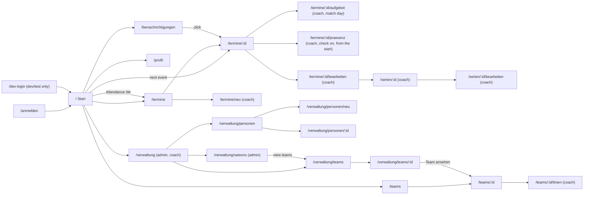

# Navigation and screens

Map of the UI for humans and agents. The test agent uses it to jump straight to the right place by URL. Whoever changes a route or a fixed test ID updates this file in the same PR.

Status: target state for the core. The column «Feature» states with which feature from the [backlog](../pipeline/backlog.md) a screen arrives. Built are F-00 (foundation: `/anmelden`, `/dev-login`, `/`, `/termine` as empty state, `/profil`), F-01 (`/teams`, `/teams/:id`, `/verwaltung` with people, teams and seasons), F-02 (`/teams/:id/linien`, `/teams/:id` by line), F-03 (`/termine` with filters, `/termine/neu`, `/termine/:id` with details, `/termine/:id/bearbeiten`, `/serien/:id`, `/serien/:id/bearbeiten`), F-04 (responses in `/`, `/termine` and `/termine/:id`, overview by team and line), F-05 (match day in the form with matches, meeting point and Google Maps link; matches, results and call-up status in `/termine/:id`; `/termine/:id/aufgebot`) and F-06 (`/benachrichtigungen`, bell with counter in the navigation). F-14: switch «Präsenz erfassen» in the event and series form, section «Präsenz» in `/termine/:id`, `/termine/:id/praesenz`. F-12: coaches (coach of at least one team in the current season) see «Verwaltung» and manage all teams; delete actions, «Saisons», swiss unihockey and the admin checkbox stay with admins (RR-03, RR-08).

## Navigation

- **Mobile:** bottom navigation with «Start», «Termine», «Teams», «Profil». Admins and coaches also see «Verwaltung» (F-12).
- **Desktop (from 1024px):** the same entries as a side navigation on the left.
- **Notifications (F-06):** its own link in the navigation, outside the list of main entries. On mobile a round bell at the top right in a fixed header, the content scrolls underneath (name «Benachrichtigungen», label for screen readers only); from 1024px an entry «Benachrichtigungen» above «Start». With unread notifications it shows the number (`notifications-counter`), and the name then reads e.g. «Benachrichtigungen 2 ungelesen». The counter is reloaded on every page change.
- The active entry has `aria-current="page"`.
- The navigation is a `nav` with `aria-label="Hauptnavigation"`.
- Order: «Start», «Termine», «Teams», «Profil», («Verwaltung»). Page title in the browser: «<Seite> · STV Bero».

## Routes

| Route | Screen | Who | Content | Feature |
|---|---|---|---|---|
| `/anmelden` | «Anmelden» (login) | everyone | Login (method open, O-01). In test mode link «Zur Anmeldung im Testmodus». `?ziel=` is passed on | F-00 |
| `/dev-login` | «Testmodus-Anmeldung» (test mode login) | only `dev`/`test` (development build) | List of seed persons (`GET /api/test/persons`); one click logs in and leads to `?ziel=` or `/` | F-00 |
| `/` | «Start» | logged in | Greeting, own next event with response buttons and counter, then «Weitere Trainings» until at least two upcoming practices are visible (cancelled ones skipped), link «Alle Termine», tiles depending on role | F-00, F-04, F-13 |
| `/termine` | «Termine» (events) | logged in | Upcoming events of all own teams by month, switch «Kommend»/«Vergangen» (`nav` «Ansicht», `?ansicht=vergangen`), select «Team» (`?team=<id>`; coaches and admins choose from all teams of the season and then see that team's events, F-12), coaches and admins: link «Termin erfassen». From F-04 own response can be changed directly, only on events of own teams (events of other teams show no «Meine Antwort», F-12) | F-03, F-04 |
| `/termine/:id` | «Termin» (event) | members of the teams involved, coach, admin | Details (date, time, teams, location, meeting point, response deadline, notes, series), status «Abgesagt: <Grund>» or «verschoben», coaches: «Termin bearbeiten», «Serie ansehen». From F-04: own response, overview by team and line, coach block. For a match day from F-05: matches, own call-up status. From F-14 with the switch «Präsenz erfassen» on: coaches and admins see the section «Präsenz» (before the start only «Die Präsenz lässt sich ab Beginn des Termins erfassen.», from the start «Noch keine Präsenz erfasst.» / «Präsenz ist erfasst.» and the link «Präsenz erfassen» / «Präsenz korrigieren»); players with a recorded value see «Deine Präsenz» | F-03, F-04, F-05, F-14 |
| `/termine/neu` | «Termin erfassen» (create event) | coach, admin | Choice «Einzelner Termin» / «Serie (jede Woche)» (`?art=serie`), type (Training, Spieltag, Anlass), title, date or weekday and period, start, end, teams (checkboxes), location, Google Maps link, notes, response deadline, checkbox «Präsenz erfassen» (off by default, F-14). For «Spieltag»: location is called «Spielort», group «Treffpunkt» (time, place), group «Spiele» with one group «Spiel n» each (opponent, start time, «Heim oder auswärts», «Spiel n entfernen») and «Spiel hinzufügen» | F-03, F-05 |
| `/termine/:id/bearbeiten` | «Termin bearbeiten» (edit event) | coach (any team), admin | Change details, postpone (other date or other time), «Termin absagen» (dialog with reason). For series events notice «gilt nur für diesen Termin». Switching «Präsenz erfassen» off while attendance is recorded asks «Präsenz ausschalten?» («Ausschalten und speichern», «Abbrechen»; F-14). Match day: matches as when creating; matches from swiss unihockey read-only; if swiss unihockey no longer delivers a match, it shows «swiss unihockey liefert dieses Spiel nicht mehr.» and the button «Spiel <n> entfernen» (#44) | F-03, F-05 |
| `/termine/:id/aufgebot` | «Aufgebot» (call-up) | coach (any team), admin (otherwise «Keine Berechtigung»; not a match day: «Nur ein Spieltag hat ein Aufgebot.») | Status (`call-up-status`, `call-up-count`), selection grouped by lines (one group each with the group name, checkbox with the player's name, response status and comment next to it), saves immediately (feedback «<Name> ist aufgeboten.»), «Veröffentlichen» with confirmation. Coaches are not in the selection (AUF-28). Cancelled or past: read-only | F-05 |
| `/termine/:id/praesenz` | «Präsenz erfassen» (attendance check) | coach (any team), admin (otherwise «Keine Berechtigung»; check off, cancelled: «Für diesen Termin lässt sich keine Präsenz erfassen.»; before the start: «Die Präsenz lässt sich ab Beginn des Termins erfassen.») | State (`attendance-state`: «Noch keine Präsenz erfasst.» or «Zuletzt gespeichert von <Name> am <Datum> <Zeit>.»), players of the involved teams by team (`h3` with the team name, teams by name as in the overview) and within the team by line (`h4` with the group name; a player in two teams appears in both, with one status), each with response status, comment and a radio group «Präsenz von <Name>» with «anwesend», «abwesend», «entschuldigt». Preselection: «dabei» → «anwesend», otherwise «abwesend». Summary «4 anwesend · 3 abwesend · 0 entschuldigt», «Noch nicht gespeichert.» after changes, button «Präsenz speichern» (feedback «Die Präsenz ist gespeichert.»). Coaches are not in the list (PRS-05) | F-14 |
| `/serien/:id` | «Serie» (series) | members of the teams of the series, coaches and admins (coaches and admins with editing) | Rule, period, teams (all teams of the series, including those one is not in), response deadline, exceptions (list and form «Ausnahme hinzufügen»), link «Serie bearbeiten» | F-03 |
| `/serien/:id/bearbeiten` | «Serie bearbeiten» (edit series) | coach (any team), admin | Like «Termin erfassen» as a series; applies to future events (TER-08), also the switch «Präsenz erfassen» (PRS-01) | F-03, F-14 |
| `/teams` | «Meine Teams» (my teams) | logged in | Own teams of the current season with own team role (PTF-12), link to `/teams/:id` | F-01 |
| `/teams/:id` | «Team» | members, coach, admin | Coaches and players separate (PTF-07), players by line (lists with the group name, empty groups are missing). Coaches and admins see the link «Linien einteilen». `?saison=<id>` shows another season (archive with notice). Without team membership (and not coach or admin) «Keine Berechtigung» | F-01, F-02, F-12 |
| `/teams/:id/linien` | «Linien» (lines) | coach (any team), admin (other members read-only) | Add, rename, sort («<Linie> nach oben/unten»), delete (dialog, admins only, RR-08) lines, assign players by drag and drop or select field «Linie von <Name>»; saves immediately. Without team membership (and not coach or admin) «Keine Berechtigung». Current season | F-02, F-12 |
| `/benachrichtigungen` | «Benachrichtigungen» (notifications) | logged in | Own notifications, newest first (list «Benachrichtigungen»): text, time, unread ones with «Neu». A click marks as read and opens `/termine/:id` (BEN-12). Button «Alle als gelesen markieren» (only with unread ones, feedback «Alle sind als gelesen markiert.»). Empty: «Keine Benachrichtigungen.» | F-06 |
| `/profil` | «Profil» (profile) | logged in | Name, theme («Hell», «Düne», «GitHub Dark», «System»; NF-08), log out | F-00 |
| `/verwaltung` | «Verwaltung» (administration) | admin, coach | Entry page: links «Personen», «Teams verwalten», for admins also «Saisons». Others see «Keine Berechtigung» | F-00, F-01, F-12 |
| `/keine-saison` | «Keine aktuelle Saison» (no current season) | logged in | Notice when `GET /api/me` responds with 409 (no season set as current, SAI-03). Without navigation, buttons «Nochmals versuchen» (back to `?ziel=`) and «Abmelden». In this state every route redirects here with `?ziel=`. Opened directly: without login to the login page, with a current season straight on to the target | Follow-up fix #13 |
| `/**` | «Nicht gefunden» (not found) | logged in | «Diese Seite gibt es nicht.» with link «Zur Startseite» | F-00 |
| `/verwaltung/personen` | «Personen» (people) | admin, coach | List by last name, search `?suche=`, link «Person erfassen» | F-01 |
| `/verwaltung/personen/neu` | «Person erfassen» (create person) | admin, coach | First name, last name, e-mail, admin (checkbox for admins only). After saving on to `/verwaltung/personen/:id` | F-01 |
| `/verwaltung/personen/:id` | «Person bearbeiten» (edit person) | admin, coach | Change details (admin checkbox for admins only), team memberships of all seasons | F-01 |
| `/verwaltung/teams` | «Teams verwalten» (manage teams) | admin, coach | Select «Saison» (`?saison=<id>`), teams of the season, «Team anlegen». Archive read-only. Linked teams with chip «swiss unihockey» (`su-linked-<teamId>`) | F-01, F-07 |
| `/verwaltung/teams/:id` | «Team verwalten» (manage team) | admin, coach | Link «Team ansehen» (to `/teams/:id`, not in the archive), rename, section «swiss unihockey» (admins only) (field «Team-ID bei swiss unihockey», «Verknüpfen», «Verknüpfung lösen», «Jetzt abgleichen» with result as `role="status"`, failure as `role="alert"`; not in the archive), coaches and players with select «Funktion von <Name>» and «<Name> entfernen» (admins only, RR-08), «Person aufnehmen». `?saison=<id>`; archive read-only | F-01, F-07 |
| `/verwaltung/saisons` | «Saisons» (seasons) | admin (coaches see «Keine Berechtigung») | Seasons with status (current, archive, planned), «Teams ansehen», «Zur aktuellen Saison machen», form «Neue Saison» with carry-over | F-01 |

Without permission a screen shows the text «Keine Berechtigung» (`role="alert"`) instead of an empty screen. Without login every route redirects to `/anmelden` (or `/dev-login` in test mode) with `?ziel=<original route>` and returns there after login. The frontend checks whether someone is logged in via `GET /api/session` (always 200), so that no errors appear in the console without login.

## Dialogs

| Dialog | Opened from | Name (heading) |
|---|---|---|
| Maybe with comment | Response «vielleicht» (field «Kommentar», required; empty: message at the field) | «Vielleicht – bitte kurz begründen» |
| Reason for declining | Response «nicht dabei», after it is already saved (field «Grund (freiwillig)», buttons «Grund speichern», «Überspringen») | «Nicht dabei» |
| Respond on behalf | Coach (any team) or admin in the overview, button next to a person | «Antwort für <Name> eintragen» (select «Antwort» with radio buttons, field «Kommentar (bei «vielleicht» Pflicht)») |
| Cancel event | Edit event, «Termin absagen» | «Termin absagen» (field «Grund», required) |
| Delete line | Lines, «<Linie> löschen» (admins only) | «<Linie> löschen?» |
| Publish call-up | Call-up, «Veröffentlichen» (buttons «Veröffentlichen», «Abbrechen») | «Aufgebot veröffentlichen?» |
| Switch off attendance check | Edit event, untick «Präsenz erfassen» while attendance is recorded, «Änderungen speichern» (buttons «Ausschalten und speichern», «Abbrechen») | «Präsenz ausschalten?» |
| Enter result | Event (match day), button «Resultat für <Heim> – <Gast> erfassen» (coach, admin) | «Resultat: <Heim> – <Gast>» (field «Resultat (Heim:Gast, z.B. 5:3)», empty removes it, button «Resultat speichern») |

## Test IDs

Fixed test IDs that tests rely on. Scheme and rules: [testability.md](../testability.md#4-test-ids-where-semantics-are-not-enough).

### Global

| Test ID | Element |
|---|---|
| `main-navigation` | Navigation (mobile and desktop) |
| `theme-switch` | Switch «Darstellung» in the profile: choice (radio) «Hell», «Düne», «GitHub Dark», «System» |
| `test-mode-notice` | Banner «Testmodus» (dev/test only) |
| `tile-<id>` | Tile on the start screen (link), e.g. `tile-anwesenheit` |
| `dev-login-person-<key>` | Entry of a test person on `/dev-login`, e.g. `dev-login-person-petra` |
| `next-event` | Card «Nächster Termin» on the start screen: next planned event of the own teams (cancelled ones skipped) with link to the event, `event-counter` and `my-response`. Without an event: «Keine kommenden Termine» |
| `next-practices` | Card «Weitere Trainings» on the start screen (F-13): practices after the next event, so that at least two upcoming practices are visible in total (one more if the next event is a practice, otherwise two). Cancelled practices are skipped. Missing when there is none |
| `start-practice-<id>` | Entry in `next-practices` (`li`, name e.g. «Training Do 19.11. 19:00») with link to the event, teams, `event-counter` and `my-response` |
| `all-events` | Link «Alle Termine» on the start screen to `/termine` (F-13) |
| `notifications-counter` | Number of unread notifications in the navigation (missing when everything is read) |
| `notification-<id>` | Entry in `/benachrichtigungen` (`li` with `data-read="true\|false"` and `data-kind`, e.g. `REMINDER`) |
| `no-season-notice` | Notice on `/keine-saison` |

### Teams and administration (F-01)

| Test ID | Element |
|---|---|
| `team-card-<teamId>` | Entry in «Meine Teams» (`/teams`) |
| `team-coaches` | Section «Coaches» (`/teams/:id`, `/verwaltung/teams/:id`) |
| `team-players` | Section «Spielerinnen» (`/teams/:id`, `/verwaltung/teams/:id`) |
| `team-person-<personId>` | Person in `/teams/:id` |
| `member-<personId>` | Person in `/verwaltung/teams/:id` (`li` with the name as `aria-label`) |
| `archive-notice` | Notice «Saison … im Archiv: nur lesend.» |
| `person-<personId>` | Entry in `/verwaltung/personen` |
| `team-<teamId>` | Entry in `/verwaltung/teams` |
| `season-<seasonId>` | Entry in `/verwaltung/saisons` (`li` with the season name as `aria-label`) |
| `season-status` | Status of a season: «aktuell», «Archiv», «geplant» |
| `swiss-unihockey` | Section «swiss unihockey» in `/verwaltung/teams/:id` (`section`, name «swiss unihockey») |
| `su-status` | «Verknüpft mit Team-ID <ID>.» or «Nicht verknüpft.» |
| `su-linked-<teamId>` | Chip «swiss unihockey» next to a linked team in `/verwaltung/teams` |

Success messages have `role="status"`, errors `role="alert"`. In «Person aufnehmen», people already in the team are marked with «(schon im Team)» and cannot be selected (PTF-04).

### Events

| Test ID | Element |
|---|---|
| `event-card-<eventId>` | Entry in the event list (`li` with `aria-label` «<Titel> <Datum> <Beginn>», e.g. «Training Di 17.11. 18:30», and `data-status`) |
| `my-response` | Response buttons of the logged-in person (in card, detail and start), `role="group"` with the name «Meine Antwort» or «Meine Antwort für <Titel> <Datum> <Beginn>» and `data-response`. Feedback «Gespeichert: dabei.» (`role="status"`). Cancelled: buttons `disabled`, explanation via `aria-describedby` |
| `response-attending`, `response-declined`, `response-maybe` | The three response buttons inside `my-response` (names «Dabei», «Nicht dabei», «Vielleicht», selected: `aria-pressed="true"`) |
| `event-counter` | Total counter in the card of the event list (not for cancelled events) and on the start screen (F-13) |
| `event-status` | Notice «abgesagt» or «verschoben» (as a chip in the card, as a notice with reason in the detail) |
| `response-deadline` | Response deadline in the detail of an event, e.g. «Mo 16.11. 18:30 (24 Stunden vor Beginn)» |
| `exceptions` | Section «Ausnahmen» on `/serien/:id` |
| `overview` | Entire overview of an event |
| `overview-total` | Total counter |
| `overview-team-<teamId>` | Section of a team |
| `overview-team-<teamId>-counter` | Counter of a team |
| `overview-group-<groupId>` | Line or goalies within a team |
| `overview-no-line-<teamId>` | Group «Ohne Linie» of a team (only if not empty) |
| `overview-person-<personId>` | Entry of a person (`li`), with `data-response`, status as text, comment «…» only for those permitted, «eingetragen von …», «kurzfristig abgemeldet». Coaches (of any team) and admins see the button «Antwort für <Name> eintragen», also for coaches in the coach block (F-12). The same person can appear in several teams and in the coach block: narrow down via the section |
| `coach-block` | Block of the coaches |

Counter elements carry `data-counter="attending|declined|maybe|pending"`.

### Match day and call-up

| Test ID | Element |
|---|---|
| `matches` | List of the matches of a match day (`ol`, by start time). Without matches: text «Für diesen Spieltag sind noch keine Spiele erfasst.» |
| `match-<matchId>` | One match (`li` with `aria-label` «<Anspielzeit> <Heim> – <Gast>», e.g. «09:30 Team 1 – UHC Musterdorf»), plus «Heim»/«Auswärts» and «Resultat 5:3» |
| `meeting-point` | Meeting point (time and place), e.g. «08:00 · Parkplatz Sporthalle Nord» |
| `venue-map` | Link «In Google Maps öffnen» (`target="_blank"`) |
| `my-call-up` | Own status in the event, only for players of the team: «aufgeboten», «nicht aufgeboten», «noch kein Aufgebot». Coaches and admins see the status and the link «Aufgebot bearbeiten» instead |
| `call-up-selection` | Selection list in the call-up screen |
| `call-up-person-<personId>` | Entry in the selection (`li` with `data-response` and `data-called-up="true\|false"`, checkbox with the name, response status as text next to it) |
| `call-up-publish` | Button «Veröffentlichen» (only in draft; without selection `disabled` with explanation) |
| `call-up-status` | «Entwurf», «Entwurf: noch niemand ausgewählt» or «veröffentlicht am Mo 16.11. 06:00» |
| `call-up-count` | Number of called-up players, e.g. «5 aufgeboten» |

### Attendance check (F-14)

| Test ID | Element |
|---|---|
| `event-attendance-check` | Checkbox «Präsenz erfassen» in the event and series form |
| `attendance-section` | Section «Präsenz» in `/termine/:id`, only coaches and admins, only with the switch on and not cancelled |
| `attendance-recorded` | «Noch keine Präsenz erfasst.» or «Präsenz ist erfasst.» (`data-recorded="true\|false"`) |
| `attendance-record` | Link «Präsenz erfassen» or «Präsenz korrigieren» to `/termine/:id/praesenz` (from the start) |
| `my-attendance` | Section «Deine Präsenz» for a player with a recorded value, «Der Coach hat dich als «anwesend» erfasst.» (`data-attendance="PRESENT\|ABSENT\|EXCUSED"`, the status from the API) |
| `attendance-list` | Form with the players in `/termine/:id/praesenz` |
| `attendance-state` | «Noch keine Präsenz erfasst.» or «Zuletzt gespeichert von Petra Keller am Do 05.11. 21:00.» (`data-recorded`) |
| `attendance-team-<teamId>` | Block of a team in `/termine/:id/praesenz` (region named after the team) |
| `attendance-group-<groupId>`, `attendance-no-line-<teamId>` | Group of a team (line, goalies, «Ohne Linie»), region named after the group |
| `attendance-person-<personId>` | Entry of a player (`li` with `aria-label` = name, `data-response`, `data-attendance="PRESENT\|ABSENT\|EXCUSED"`), radio group «Präsenz von <Name>» |
| `attendance-summary` | «4 anwesend · 3 abwesend · 0 entschuldigt» (every player once) |
| `attendance-unsaved` | «Noch nicht gespeichert.», only with changes that are not saved |
| `attendance-save` | Button «Präsenz speichern» |

### Lines

| Test ID | Element |
|---|---|
| `lines-management` | Lines screen of a team |
| `group-<groupId>` | A line or goalies (`section`, named after the heading) |
| `group-no-line` | Group «Ohne Linie» in the lines screen (always visible, when empty with the text «Alle Spielerinnen sind eingeteilt.») |
| `player-<personId>` | Player in the lines screen (`li` with the name as `aria-label`, draggable for coaches) |
| `add-line` | Button «Linie hinzufügen» |
| `assignment-<personId>` | Select field «Linie von <Name>» of a player (alternative to drag and drop). Values: group IDs, empty = «Ohne Linie» |

## Display rules that affect tests

- Empty groups («Ohne Linie», empty line, goalies without a player) are not shown in the overview of an event. In the lines screen they are shown.
- Order in the overview: teams by name, within them lines by order, then goalies, then «Ohne Linie». People by last name, then first name.
- Dates in the format «Di 17.11.», times «18:30». Full date with year only if it is not the current year.
