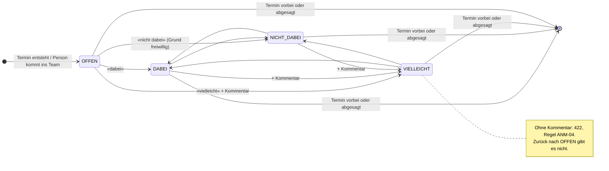
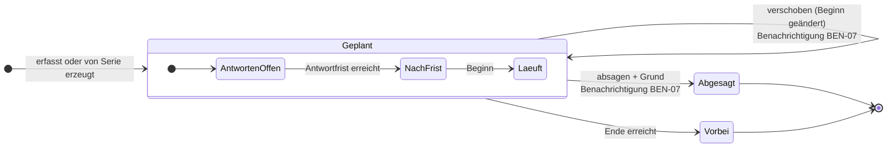
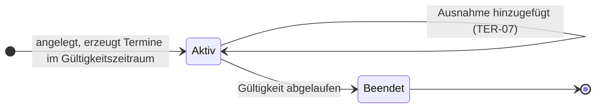
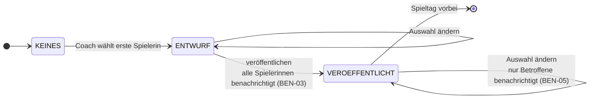
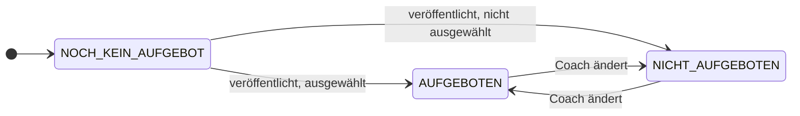
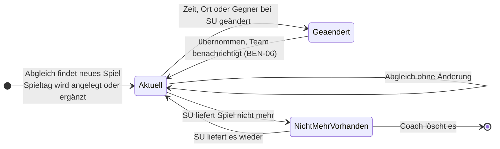
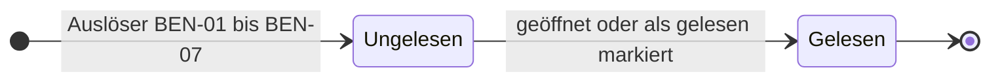
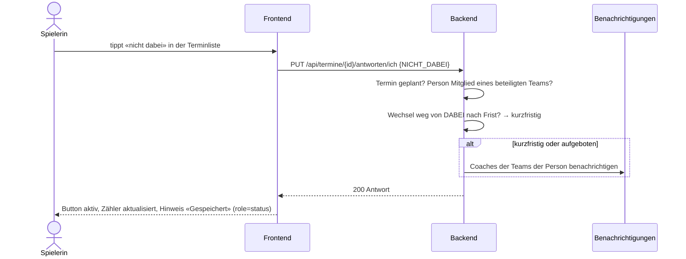
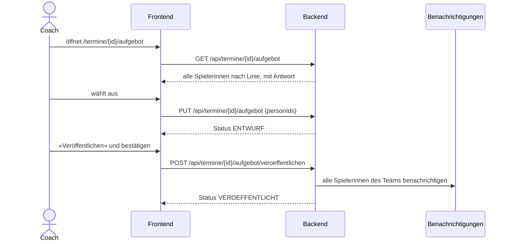
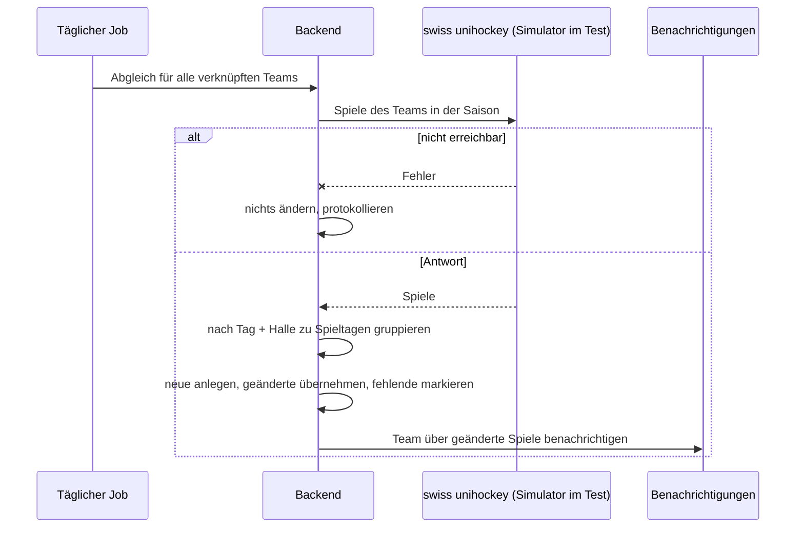

# Zustände und Abläufe

Zustandsdiagramme der fachlichen Objekte und Sequenzdiagramme der wichtigsten Abläufe. Der Test-Agent leitet daraus Testfälle ab: Jeder Übergang ist ein Testfall, jeder nicht erlaubte Übergang auch.

Wer das Verhalten ändert, passt das Diagramm im selben PR an. Diagramme sind [Mermaid](https://mermaid.js.org) und werden von GitHub direkt dargestellt.

## Antwort einer Person auf einen Termin

| Regel | Bezug |
|---|---|
| Jeder Wechsel ist erlaubt, auch nach der Antwortfrist. | ANM-09 |
| Wechsel **weg von DABEI** nach der Antwortfrist setzt `kurzfristig` und benachrichtigt die Coaches. | ANM-10, BEN-02 |
| Bei einer aufgebotenen Spielerin benachrichtigt jeder Wechsel weg von DABEI die Coaches, auch vor der Frist. | AUF-26, BEN-04 |
| Stellvertretend gesetzte Antworten folgen denselben Übergängen und speichern `eingetragenVon`. | ANM-11, ANM-12 |
| Nach Absage oder Ende des Termins sind keine Änderungen mehr möglich (409). | TER-06 |

## Termin

- Gespeichert wird nur `GEPLANT` oder `ABGESAGT`. «Nach Frist», «läuft» und «vorbei» ergeben sich aus der Backend-Uhr.
- Eine Erinnerung (BEN-01) geht 12 Stunden vor der Antwortfrist an alle mit Antwort OFFEN, höchstens einmal pro Person und Termin (BEN-13). Die 12 Stunden sind eine Annahme.
- Verschieben behält alle Antworten. Ob «dabei» nach einer Verschiebung noch gilt, entscheidet die Person selbst.

## Serie

Beim Hinzufügen einer Ausnahme (z.B. Ferien) gilt für die betroffenen künftigen Termine:

- Termin ohne Antworten: wird entfernt.
- Termin mit Antworten: wird abgesagt, Grund = Grund der Ausnahme. So geht keine Antwort verloren und alle werden benachrichtigt.

Das ist eine Annahme.

## Aufgebot eines Spieltags

Sicht einer Spielerin (`meinAufgebot`):

- Solange das Aufgebot ein Entwurf ist, sehen es nur Coaches (AUF-23).
- Aufgeboten werden kann jede Spielerin des Teams, unabhängig von ihrer Antwort (AUF-22).
- Aufgebotene bestätigen nicht (AUF-25).

## Spiel aus swiss unihockey

- Der Abgleich überschreibt nur importierte Felder: Gegner, Anspielzeit, Heim/Auswärts, Spielort, Resultat. Treffpunkt, Hinweise, Antworten und Aufgebot bleiben unberührt (SUH-06).
- Spiele desselben Teams am selben Tag in derselben Halle bilden einen Spieltag (SUH-04).
- Ist swiss unihockey nicht erreichbar, ändert sich nichts. Der nächste Lauf versucht es wieder (SUH-09).

## Benachrichtigung

## Abläufe

### Antworten mit einem Tap

### Aufgebot veröffentlichen

### Abgleich mit swiss unihockey

