# Zustände und Abläufe

Zustandsdiagramme der fachlichen Objekte und Sequenzdiagramme der wichtigsten Abläufe. Der Test-Agent leitet daraus Testfälle ab: Jeder Übergang ist ein Testfall, jeder nicht erlaubte Übergang auch.

Wer das Verhalten ändert, passt das Diagramm im selben PR an. Diagramme sind [Mermaid](https://mermaid.js.org) und werden von GitHub direkt dargestellt.

## Antwort einer Person auf einen Termin

| Regel | Bezug |
|---|---|
| Jeder Wechsel ist erlaubt, auch nach der Antwortfrist. | ANM-09 |
| Wechsel **weg von DABEI** nach der Antwortfrist setzt `kurzfristig` und benachrichtigt die Coaches. | ANM-10, BEN-02 |
| Bei einer aufgebotenen Spielerin (veröffentlichtes Aufgebot) benachrichtigt jede Abmeldung die Coaches, auch vor der Frist: von DABEI oder OFFEN auf NICHT_DABEI oder VIELLEICHT, oder von VIELLEICHT auf NICHT_DABEI (Annahme F-06, O-49). Trifft zugleich eine kurzfristige Absage zu, geht nur diese eine Benachrichtigung raus. | AUF-26, BEN-04 |
| Die kurzfristige Absage benachrichtigt einmal, beim Wechsel weg von DABEI. Weitere Wechsel, die kurzfristig bleiben, benachrichtigen nicht nochmals. Empfänger sind die Coaches der Teams, in denen die Person beim Termin Spielerin ist (O-17). | ANM-10, BEN-02 |
| Die Markierung `kurzfristig` bleibt bei weiteren Wechseln zwischen NICHT_DABEI und VIELLEICHT und fällt mit DABEI weg (Annahme O-43). | ANM-10 |
| Für sich antworten darf jedes Mitglied eines beteiligten Teams (jede Funktion), sonst 403. | ANM-01, RR-02 |
| Stellvertretend gesetzte Antworten folgen denselben Übergängen und speichern `eingetragenVon`. Erlaubt für Coaches eines Teams, in dem die Person Spielerin ist, und für Admins (jedes Mitglied). Sonst 403, Person in keinem beteiligten Team 404. Antwortet die Person danach selbst, fällt `eingetragenVon` weg. | ANM-11, ANM-12, RR-06 |
| Jede Antwort ersetzt die vorherige ganz, auch den Kommentar. In der Oberfläche speichert «nicht dabei» sofort und bietet danach den Grund an. | ANM-05, ANM-08 |
| Nach Absage oder Ende des Termins sind keine Änderungen mehr möglich (409). | TER-06 |

## Termin

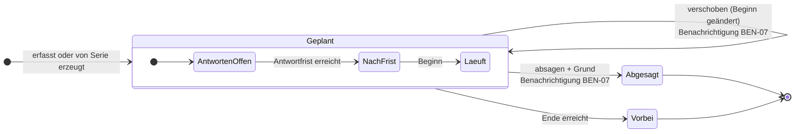

- Gespeichert wird nur `GEPLANT` oder `ABGESAGT`. «Nach Frist», «läuft» und «vorbei» ergeben sich aus der Backend-Uhr.
- Eine Erinnerung (BEN-01) geht 12 Stunden vor der Antwortfrist an alle Mitglieder der beteiligten Teams (jede Funktion) mit Antwort OFFEN, höchstens einmal pro Person und Termin (BEN-13, Tabelle `erinnerung`). Nach der Frist wird nicht mehr erinnert. Die 12 Stunden sind eine Annahme (O-18). Geprüft wird jede Minute; im Test sofort beim Setzen der Uhr (`PUT /api/test/uhr`).
- Absagen und Verschieben (einzeln oder durch eine Ausnahme bzw. Änderung der Serie, die einen Termin mit Antworten absagt) benachrichtigen alle Mitglieder der beteiligten Teams (BEN-07). Beim Verschieben auch die Mitglieder von Teams, die dabei entfernt wurden. Eine geänderte Seriezeit ist keine Verschiebung (O-41). Ein Serientermin ohne Antworten, der durch eine Ausnahme oder Änderung der Serie entfernt wird, benachrichtigt niemanden (Annahme F-06, O-52).
- Verschieben behält alle Antworten. Ob «dabei» nach einer Verschiebung noch gilt, entscheidet die Person selbst.

| Regel | Bezug |
|---|---|
| Ein Termin gehört zur Saison, in die sein Datum fällt. Sichtbar ist er für Mitglieder (jede Funktion) eines beteiligten Teams in dieser Saison und für Admins, sonst 403. | TER-13, RR-02 |
| Erfassen: Admins oder Coach in **mindestens einem** der Teams (so erfasst Petra das gemeinsame Training von Team 1 + Team 2). Nur Teams, in denen die Person nichts ist: 403. Bearbeiten und absagen: Coach eines beteiligten Teams oder Admin; nach der Änderung muss weiterhin ein Team dabei sein, in dem die Person Coach ist (Annahme O-39). | TER-01, TER-11, RR-06 |
| Ende vor Beginn, kein Team, Spieltag mit mehr als einem Team, unbekanntes Team oder ein Termin in der Vergangenheit: 400 mit Feld. Termin in einer Saison im Archiv: 409 (SAI-02). | TER-04, AUF-03 |
| Abgesagte oder vergangene Termine lassen sich weder ändern noch nochmals absagen: 409, Regel TER-06. | TER-06 |
| Eine andere Beginnzeit setzt `verschoben` (bleibt danach gesetzt). Ein so geänderter Serientermin übernimmt spätere Änderungen der Serie nicht mehr. | TER-06 |
| Antwortfrist = Beginn minus `antwortfristStunden` (0 bis 336, Standard 24). Ausserhalb: «Mindestens 0 Stunden.» bzw. «Höchstens 336 Stunden (14 Tage).», im Formular und in der API. | TER-09, TER-10 |
| Liste: kommende = Ende nach «jetzt», aufsteigend; vergangene = Ende erreicht, absteigend. `?team=` zeigt die eigenen Termine, an denen dieses Team beteiligt ist. Ist es kein eigenes Team (z.B. geteilter Link), erscheint es zusätzlich in der Auswahl «Team», damit Auswahl und Liste übereinstimmen. | TER-13 |

## Serie

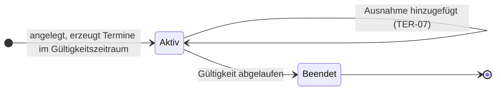

Beim Hinzufügen einer Ausnahme (z.B. Ferien) gilt für die betroffenen künftigen Termine:

- Termin ohne Antworten: wird entfernt.
- Termin mit Antworten: wird abgesagt, Grund = Grund der Ausnahme. So geht keine Antwort verloren und alle werden benachrichtigt.

Das ist eine Annahme.

| Regel | Bezug |
|---|---|
| Anlegen erzeugt einen Termin für jeden Wochentag im Gültigkeitszeitraum, der noch nicht begonnen hat. Der Zeitraum dauert höchstens ein Jahr (400). | TER-05 |
| Eine Ausnahme betrifft künftige **geplante** Termine der Serie, deren Datum im Zeitraum liegt (auch einzeln verschobene). Abgesagte bleiben. | TER-07 |
| Ändern betrifft nur künftige Termine: geplante, nicht einzeln geänderte übernehmen die neuen Angaben (Antworten bleiben, `verschoben` wird nicht gesetzt). Daten, die neu dazukommen, erhalten einen Termin. Termine, deren Datum nicht mehr zur Serie passt, werden wie bei einer Ausnahme entfernt bzw. abgesagt (Grund «Serie geändert»). Vergangene, abgesagte und einzeln geänderte Termine bleiben. | TER-08 |
| Rechte wie bei Terminen. Ansehen: Mitglieder der Teams der Serie und Admins (403). | TER-11, RR-06 |

## Aufgebot eines Spieltags

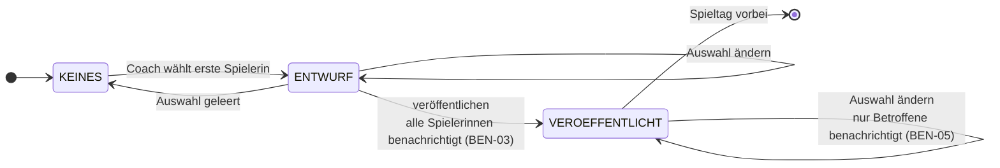

Sicht einer Spielerin (`meinAufgebot`):

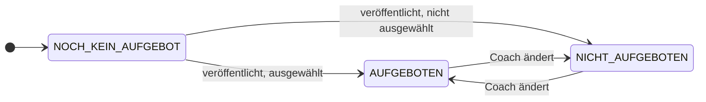

- Solange das Aufgebot ein Entwurf ist, sehen es nur Coaches (AUF-23).
- Aufgeboten werden kann jede Spielerin des Teams, unabhängig von ihrer Antwort (AUF-22).
- Aufgebotene bestätigen nicht (AUF-25).

| Regel | Bezug |
|---|---|
| Ansehen, auswählen und veröffentlichen dürfen Coaches des Teams und Admins, sonst 403. Ein Termin, der kein Spieltag ist, hat kein Aufgebot (409, Regel AUF-02). | RR-03, AUF-02 |
| Speichern ersetzt die ganze Auswahl. Nur Spielerinnen des Teams, keine Coaches und niemand ausserhalb: 422 mit Regel AUF-28. Leere Auswahl im Entwurf: zurück zu KEINES. | AUF-22, AUF-28 |
| Veröffentlicht wird nur ein Entwurf mit mindestens einer Spielerin, und nur einmal (sonst 409, Regel AUF-23). Danach bleibt es veröffentlicht, auch wenn die Coach die Auswahl ändert (Annahme O-46). | AUF-23 |
| Vor der Veröffentlichung sehen Personen ohne Coach-Recht `aufgebotStatus: KEINES` und `meinAufgebot: NOCH_KEIN_AUFGEBOT` (Annahme O-45). `meinAufgebot` gibt es nur für Spielerinnen des Teams. | AUF-23, AUF-24 |
| Abgesagter oder vergangener Spieltag: Auswahl und Veröffentlichen ergeben 409 (TER-06), Ansehen geht. Gleichzeitige Änderungen ergeben nie 500. | TER-06 |
| Veröffentlichen benachrichtigt alle Spielerinnen des Teams, je mit «aufgeboten» oder «nicht aufgeboten» (BEN-03). Eine Änderung danach benachrichtigt nur, wer neu dazukommt oder herausfällt (BEN-05). Änderungen im Entwurf benachrichtigen niemanden. | AUF-24, AUF-27 |

## Spiel eines Spieltags

| Regel | Bezug |
|---|---|
| Spiele haben Gegner, Anspielzeit, Heim/Auswärts und optional ein Resultat Heim:Gast (z.B. 5:3). Die API liefert sie nach Anspielzeit. | AUF-14, AUF-15 |
| Erfassen, ändern und löschen dürfen Coaches des Teams und Admins (403). Nur bei Spieltagen (409, Regel AUF-01). | TER-11, RR-06 |
| Die Anspielzeit liegt am Tag des Spieltags (400 beim Feld `anspielzeit`). Beim Ändern eines Spiels gilt das nur für eine neue Anspielzeit, das Resultat lässt sich also immer erfassen. Wird der Spieltag auf einen anderen Tag verschoben, ziehen von Hand erfasste Spiele mit. Hat er Spiele aus swiss unihockey, lässt er sich nur am selben Tag verschieben (422 beim Feld `beginn`, Regel SUH-05); deren Datum kommt von swiss unihockey (Annahme O-48). | AUF-01, SUH-05 |
| Hinzufügen und löschen nur, solange der Spieltag geplant und nicht vorbei ist (409, TER-06). Ändern, z.B. das Resultat, auch danach; nur ein abgesagter Spieltag ergibt 409 (Annahme O-47). | AUF-15, TER-06 |
| Spiele aus swiss unihockey: Gegner, Anspielzeit und Heim/Auswärts sind schreibgeschützt, Löschen nur, wenn swiss unihockey sie nicht mehr liefert (409, Regel SUH-06). Das Resultat lässt sich erfassen. | SUH-06 |
| Ein Spieltag mit Spielen oder Aufgebot lässt sich nicht in einen anderen Typ ändern (409, Regel AUF-01). | AUF-01 |

## Spiel aus swiss unihockey

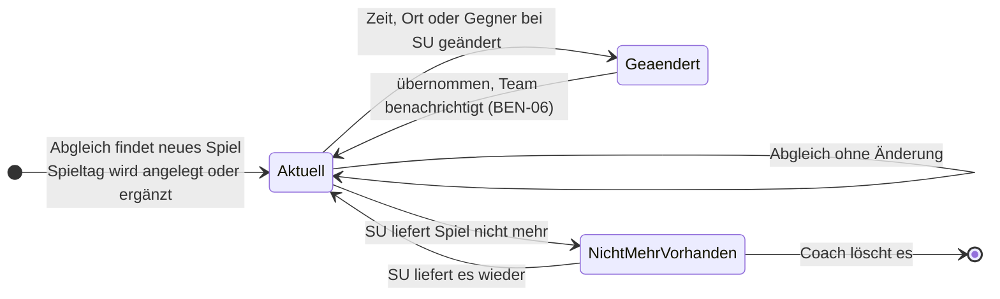

- Der Abgleich überschreibt nur importierte Felder: Gegner, Anspielzeit, Heim/Auswärts, Spielort, Resultat. Treffpunkt, Hinweise, Antworten und Aufgebot bleiben unberührt (SUH-06).
- Spiele desselben Teams am selben Tag in derselben Halle bilden einen Spieltag (SUH-04). Ein neues Spiel kommt zu einem bestehenden importierten Spieltag mit gleichem Tag und gleicher Halle, sonst entsteht ein neuer Spieltag «Spieltag». Von Hand erfasste Spieltage bekommen nie Spiele aus dem Abgleich (SUH-10).
- Beginn und Ende eines betroffenen Spieltags folgen seinen Spielen: Beginn ist die erste Anspielzeit, Ende die letzte plus 75 Minuten (Annahme F-07). Ändert sich dadurch der Beginn, gilt der Spieltag als verschoben.
- Wechselt ein Spiel auf einen anderen Tag oder in eine andere Halle: Ist es das einzige Spiel seines Spieltags, zieht der Spieltag mit (Spielort und Zeit neu, eigene Daten bleiben). Sonst wechselt das Spiel in den passenden oder einen neuen Spieltag.
- Benachrichtigt werden alle Mitglieder des Teams (BEN-06), einmal pro Spieltag und Abgleich, wenn sich Zeit, Halle, Gegner oder Heim/Auswärts eines Spiels geändert haben und der Spieltag geplant und nicht vorbei ist. Ein neues Resultat (SUH-08) oder eine Markierung «nicht mehr vorhanden» benachrichtigt nicht.
- Das Resultat überschreibt der Abgleich nur, wenn swiss unihockey eines liefert; ein von Hand erfasstes bleibt sonst (O-47).
- Ist swiss unihockey nicht erreichbar oder liefert es Unerwartetes, ändert sich nichts. Der Abgleich von Hand meldet es (502, Regel SUH-09), der tägliche Lauf (04:30) versucht es am nächsten Tag wieder; ein gestörtes Team hält die anderen nicht auf (SUH-09).
- Abgeglichen wird die aktuelle Saison. Ein Team ohne Verknüpfung oder ausserhalb der aktuellen Saison: 409.

## Benachrichtigung

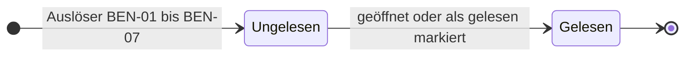

| Regel | Bezug |
|---|---|
| Jede Person sieht nur ihre eigenen Benachrichtigungen, neueste zuerst. Fremde als gelesen markieren: 403. Mehrfach markieren ändert nichts. | RR-07 |
| Ein Klick auf eine Benachrichtigung markiert sie als gelesen und öffnet den Termin. | BEN-12 |
| Wer etwas auslöst, wird darüber nicht benachrichtigt (z.B. die Coach, die absagt; Annahme F-06, O-50). | BEN |
| Die Liste in der App gibt es immer. Weitere Kanäle (E-Mail, Push) erhalten dieselben Nachrichten über die Schnittstelle `Kanal`. | BEN-10, BEN-11, E-56 |

## Saison

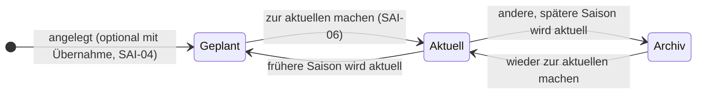

| Regel | Bezug |
|---|---|
| Es gibt immer genau eine aktuelle Saison. Ohne Angabe von `saison` gilt sie. | SAI-03 |
| Ist (noch) keine Saison aktuell, z.B. in einer frischen Installation ohne Seed, antwortet `GET /api/ich` und jede Anfrage ohne `saison` mit 409 «Keine aktuelle Saison» (Regel SAI-03). Die Oberfläche leitet dann jede Route auf den Hinweis `/keine-saison` um. Den Hinweis zeigt sie nur in diesem Zustand: direkt geöffnet ohne Anmeldung geht es zur Anmeldung, mit aktueller Saison weiter zum Ziel. | SAI-03 |
| «Archiv» ist jede Saison, die vor der aktuellen beginnt. Teams und Zugehörigkeiten darin sind nur lesbar: Ändern ergibt 409 mit Regel SAI-02. | SAI-02 |
| Eine neue Saison ist zuerst «geplant» und kann angepasst werden, bevor sie aktuell wird. | SAI-04 |
| Übernahme kopiert Teams, Teamzugehörigkeiten und Linien mit Namen, Reihenfolge und Zuweisungen. Die Quelle bleibt unverändert. | SAI-04, LIN-11 |
| Name schon vergeben oder Zeitraum überschneidet sich mit einer anderen Saison: 409. Auch zwei gleichzeitige Anfragen (Doppelklick) ergeben 201 und 409, nie 500. Ende vor Beginn: 400. | SAI-01 |

## Teamzugehörigkeit

| Regel | Bezug |
|---|---|
| Pro Person, Team und Saison genau eine Funktion. Eine zweite Aufnahme ergibt 409 mit Regel PTF-04, auch wenn beide Anfragen gleichzeitig ankommen. Funktion wechseln geht über «Funktion ändern». | PTF-04 |
| Coaches stehen nie bei den Spielerinnen. | PTF-07 |
| Entfernen löscht nur die Zugehörigkeit; die Person bleibt bestehen. | PTF-01 |
| Personen, Teams, Zugehörigkeiten und Saisons verwalten nur Admins (403). Ein Team sehen nur seine Mitglieder und Admins (403). | RR-04, RR-07 |
| Der letzten Person mit Admin-Rechten kann das Recht nicht entzogen werden (409, Regel RR-04). | RR-04 |

## Linien

| Regel | Bezug |
|---|---|
| Linien und Goalies gehören zu einem Team in einer Saison. Die API arbeitet immer mit der aktuellen Saison; das Archiv zeigt seine Einteilung unverändert. | LIN-03, LIN-11, SAI-02 |
| Jedes Team hat pro Saison genau eine Gruppe «Goalies». Sie entsteht mit dem Team (bzw. wenn es in eine Saison kommt) und lässt sich weder löschen noch umbenennen noch verschieben (409, Regel LIN-05). | LIN-05 |
| Eine Spielerin ist pro Team in höchstens einer Gruppe. Eine neue Zuweisung ersetzt die bisherige; `gruppeId: null` heisst «ohne Linie». Zwei gleichzeitige Zuweisungen ergeben nie 500. | LIN-02, LIN-06 |
| Nur Personen mit Funktion «Spielerin» im Team sind zuweisbar (sonst 409, Regel LIN-10). Wechselt eine Spielerin zur Coach, verliert sie ihre Zuweisung. | LIN-10 |
| Neue Linie ohne Angabe kommt ans Ende. Verschieben und Löschen nummerieren die Linien neu (1, 2, …, ohne Lücke). Die Oberfläche schlägt «Linie n» mit dem nächsten freien n vor. | LIN-09 |
| Namen sind pro Team eindeutig, ohne Gross-/Kleinschreibung, auch gegenüber «Goalies» (409, Regel LIN-09). Beim Umbenennen erscheint die Meldung beim Namensfeld, der Fokus bleibt im Feld. | LIN-09 |
| Wird eine Linie mit «nach oben»/«nach unten» an den Rand verschoben, geht der Fokus auf den Gegenknopf derselben Linie (der gedrückte ist danach gesperrt). | LIN-09 |
| Gelöschte Linie: ihre Spielerinnen sind danach «Ohne Linie». | LIN-06 |
| Ändern dürfen Coaches des Teams und Admins (sonst 403), ansehen alle Mitglieder des Teams und Admins. | LIN-07, RR-03, RR-07 |

## Formulare

| Regel | Bezug |
|---|---|
| Solange eine Anfrage läuft, ist der Absende-Button gesperrt und weitere Klicks (auch ein Doppelklick) lösen keine zweite Anfrage aus. | – |
| Gilt für jede schreibende Aktion, nicht nur für Formulare: Anmelden unter `/dev-login`, Abmelden, Umbenennen, Aufnehmen, Entfernen, Saison anlegen und zur aktuellen machen, Person speichern, Linien hinzufügen, umbenennen, verschieben, löschen und zuweisen, Termin und Serie speichern, Termin absagen, Ausnahme hinzufügen, Aufgebot auswählen (alle Checkboxen gesperrt) und veröffentlichen, Resultat speichern. Die geklickte Schaltfläche hat während der Anfrage `aria-busy="true"`, gleichartige Schaltflächen daneben sind `disabled`. Schlägt die Anfrage fehl, sind sie wieder bedienbar. | Nachbesserung #14 |

## Sitzung

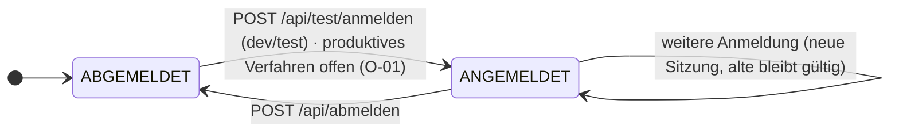

| Regel | Bezug |
|---|---|
| Ohne gültige Sitzung antworten alle fachlichen Endpunkte mit 401 (Problem Details). Öffentlich sind nur `GET /api/sitzung`, `POST /api/abmelden` und die Test-Endpunkte. | RR-07 |
| `GET /api/sitzung` antwortet immer 200 mit `angemeldet: true/false`. | F-00 |
| Abmelden löscht die Sitzung und das Cookie, auch ohne gültige Sitzung 204. | F-00 |
| Eine Sitzung läuft nicht ab (Annahme, O-33). | O-01 |

## Abläufe

### Anmeldung und Rückleitung

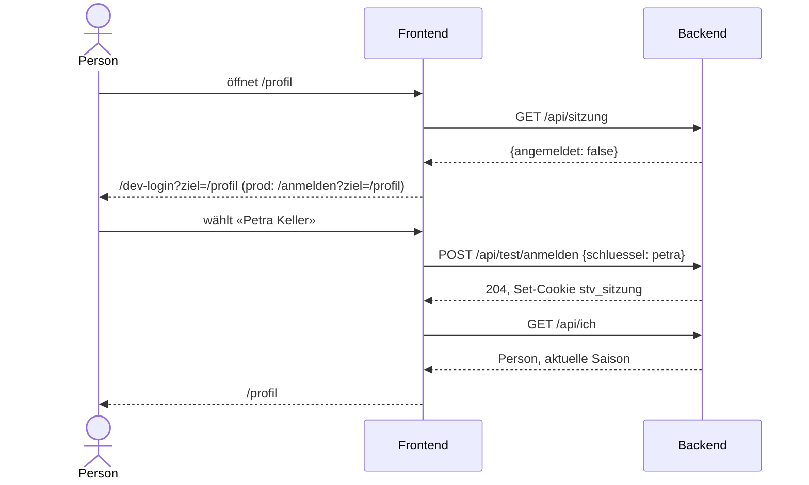

### Antworten mit einem Tap

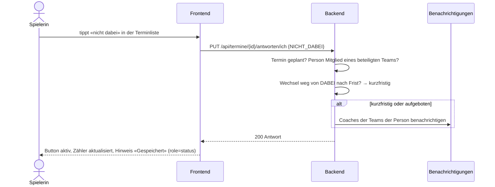

### Aufgebot veröffentlichen

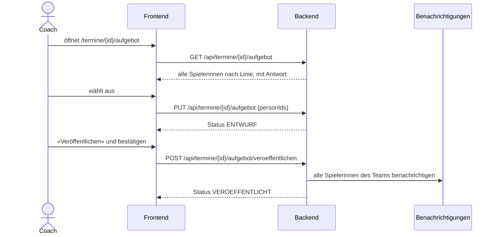

### Abgleich mit swiss unihockey

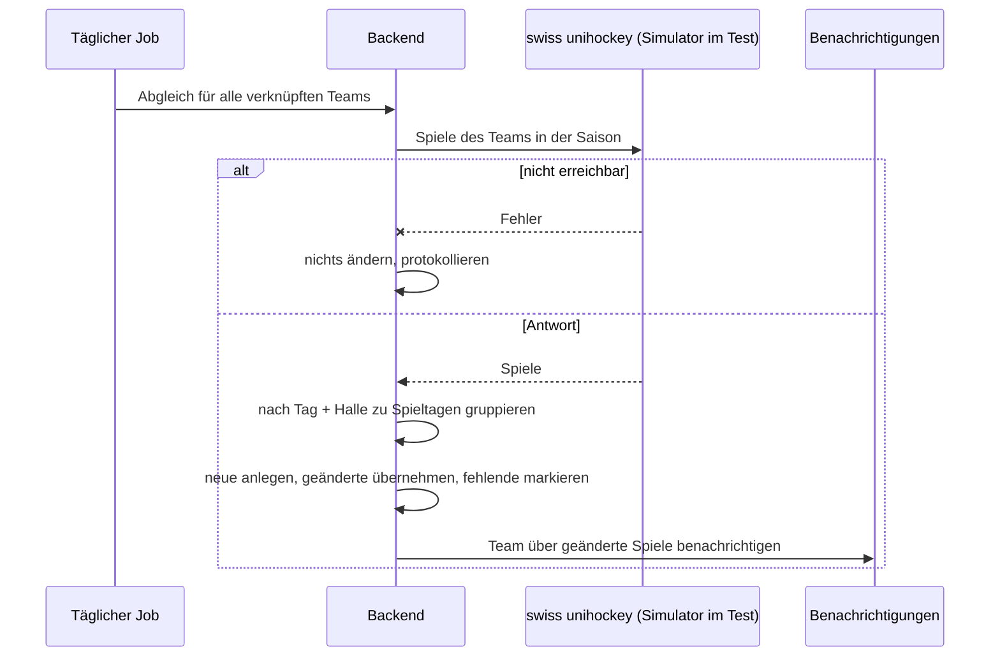
